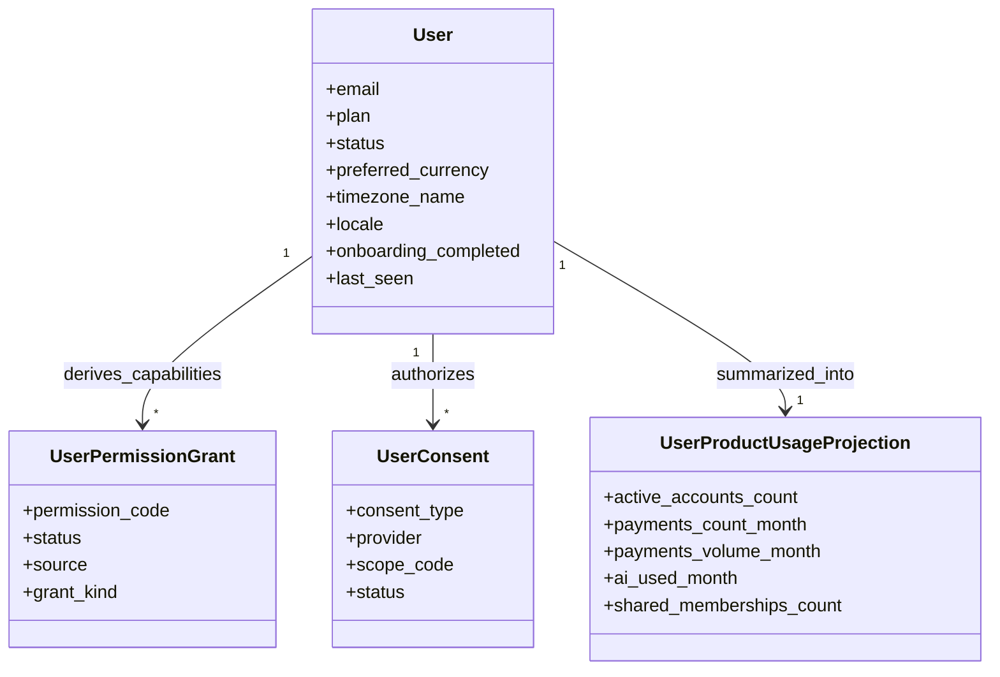
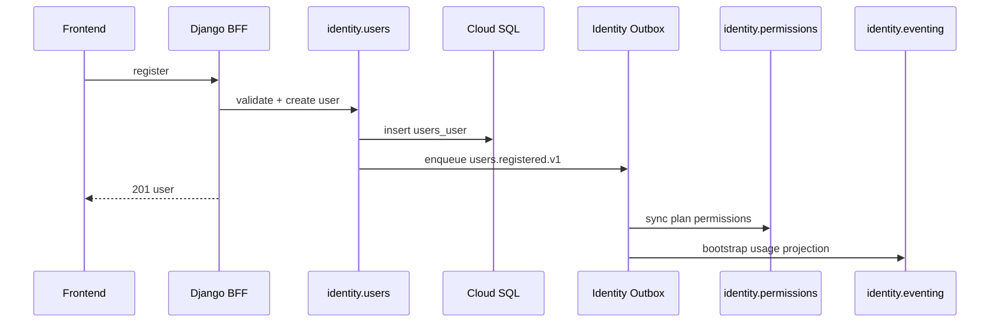
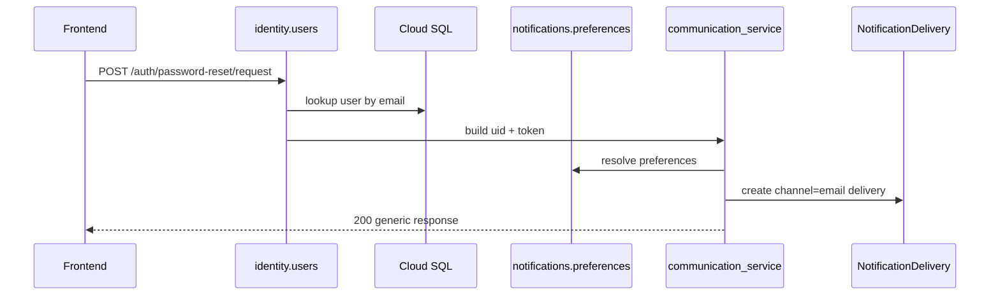
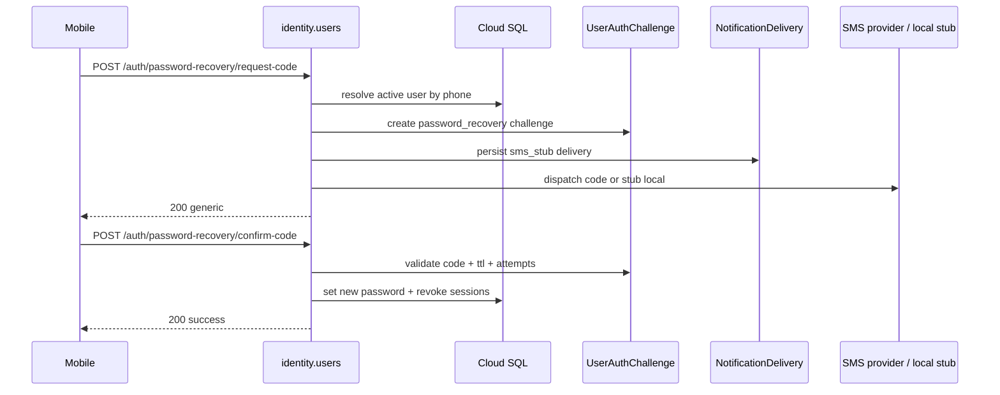
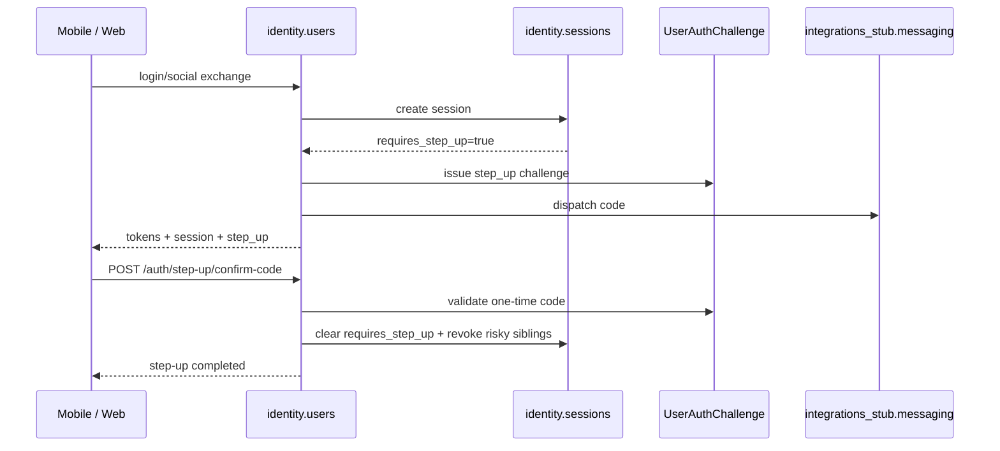
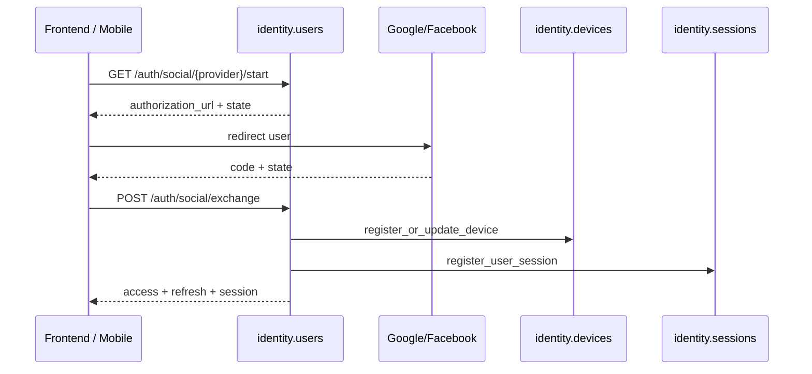

# identity.users

## Que hace

Este modulo concentra identidad base de usuario, plan efectivo de producto y
capabilities visibles para mobile/web.

No ejecuta integraciones largas ni rails externos. Su responsabilidad es:

- definir `User` y el plan efectivo del usuario
- exponer `plan_matrix` y overrides comerciales
- publicar eventos `users.*`
- entregar a la app capacidades, permisos derivados y usage operativo

## Rol En El Producto

De cara al usuario, este modulo responde:

- quien soy en Vexxo
- que plan tengo
- que funciones deberia ver desbloqueadas
- cuanto uso llevo frente a mis limites
- que mensajes de upgrade o bloqueo son validos

## Vista visual

## Secuencia critica: register

## Flujos principales

### Auth y comunicaciones del usuario

`identity.users` ya cubre estos caminos:

- registro `email + password`
- login con JWT y sesion/dispositivo
- refresh seguro con deteccion de reuse
- logout con revocacion
- OAuth2 Google y Facebook
- recuperacion de contrasena por correo como fallback
- recuperacion mobile-first por codigo temporal de 2 minutos
- step-up por codigo temporal en dispositivos `unknown` o `suspicious`
- configuracion de contrasena para usuarios autenticados
- correo de bienvenida desacoplado del request path
- preferencia de newsletter y correos lifecycle via `notifications.preferences`
- validacion de contrasena con longitud minima, mayuscula, minuscula y numero

### Secuencia critica: reset de contrasena

### Secuencia critica: recovery code mobile

### Secuencia critica: step-up embebido

### Secuencia critica: social login

### Plan y capabilities

1. `User.plan` es la fuente comercial canónica.
2. `identity.users.domain.plan_matrix` traduce ese plan a capabilities.
3. `identity.permissions` deriva permission codes booleanos.
4. Los bounded contexts aplican guards propios usando esas capabilities.

### Usage projection

`identity.users.services.product_usage_projection_service` materializa una
proyeccion de uso por usuario.

Objetivo:

- evitar `count()` y `aggregate()` repetidos contra OLTP en cada request
- servir a mobile un snapshot compacto de uso y limites
- preparar el camino para proyectores incrementales y pipelines cloud

Estado actual:

- la lectura del API ya usa la proyeccion
- la proyeccion se refresca desde eventos de `accounts.*`, `alerts.*`,
  `payments.*` y productores locales como reglas y pagos programados
- si la proyeccion aun no existe, se reconstruye una vez para bootstrap

### Estrategia de actualizacion

La proyeccion funciona en modo hibrido con direccion incremental:

- delta exacto:
  - `rules_count`
  - `manual_accounts_count`
  - `connected_accounts_count`
  - `active_accounts_count`
  - `shared_memberships_count`
  - `ai_used_month`
  - `payments_count_month`
  - `payments_volume_month`
  - `payments_count_day`
  - `payments_volume_day`
  - `payouts_count_month`
  - `payouts_volume_month`
  - `payouts_count_day`
  - `payouts_volume_day`
- resync por slice:
  - `scheduled_payments_active_count`
  - fallback mensual cuando cambia el periodo
- rebuild completo:
  - fallback cuando no hay proyeccion o falta contexto suficiente

Para los eventos del bus se guarda un checkpoint persistente por
`owner + event_key`. Eso evita aplicar dos veces el mismo delta si el worker o
el bus reintentan una entrega.

## Limites diarios y caps operativos

`identity.users.services.product_access_service` ahora distingue:

- limites comerciales por plan
- caps operativos internos de Vexxo por proveedor/rail

Ejemplo:

- el plan puede permitir pagar mas
- pero Vexxo puede bloquear igual por `platform_daily_payment_cap`
  si ese rail o proveedor ya llego al volumen operativo seguro del dia

Hoy esos caps operativos son configurables por `settings` y pueden no existir
por defecto. La idea es no acoplar el producto a un PSP unico ni a limites
hardcodeados de un proveedor puntual.

Eso evita confundir capacidad de infraestructura con capacidad operativa real.

## Relacion con otros modulos

- `identity.eventing`: persiste eventos y read models
- `identity.permissions`: deriva entitlements desde el plan
- `finance.accounts`: emite eventos para cuentas y sharing
- `alerts.alerts`: emite eventos de enriquecimiento IA
- `payments.payment_intents`: emite eventos de pagos externos
- `payments.scheduled_payments`: representa planificacion futura

## Encaje Con GCP

`identity.users` funciona bien como capa ligera en Cloud Run:

- el BFF responde auth, perfil, dashboard y capabilities
- el uso no se recalcula contra OLTP en cada request; se lee desde proyeccion
- los eventos `users.*` se persisten y publican por outbox
- futuros servicios de growth, billing o analytics pueden consumir esos eventos

Esto evita convertir al API Gateway o al BFF en un coordinador pesado.

## Esqueleto/futuro

Todavia faltan productores canonicos por evento para:

- `documents` / OCR

Cuando esos modulos maduren, deben proyectar `UserProductUsageProjection`
sin volver a meter lecturas OLTP pesadas en el request path.

## Endpoints clave de auth

- `POST /api/identity/users/auth/register/`
- `POST /api/identity/users/auth/login/`
- `POST /api/identity/users/auth/refresh/`
- `POST /api/identity/users/auth/logout/`
- `POST /api/identity/users/auth/password-reset/request/`
- `POST /api/identity/users/auth/password-reset/confirm/`
- `POST /api/identity/users/auth/password-recovery/request-code/`
- `POST /api/identity/users/auth/password-recovery/confirm-code/`
- `POST /api/identity/users/auth/step-up/request-code/`
- `POST /api/identity/users/auth/step-up/confirm-code/`
- `POST /api/identity/users/auth/set-password/`
- `GET /api/identity/users/auth/social/providers/`
- `GET /api/identity/users/auth/social/{provider}/start/`
- `GET /api/identity/users/auth/social/{provider}/callback/`
- `POST /api/identity/users/auth/social/exchange/`

## Relacion con notificaciones y correo

- el correo de bienvenida se dispara desde `users.registered.v1`, no desde el request de registro
- el request de recovery responde siempre 200 para no filtrar si el correo o telefono existen
- el registro no exige email verification para activar la cuenta; el email de bienvenida permanece informativo
- el canal principal embebido para recovery y step-up es codigo corto temporal al telefono
- el PIN de 4 digitos o biometria pertenece al dispositivo/mobile app, no al backend como secreto principal
- `notifications.preferences` decide si se permiten correos lifecycle
- `NotificationDelivery(channel=email)` guarda trazabilidad de welcome y password reset
- `integrations_stub.messaging` abstrae el transporte SMS/WhatsApp fuera de `identity.users`

## Local vs cloud

- local/dev:
  - recovery y step-up usan `integrations_stub.messaging` con `IDENTITY_MESSAGE_BACKEND=local_stub`
  - si `IDENTITY_RECOVERY_DEBUG_REVEAL_CODE=True`, el codigo aparece solo en `NotificationDelivery.payload.debug_code`
- cloud/prod:
  - el backend ya persiste `UserAuthChallenge`
  - el adapter real de SMS/WhatsApp debe vivir fuera de `identity.users`
  - el contrato del flujo no cambia: request generico, confirm con codigo corto

## Nota de limites de alcance

- `UserAuthChallenge` ya reserva `magic_link` como purpose
- no se cableo aun a invitaciones de `finance.accounts` o `social.teams`
- esa integracion debe hacerse desde el bounded context dueno de la invitacion,
  no desde auth puro, para no mezclar sharing con login
