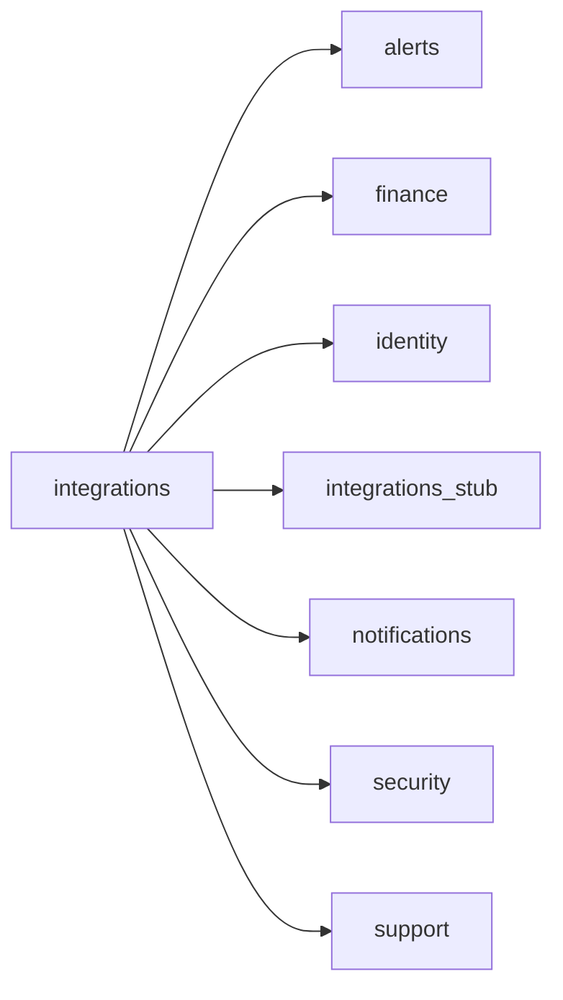

# integrations

## Responsabilidad

Esta carpeta es la frontera canonica de integraciones externas. Contiene los
mapeos contractuales por proveedor y los runtimes que ya tienen estado y
lifecycle propios. No contiene reglas contables ni credenciales.

## Estructura

- `open_banking/`: consentimiento, conexiones, enlaces a cuentas, webhooks y
  catalogo seguro de proveedores bancarios.
- `credentials/`: envelopes cifrados y lifecycle de tokens/secretos externos.
- `provider_mappings/bank_data/`: normalizacion de datos bancarios.
- `provider_mappings/payment_execution/`: contratos de ejecucion de pagos.
- `provider_mappings/market_data/`: fuentes de mercado.
- `provider_mappings/message_sources/`: SMS, voz y otras entradas.

`integrations_stub` sigue existiendo como receptor local temporal para jobs
que aun no tienen adapter real. No es fuente de verdad ni un segundo dominio.

## Regla para nuevos proveedores

Cada adapter debe declarar proveedor, bounded context propietario, contrato
canonico, consentimiento, idempotencia, firma de webhook, datos persistidos,
eventos, observabilidad y estrategia de revocacion. Los secretos bootstrap se
inyectan por variables de entorno y nunca se versionan. Los tokens dinamicos
emitidos por proveedores viven en `IntegrationCredential`, nunca en metadata,
eventos o respuestas mobile.

Documentos relacionados:

- [Catalogo de fuentes](../INTEGRATION_SOURCE_CATALOG.md)
- [Contratos de pagos](../payments/payment_intents/PAYMENT_EXECUTION_CONTRACTS.md)
- [Open Banking](open_banking/README.md)

<!-- backend-source-audit:start -->
## Evidencia del codigo y mapa de dependencias

Inventario estatico reproducible del checkout. Describe declaraciones e imports;
no prueba despliegue, permisos efectivos ni que todos los caminos se ejecuten.
Las rutas son locales a su URLConf: el prefijo publico se consulta en
[`api/v1/routers.py`](../api/v1/routers.py).

- Archivos Python de implementacion: **26** (excluye tests y migraciones).
- Huella SHA-256 del codigo inventariado: `7152b92a12f71298ea7f31f9344d694c2223a92be4073e56cd86334f8ae2af0a`.
- Familias detectadas: management, models, serializers, services, views.

### Declaraciones de modelos detectadas

- `IntegrationCredential` en [integrations/credentials/models.py](credentials/models.py).
- `OpenBankingAccountLink` en [integrations/open_banking/models.py](open_banking/models.py).
- `OpenBankingConnection` en [integrations/open_banking/models.py](open_banking/models.py).
- `OpenBankingExternalPayload` en [integrations/open_banking/models.py](open_banking/models.py).
- `OpenBankingInstitution` en [integrations/open_banking/models.py](open_banking/models.py).
- `OpenBankingProviderInstitution` en [integrations/open_banking/models.py](open_banking/models.py).
- `OpenBankingReconciliationIssue` en [integrations/open_banking/models.py](open_banking/models.py).
- `OpenBankingSyncRun` en [integrations/open_banking/models.py](open_banking/models.py).
- `OpenBankingTimelineEvent` en [integrations/open_banking/models.py](open_banking/models.py).
- `OpenBankingWebhookReceipt` en [integrations/open_banking/models.py](open_banking/models.py).

### Rutas declaradas

| Patron local | Fuente |
| --- | --- |
| `` | [integrations/open_banking/urls.py](open_banking/urls.py) |
| `connections/ [DRF router]` | [integrations/open_banking/urls.py](open_banking/urls.py) |
| `institutions/` | [integrations/open_banking/urls.py](open_banking/urls.py) |
| `open-banking/connections/<uuid:public_id>/timeline/` | [integrations/open_banking/support_urls.py](open_banking/support_urls.py) |
| `providers/` | [integrations/open_banking/urls.py](open_banking/urls.py) |
| `webhooks/<str:provider>/` | [integrations/open_banking/urls.py](open_banking/urls.py) |

### Diagrama de dependencia estatica

Las flechas representan imports entre paquetes, no eventos ni orden de ejecucion.

Flujos transversales: [flujo actualizado](../docs/BACKEND_CURRENT_FLOW.md).

Regeneracion: `py -3 scripts/audit_backend_docs.py --write`.
Comprobacion de deriva: `py -3 scripts/audit_backend_docs.py --check`.
<!-- backend-source-audit:end -->
