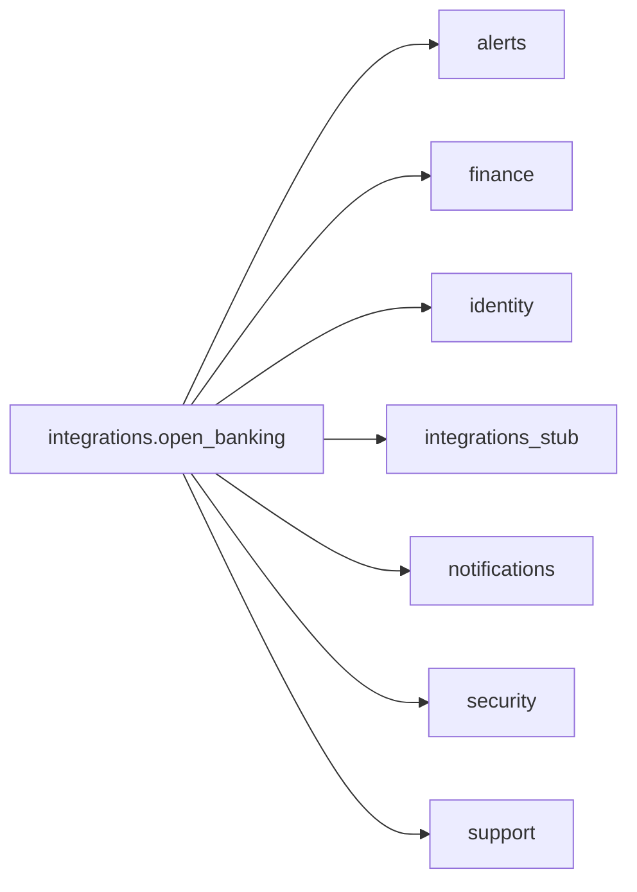

# integrations.open_banking

## Objetivo

Modela la autorizacion y operacion de una conexion bancaria sin convertir al
proveedor en fuente de verdad contable. `finance.transactions` conserva el
ledger y `finance.accounts.Account.balance` sigue siendo cache operativo.

## Flujo

1. Flutter consulta el catalogo de proveedores.
2. El usuario inicia una conexion con `Idempotency-Key`.
3. El servicio registra `identity.consents` y `OpenBankingConnection`.
4. El adapter descubre productos y el backend materializa cada producto
   autorizado como una cuenta Vexxo del mismo owner.
5. Cada pagina externa entra primero en cuarentena durable, sanitizada y con TTL.
6. Una solicitud o webhook agenda `finance.accounts` sync durable.
7. El worker bancario normaliza datos y delega al intake canonico de
   `finance.transactions`; nunca escribe el ledger directamente.
8. `reconcile()` compara saldo proveedor, cache y ledger; una diferencia abre
   un caso y nunca ajusta saldos automaticamente.
9. Al desconectar, se retira el consentimiento, se desactivan enlaces y se
   rechazan webhooks tardios que intenten reactivar la conexion.

## Seguridad

- Todos los querysets de usuario son owner-scoped.
- Los webhooks no usan sesion, pero requieren HMAC SHA-256 sobre
  `timestamp.body`, ventana temporal, throttle durable y deduplicacion por
  `provider + provider_event_id`. Legacy sin timestamp solo existe en local.
- El payload externo se conserva solo en cuarentena sanitizada, clasificada y
  expirable. El dominio persistente guarda hash, referencias, cursor,
  `schema_version`, `mapper_version` y metadata allowlisted.
- Los proveedores reales aparecen deshabilitados hasta que existan sus
  credenciales y una certificacion oficial verificable por checksum.
- Los secretos permanecen vacios en `.env.local.example` y fuera de Git.
- OAuth/access/refresh tokens se guardan en `IntegrationCredential` con
  envelope encryption; revocar la conexion revoca tambien esas credenciales.

## Proveedores

- `local_mock`: flujo local determinista. Expone dos productos bancarios
  simulados por conexion y un snapshot versionado de movimientos. Flutter
  selecciona el producto y el backend crea su cuenta Vexxo owner-scoped.
- `belvo`: adapter contractual con paginacion, normalizacion, revocacion y
  verificacion de callback. No certificado contra sandbox oficial.
- `salt_edge`: adapter contractual equivalente, incluida paginacion por cursor
  y firma RSA. No certificado contra sandbox oficial.

Los fixtures Belvo/Salt Edge del repositorio son `synthetic_sandbox_shaped`:
sirven como golden data de Vexxo, pero no sustituyen vectores oficiales.

La activacion externa exige `*_CERTIFIED=true`, ruta a un fixture
`official_sandbox_vector`, SHA-256 esperado y al menos un vector oficial de
webhook. El comando no imprime secretos:

```powershell
docker compose --env-file .env.local -f docker-compose.local.yml exec -T api python manage.py open_banking_certification_status --strict
```

## API

- `GET /api/integrations/open-banking/providers/`
- `GET /api/integrations/open-banking/institutions/`
- `GET|POST /api/integrations/open-banking/connections/`
- `POST .../{public_id}/import-account/`
- `GET .../{public_id}/available-accounts/`
- `POST .../{public_id}/request-sync/`
- `POST .../{public_id}/refresh-credentials/`
- `POST .../{public_id}/reconcile/`
- `GET .../{public_id}/timeline/`
- `POST .../{public_id}/revoke/`
- `POST /api/integrations/open-banking/webhooks/{provider}/`
- `GET /api/internal/support/open-banking/connections/{public_id}/timeline/`

La ruta de soporte exige staff, `X-Support-Reason` y `X-Support-Case`, y crea
`SupportAccessRecord`. Devuelve trazabilidad minimizada, nunca tokens ni el
payload financiero crudo por defecto.

Agregar un proveedor requiere un adapter y su descriptor en un solo catalogo;
no requiere modificar scripts por entorno. En local, Docker traduce variables
`VEXXO_LOCAL_*` a los nombres canonicos internos.

## Fixture local

`local_mock.py` genera datos estables a partir de `external_account_id` y
`LOCAL_MOCK_FIXTURE_VERSION`. Una primera sincronizacion materializa ingreso de
nomina y gastos de supermercado, servicios y cafe. Reintentar conserva los
mismos IDs externos: el intake los clasifica como duplicados o no-op y no
vuelve a afectar el ledger.

El recorrido local es:

1. iniciar conexion `local_mock`
2. consultar y escoger un producto bancario simulado
3. materializarlo como cuenta Vexxo propia con tipo, moneda e institucion
4. solicitar sync
5. `accounts-outbox` entrega el evento a `accounts-sync-worker`
6. el worker crea un `TransactionIntakeBatch` y aplica sus filas
7. Flutter abre el feed filtrado de la cuenta enlazada

Cada corrida deja batch, receipts, cursor, conteos, timeline y timestamps. El
payload no se copia a la conexion ni al ledger; la cuarentena se purga por TTL.

## Consentimiento y desconexion

Cada conexion expone estado, finalidad, categorias, grant, expiracion y
revocacion. Desconectar detiene recoleccion y sync futuro, pero no borra
silenciosamente el ledger ya importado. Consulta
[`docs/OPEN_FINANCE_CONSENT_AND_REVOCATION.md`](../../docs/OPEN_FINANCE_CONSENT_AND_REVOCATION.md).

## Adapters externos

Belvo y Salt Edge implementan authorize, refresh, products, sync paginado,
transactions, reconcile y revoke. Los tokens efimeros del widget solo se devuelven en la respuesta de
creacion y no se guardan. Belvo exige la autorizacion acordada para callbacks;
Salt Edge verifica RSA-SHA256 sobre `callback_url|raw_body`. Ninguno aparece
`available` hasta cargar keyring, credenciales y material oficial de
verificacion de webhook. La activacion es fail-closed incluso si las
credenciales ya fueron cargadas.

<!-- backend-source-audit:start -->
## Evidencia del codigo y mapa de dependencias

Inventario estatico reproducible del checkout. Describe declaraciones e imports;
no prueba despliegue, permisos efectivos ni que todos los caminos se ejecuten.
Las rutas son locales a su URLConf: el prefijo publico se consulta en
[`api/v1/routers.py`](../../api/v1/routers.py).

- Archivos Python de implementacion: **20** (excluye tests y migraciones).
- Huella SHA-256 del codigo inventariado: `23d23e4e1a7af574fb79ab26054e6e2069494e432236f29bbaee1d68d889ee03`.
- Familias detectadas: management, models, serializers, services, views.

### Declaraciones de modelos detectadas

- `OpenBankingAccountLink` en [integrations/open_banking/models.py](models.py).
- `OpenBankingConnection` en [integrations/open_banking/models.py](models.py).
- `OpenBankingExternalPayload` en [integrations/open_banking/models.py](models.py).
- `OpenBankingInstitution` en [integrations/open_banking/models.py](models.py).
- `OpenBankingProviderInstitution` en [integrations/open_banking/models.py](models.py).
- `OpenBankingReconciliationIssue` en [integrations/open_banking/models.py](models.py).
- `OpenBankingSyncRun` en [integrations/open_banking/models.py](models.py).
- `OpenBankingTimelineEvent` en [integrations/open_banking/models.py](models.py).
- `OpenBankingWebhookReceipt` en [integrations/open_banking/models.py](models.py).

### Rutas declaradas

| Patron local | Fuente |
| --- | --- |
| `` | [integrations/open_banking/urls.py](urls.py) |
| `connections/ [DRF router]` | [integrations/open_banking/urls.py](urls.py) |
| `institutions/` | [integrations/open_banking/urls.py](urls.py) |
| `open-banking/connections/<uuid:public_id>/timeline/` | [integrations/open_banking/support_urls.py](support_urls.py) |
| `providers/` | [integrations/open_banking/urls.py](urls.py) |
| `webhooks/<str:provider>/` | [integrations/open_banking/urls.py](urls.py) |

### Diagrama de dependencia estatica

Las flechas representan imports entre paquetes, no eventos ni orden de ejecucion.



Flujos transversales: [flujo actualizado](../../docs/BACKEND_CURRENT_FLOW.md).

Regeneracion: `py -3 scripts/audit_backend_docs.py --write`.
Comprobacion de deriva: `py -3 scripts/audit_backend_docs.py --check`.
<!-- backend-source-audit:end -->
