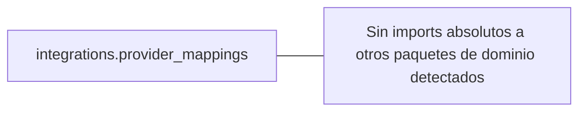

# provider_mappings

## Objetivo

Aqui viven las matrices concretas por proveedor.

La clasificacion transversal vive en:

- [INTEGRATION_SOURCE_CATALOG.md](/D:/Vexxo_Backend_API/INTEGRATION_SOURCE_CATALOG.md)

Los contratos canonicos viven en:

- [finance/transactions/RAIL_NORMALIZATION_CONTRACTS.md](/D:/Vexxo_Backend_API/finance/transactions/RAIL_NORMALIZATION_CONTRACTS.md)
- [payments/payment_intents/PAYMENT_EXECUTION_CONTRACTS.md](/D:/Vexxo_Backend_API/payments/payment_intents/PAYMENT_EXECUTION_CONTRACTS.md)

<!-- backend-source-audit:start -->
## Evidencia del codigo y mapa de dependencias

Inventario estatico reproducible del checkout. Describe declaraciones e imports;
no prueba despliegue, permisos efectivos ni que todos los caminos se ejecuten.
Las rutas son locales a su URLConf: el prefijo publico se consulta en
[`api/v1/routers.py`](../../api/v1/routers.py).

- Archivos Python de implementacion: **0** (excluye tests y migraciones).
- Huella SHA-256 del codigo inventariado: `e3b0c44298fc1c149afbf4c8996fb92427ae41e4649b934ca495991b7852b855`.
- Familias detectadas: sin capas convencionales detectadas.

No se detectan declaraciones `path`/`re_path` propias en este alcance.
Esto no implica que el modulo carezca de consumidores internos.

### Diagrama de dependencia estatica

Las flechas representan imports entre paquetes, no eventos ni orden de ejecucion.

Flujos transversales: [flujo actualizado](../../docs/BACKEND_CURRENT_FLOW.md).

Regeneracion: `py -3 scripts/audit_backend_docs.py --write`.
Comprobacion de deriva: `py -3 scripts/audit_backend_docs.py --check`.
<!-- backend-source-audit:end -->
