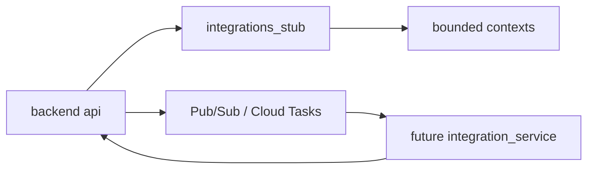

# integrations_stub

## Que hace

`integrations_stub` es un conjunto de receptores internos temporales que simulan
el rol de futuros servicios externos o separados.

Su objetivo es permitir que los bounded contexts ya trabajen con:

- eventos
- jobs internos
- callbacks
- workers

sin obligar a tener desde el primer dia todos los microservicios separados.

## Documento canonico y subdocumentos

Este README es el documento canonico del modulo `integrations_stub`.

Subdocumento derivado:

- [banks/README.md](/c:/Users/Alamb/Documents/Vexxo_Backend_API/integrations_stub/banks/README.md)
  frontera temporal para sync bancario, refresh de inteligencia y puente hacia
  intake/reconciliacion de `transactions`
- [llm/README.md](/c:/Users/Alamb/Documents/Vexxo_Backend_API/integrations_stub/llm/README.md)
  runtime temporal para inferencia de voz transaccional antes de extraer
  `llm_gateway`
- [messaging/README.md](/c:/Users/Alamb/Documents/Vexxo_Backend_API/integrations_stub/messaging/README.md)
  adapter temporal para SMS/WhatsApp embebido en recovery y step-up
- [Catalogo de fuentes e integraciones](/c:/Users/Alamb/Documents/Vexxo_Backend_API/INTEGRATION_SOURCE_CATALOG.md)
  clasificacion transversal de proveedores, source types y bounded contexts

## Rol En La Arquitectura

Este modulo permite que el dominio se diseñe como si ya existieran:

- `integrations_service`
- `llm_gateway`
- servicios OCR/ML
- workers externos

pero ejecutando aun dentro del mismo repositorio.

## Por Que Existe

Este modulo permite diseñar desde ya con fronteras cloud-native aunque la
separacion fisica de servicios llegue despues.

Eso evita que el monolito se acople a llamadas directas imposibles de extraer.

## Principio

El dominio no debe depender del stub. El stub depende del dominio.

Eso significa:

- las reglas reales viven en `accounts`, `payments`, `alerts`, etc.
- el stub solo recibe trabajo y delega al servicio canonico

## Encaje Con GCP

Este modulo es el puente natural para migrar a:

- Cloud Run services separados
- Cloud Tasks
- Pub/Sub consumers
- callbacks HTTP internos

Cuando el servicio real exista, el ideal es mover el receptor y dejar intacta
la semantica del caso de uso.

## Nota operativa de rutas internas

El stub ya tiene prefijo canonico adicional bajo:

- `/api/internal/integrations/banks/...`
- `/api/internal/integrations/llm/...`

El prefijo antiguo:

- `/internal/integrations/banks/...`
- `/internal/integrations/llm/...`

se mantiene por compatibilidad mientras migra la topologia de integraciones.

## Vista visual

Lectura:

- hoy el stub vive dentro del repo y delega al dominio canonico
- el objetivo es reemplazar ese receptor interno por un servicio separado
- el contrato del dominio debe sobrevivir intacto a esa extraccion

## Submodulos actuales

- `banks`
  sync de cuentas, refresh de inteligencia y revocacion de consentimientos
- `llm`
  frontera temporal para tareas de IA; hoy procesa `TransactionInferenceRequest`
  de voz y delega al intake canonico de `finance.transactions`
- `messaging`
  frontera temporal para codigos cortos de auth y futuros magic links
- `ocr`
  frontera temporal para OCR/documentos
- `payments`
  frontera temporal para rails externos de pago
- `ml`
  frontera temporal para pipelines o inferencia

## Que no debe pasar

- no debe duplicar logica del bounded context real
- no debe convertirse en segundo dominio
- no debe inventar contratos incompatibles con el servicio futuro

## Estado Actual

Hoy actua como receptor temporal para bancos, IA, mensajeria, OCR, ML y pagos.

La regla sigue siendo:

- el stub recibe y traduce
- el servicio canonico del dominio decide
- la extraccion a Cloud Run futuro debe ser incremental, no traumática

## Nota operativa despues de la ultima pasada

`integrations_stub` sigue siendo temporal.

La deuda principal no cambio:

- todavia no existe un `integration_service` real y separado consumiendo
  Pub/Sub o Cloud Tasks como frontera cloud canonica
- el backend sigue siendo el productor de eventos y la fuente de verdad
- el stub no debe crecer como segundo backend ni como dominio paralelo

La mejora actual del proyecto fue otra:

- acercar los bounded contexts al mismo nivel de outbox, retry, locking,
  idempotencia y trazabilidad
- dejar un intake canonico interno en `transactions` para que el futuro
  `integration_service` no escriba ledger directo
- dejar mas claro que la separacion fisica de integraciones sigue pendiente

Para `transactions`, la frontera esperada ahora ya existe en el backend:

- `POST /api/internal/transactions/intake/batches/`
- `POST /api/internal/transactions/intake/batches/{id}/apply/`
- `POST /api/internal/transactions/intake/row/`
- `POST /api/internal/transactions/intake/reconcile/`
- `POST /api/internal/transactions/reconciliation/issues/{id}/resolve/`

Y el stub de bancos ya tiene un puente interno preparado para ese flujo:

- puede recibir batches normalizados de movimientos
- delega al intake canonico de `finance.transactions`
- puede cerrar `TransactionReconciliationIssue` con acciones formales

El stub LLM ya tiene un worker interno preparado para voz transaccional:

- recibe `TransactionInferenceRequest` por id
- simula o puentea transcripcion/extraccion
- devuelve filas `voice_inferred.normalized_payload`
- delega materializacion a `transaction_intake_service.py`
- no escribe ledger directo

## Relacion con matrices por proveedor

La clasificacion y matrices canonicas no viven en el stub.

Viven en:

- [INTEGRATION_SOURCE_CATALOG.md](/D:/Vexxo_Backend_API/INTEGRATION_SOURCE_CATALOG.md)
- [integrations/README.md](/D:/Vexxo_Backend_API/integrations/README.md)

El stub solo debe actuar como runtime temporal o puente interno.

