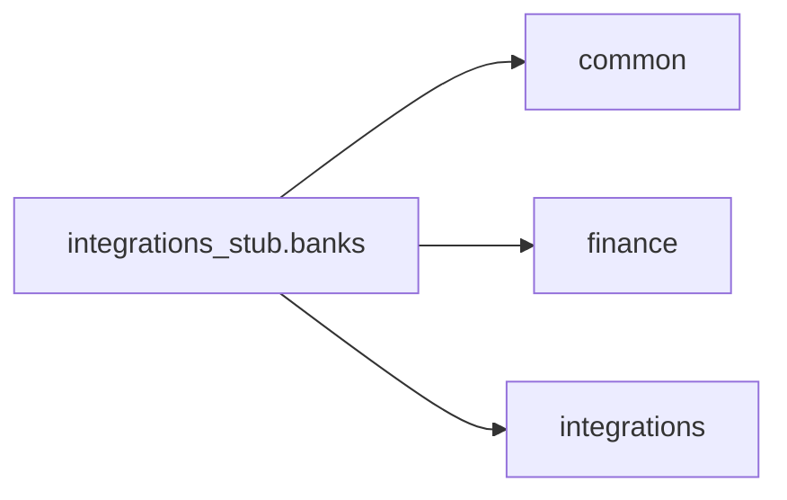

# integrations_stub.banks

## Que hace

Este modulo recibe jobs internos relacionados con cuentas bancarias y los
traduce a llamadas a los servicios canonicos del dominio.

Hoy cubre:

- sync de cuentas
- refresh de inteligencia de `accounts`
- revocacion de acceso por consentimiento/permisos
- puente temporal para intake y resolucion de reconciliacion de `transactions`

## Alcance documental

Este README es derivado del documento canonico del modulo:

- [integrations_stub/README.md](https://gitlab.com/vexxo-sas/vexxo_backend_api/-/blob/development/integrations_stub/README.md)

Su foco es la frontera temporal bancaria; no documenta todo `integrations_stub`.

## Por Que Existe

Mientras `integrations_service` no viva como servicio separado en Cloud Run,
esta carpeta permite trabajar ya con:

- endpoints internos autenticados
- workers
- Cloud Tasks
- callbacks internos

sin duplicar la logica del dominio.

## Flujo De Sync

1. `accounts` agenda sync y emite evento
2. worker o dispatcher llama al endpoint interno stub
3. `integrations_stub.banks.services` delega a
   `finance.accounts.services.account_sync_service`
4. el estado monotono de sync se actualiza en `accounts`

## Flujo De Inteligencia

1. un evento o dispatcher pide refresh
2. el endpoint interno recibe `owner_id`
3. el stub delega a `finance.accounts.services.intelligence_service`

## Flujo De Revocacion

1. `identity` o consentimiento emite evento
2. el endpoint interno recibe usuario/proveedor
3. el stub delega a
   `finance.accounts.services.user_integration_service`

## Relacion Con Otros Modulos

- `finance.accounts`: dueño real del lifecycle de sync
- `identity`: fuente de lifecycle y consentimiento
- `common.domain_events`: transporte/eventos que disparan el trabajo
- `finance.transactions`: intake canonico y resolucion formal del ledger externo

## Encaje Con GCP

Este modulo esta diseñado para ser reemplazado casi 1:1 por un servicio
externo:

- hoy puede recibir Cloud Tasks o jobs internos
- mañana puede vivir en Cloud Run separado
- los tokens internos ya preparan ese camino

La semantica correcta es:

- el stub recibe
- el dominio decide
- el estado vuelve a cuentas e identidad

## Frontera temporal para `transactions`

Este modulo ya puede actuar como puente temporal para el futuro
`integration_service` en dos tareas:

- recibir lotes normalizados de movimientos bancarios y delegarlos al intake
  canonico de `transactions`
- resolver `TransactionReconciliationIssue` detectados por re-syncs o cambios
  tardios del proveedor

Regla importante:

- el stub no escribe ledger directo
- llama al servicio canonico de `transactions`
- la identidad externa sigue gobernada por `TransactionSourceLink`

## Local mock operativo

Para cuentas cuyo `provider=local_mock`, `process_stub_account_sync` obtiene el
snapshot versionado de `integrations.open_banking.local_mock`, crea un batch
mediante `transaction_bridge` y lo aplica por el intake canonico. El stub no
crea transacciones directamente ni mantiene el lifecycle de conexion.

Reejecutar una corrida conserva IDs externos estables. Una corrida posterior
puede crear otro batch auditable, pero el intake deduplica las filas contra
`TransactionSourceLink` antes de afectar el ledger.

<!-- backend-source-audit:start -->
## Evidencia del codigo y mapa de dependencias

Inventario estatico reproducible del checkout. Describe declaraciones e imports;
no prueba despliegue, permisos efectivos ni que todos los caminos se ejecuten.
Las rutas son locales a su URLConf: el prefijo publico se consulta en
[`api/v1/routers.py`](../../api/v1/routers.py).

- Archivos Python de implementacion: **8** (excluye tests y migraciones).
- Huella SHA-256 del codigo inventariado: `011f84985a5465dbfb435bb59a0f1c6ab5dd139c330483ce87684a92d8e3467b`.
- Familias detectadas: models, services, views.

### Rutas declaradas

| Patron local | Fuente |
| --- | --- |
| `accounts/intelligence/refresh/` | [integrations_stub/banks/urls.py](urls.py) |
| `accounts/sync/` | [integrations_stub/banks/urls.py](urls.py) |
| `consents/revoke/` | [integrations_stub/banks/urls.py](urls.py) |
| `transactions/reconciliation/resolve/` | [integrations_stub/banks/urls.py](urls.py) |
| `transactions/sync/` | [integrations_stub/banks/urls.py](urls.py) |

### Diagrama de dependencia estatica

Las flechas representan imports entre paquetes, no eventos ni orden de ejecucion.

Flujos transversales: [flujo actualizado](../../docs/BACKEND_CURRENT_FLOW.md).

Regeneracion: `py -3 scripts/audit_backend_docs.py --write`.
Comprobacion de deriva: `py -3 scripts/audit_backend_docs.py --check`.
<!-- backend-source-audit:end -->
