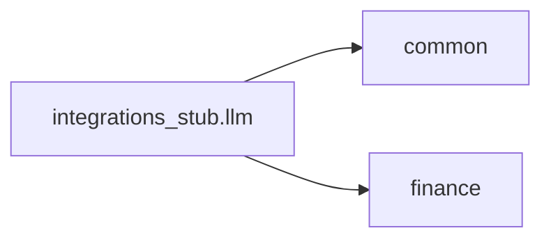

# integrations_stub.llm

## Que hace

`integrations_stub.llm` es el runtime temporal para tareas de IA que despues
deberian vivir en un `llm_gateway` separado.

Hoy cubre inferencia de transacciones por voz:

1. recibe `inference_request_id`
2. carga `TransactionInferenceRequest`
3. transcribe/extrae o simula el resultado desde `raw_payload`
4. devuelve filas `voice_inferred.normalized_payload`
5. delega la aplicacion a `finance.transactions.transaction_inference_service`

`raw_payload` en este stub es solo un mecanismo interno de simulacion. El
endpoint publico de mobile no puede enviar filas normalizadas al crear la
solicitud.

## Regla de frontera

El stub no es fuente de verdad y no escribe ledger.

La fuente de verdad del estado de mobile es `TransactionInferenceRequest` en
`finance.transactions`. La materializacion final pasa por
`TransactionIntakeBatch`, `TransactionIntakeReceipt` y `TransactionSourceLink`.

## Rutas

| Ruta | Metodo | Auth | Uso |
|---|---|---|---|
| `/api/internal/integrations/llm/transactions/inference/worker/` | `POST` | `X-Vexxo-Internal-Token` | procesa solicitud de voz |
| `/internal/integrations/llm/transactions/inference/worker/` | `POST` | `X-Vexxo-Internal-Token` | prefijo legacy compatible |

Payload minimo:

```json
{
  "inference_request_id": "00000000-0000-0000-0000-000000000000",
  "request_id": "mobile-request-001",
  "source": "cloud_tasks"
}
```

## Fallback local

Si el modo efectivo de `tasks.async_backends` para `transactions.voice` resuelve
`local_worker`, el dispatcher de `finance.transactions` deja la solicitud
marcada para que la procese un worker local durable separado.

La configuracion recomendada para ello es:

- `ASYNC_EXECUTION_MODE_TRANSACTIONS_VOICE=local_worker`

Si Cloud Tasks devuelve `AlreadyExists`, el dispatcher trata la solicitud como
ya encolada y no ejecuta fallback local.

Worker local recomendado:

- `manage.py transactions_run_inference_worker`
- `manage.py transactions_recover_stale_inferences`

## Fallos

- `transcription_failed`: no se pudo obtener texto util.
- `extraction_failed`: no se pudo estructurar ninguna fila canonica.
- `dead_letter`: se agotaron retries configurados.
- `skipped`: la solicitud ya no estaba en estado procesable y se ignoro para
  evitar reproceso tardio.
- `dispatch_failed`: fallo operativo antes de iniciar inferencia real.
- `processing_stale`: una corrida local quedo atascada y fue recuperada.

En cualquiera de esos estados no se crea ledger. El frontend puede mostrar el
estado y ofrecer retry desde el endpoint publico de `inference-requests`.

<!-- backend-source-audit:start -->
## Evidencia del codigo y mapa de dependencias

Inventario estatico reproducible del checkout. Describe declaraciones e imports;
no prueba despliegue, permisos efectivos ni que todos los caminos se ejecuten.
Las rutas son locales a su URLConf: el prefijo publico se consulta en
[`api/v1/routers.py`](../../api/v1/routers.py).

- Archivos Python de implementacion: **7** (excluye tests y migraciones).
- Huella SHA-256 del codigo inventariado: `8621ad7a59557aadc3bdd422183641b0746e7dee04ed853ae51e76db45950366`.
- Familias detectadas: models, services, views.

### Rutas declaradas

| Patron local | Fuente |
| --- | --- |
| `transactions/inference/worker/` | [integrations_stub/llm/urls.py](urls.py) |

### Diagrama de dependencia estatica

Las flechas representan imports entre paquetes, no eventos ni orden de ejecucion.



Flujos transversales: [flujo actualizado](../../docs/BACKEND_CURRENT_FLOW.md).

Regeneracion: `py -3 scripts/audit_backend_docs.py --write`.
Comprobacion de deriva: `py -3 scripts/audit_backend_docs.py --check`.
<!-- backend-source-audit:end -->
