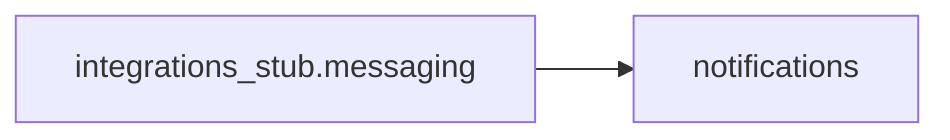

# integrations_stub.messaging

## Que hace

`integrations_stub.messaging` representa el adapter externo de mensajeria para
codigos temporales de autenticacion y futuros magic links.

No es fuente de verdad. La fuente de verdad sigue siendo:

- `identity.users.UserAuthChallenge`
- `notifications.deliveries.NotificationDelivery`

## Rol En La Arquitectura

- `identity.users` decide que challenge emitir
- `integrations_stub.messaging` decide como intentar entregar el mensaje
- `notifications.deliveries` deja trazabilidad durable del intento

## Local vs cloud

- local/dev:
  - `IDENTITY_MESSAGE_BACKEND=local_stub`
  - el codigo queda solo en trazabilidad local si el flag debug esta activo
- cloud/prod:
  - el backend de mensajeria debe reemplazarse por un adapter real
  - el contrato del challenge no cambia

## Nota

Este stub existe para evitar meter transporte SMS/WhatsApp dentro de
`identity.users`. El bounded context de identidad modela auth; no el proveedor
externo.

<!-- backend-source-audit:start -->
## Evidencia del codigo y mapa de dependencias

Inventario estatico reproducible del checkout. Describe declaraciones e imports;
no prueba despliegue, permisos efectivos ni que todos los caminos se ejecuten.
Las rutas son locales a su URLConf: el prefijo publico se consulta en
[`api/v1/routers.py`](../../api/v1/routers.py).

- Archivos Python de implementacion: **2** (excluye tests y migraciones).
- Huella SHA-256 del codigo inventariado: `148d24f9d5724bb46bc4a6a59915d91b5a6d1fd57d4f66d55637247582f85d84`.
- Familias detectadas: services.

No se detectan declaraciones `path`/`re_path` propias en este alcance.
Esto no implica que el modulo carezca de consumidores internos.

### Diagrama de dependencia estatica

Las flechas representan imports entre paquetes, no eventos ni orden de ejecucion.

Flujos transversales: [flujo actualizado](../../docs/BACKEND_CURRENT_FLOW.md).

Regeneracion: `py -3 scripts/audit_backend_docs.py --write`.
Comprobacion de deriva: `py -3 scripts/audit_backend_docs.py --check`.
<!-- backend-source-audit:end -->
