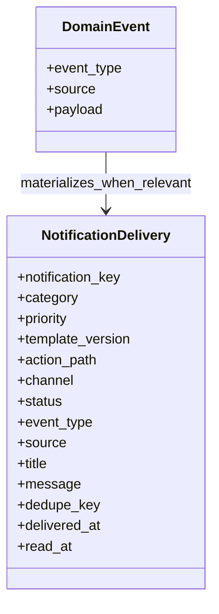
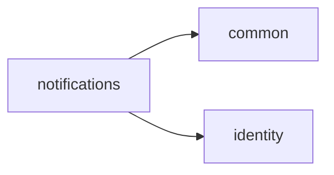

# notifications

## Que hace

`notifications` es la capa de inbox persistente y entrega funcional dentro de
la app.

No es lo mismo que:

- `alerts`, que modela senales o interpretacion del dominio
- `realtime`, que modela feedback tecnico liviano para polling o UX interactiva

`notifications` existe para que el usuario tenga un historial durable de
mensajes importantes.

## Documento canonico y subdocumentos

Este README es el documento canonico del bounded context `notifications`.

Subdocumentos derivados:

- [deliveries/README.md](https://gitlab.com/vexxo-sas/vexxo_backend_api/-/blob/development/notifications/deliveries/README.md)
  inbox persistente y semantica de `NotificationDelivery`
- [listeners/README.md](https://gitlab.com/vexxo-sas/vexxo_backend_api/-/blob/development/notifications/listeners/README.md)
  materializacion de inbox desde eventos del dominio
- [preferences/README.md](https://gitlab.com/vexxo-sas/vexxo_backend_api/-/blob/development/notifications/preferences/README.md)
  configuracion activa por canal y marketing/newsletter
- [templates/README.md](https://gitlab.com/vexxo-sas/vexxo_backend_api/-/blob/development/notifications/templates/README.md)
  renderizado y mensajes reutilizables

Regla editorial:

- este README explica `notifications` como modulo
- los subREADME explican ownership puntual por capa

## Componentes Principales

- `deliveries`
  guarda la notificacion persistente visible en la app
- `listeners`
  escucha eventos de dominio y crea entregas
- `preferences`
  preferencias activas del usuario para inbox, push, correo y newsletter
- `templates`
  punto natural para mensajes reutilizables y renderizado

## Por Que Existe

El usuario necesita un historial durable de mensajes importantes aunque no
este conectado en tiempo real.

Este modulo evita depender solo de:

- logs
- alerts tecnicas
- senales efimeras de realtime

## Vista visual

## Flujo General

1. un bounded context emite un evento fuerte
2. `notifications.listeners` decide si ese evento amerita inbox
3. `notifications.templates.catalog` resuelve identidad, categoria, prioridad,
   copy, payload permitido y deeplink
4. se crea `NotificationDelivery`
5. si el canal es `email`, el futuro worker durable usa la misma definicion y
   marca `delivered` o `failed`
6. mobile/web consume inbox o estado por API
7. el usuario marca como leido y puede navegar a la accion relacionada

## Casos De Uso

- invitacion a cuenta compartida
- invitacion aceptada
- acceso revocado
- sync exitoso o evento importante de operacion
- pagos que requieren accion y fallos; consultar el catalogo para otros eventos

## Relacion Con Otros Modulos

- `common.domain_events`: origen del bus compartido
- `finance.accounts`: hoy es uno de los productores principales
- `payments`: productor actual mediante listeners de `payments.*` y handlers especificos
- `alerts`: puede complementar o disparar notificaciones funcionales
- `realtime`: complementa UX inmediata, pero no reemplaza el inbox

## Encaje Con GCP

Este modulo puede operar asi:

- API Gateway / Cloud Run exponen inbox al usuario
- listeners locales o consumidores externos materializan `deliveries`
- Pub/Sub puede servir para escalar consumo de eventos a otros servicios
- Cloud SQL mantiene el inbox persistente

El inbox no debe depender de sockets persistentes; debe ser durable y consultable.

## Politicas Del Modulo

- solo mensajes con valor real deben entrar al inbox
- el inbox no reemplaza trazabilidad operativa ni audit log
- la deduplicacion usa el ID estable del outbox: evita duplicar reintentos sin
  silenciar acciones futuras sobre el mismo agregado
- la UI puede mezclar inbox con realtime, pero la fuente durable es
  `NotificationDelivery`

## Estado Actual

Hoy el enfoque principal es inbox in-app persistente.

El catalogo v1 cubre lifecycle, seguridad, cuentas, transacciones, presupuestos,
gastos compartidos, pagos, pagos programados, deudas, metas, alertas y OCR. No
materializa cada escritura tecnica: una accion entra al inbox cuando aporta
confirmacion, requiere atencion o cambia una obligacion. El resto permanece en
eventos, auditoria y logs para evitar fatiga de notificaciones.

`in_app_enabled=false` silencia eventos opcionales. Los avisos de seguridad de
cuenta y dispositivos se conservan como obligatorios para proteger al usuario.

Ya existe ademas:

- trazabilidad de correos lifecycle y reset de password via `NotificationDelivery(channel=email)`
- trazabilidad de recovery/step-up mobile via `NotificationDelivery(channel=system, payload.transport=sms|whatsapp)`
- preferencias de usuario por canal y newsletter

La arquitectura sigue dejando abierto el camino para:

- push provider real
- templates mas ricos
- reglas mas finas por evento

La API acepta `created_after=<ISO-8601>` para polling incremental. Flutter solo
consulta mientras el inbox esta visible y mantiene el inbox persistente como
fuente de verdad; no se requieren WebSockets para la escala local inicial.

<!-- backend-source-audit:start -->
## Evidencia del codigo y mapa de dependencias

Inventario estatico reproducible del checkout. Describe declaraciones e imports;
no prueba despliegue, permisos efectivos ni que todos los caminos se ejecuten.
Las rutas son locales a su URLConf: el prefijo publico se consulta en
[`api/v1/routers.py`](../api/v1/routers.py).

- Archivos Python de implementacion: **28** (excluye tests y migraciones).
- Huella SHA-256 del codigo inventariado: `b774a9717b92a2a9bc7208fa6107e048f02dbbbaa3c48cefe354eb7cb16c8d4c`.
- Familias detectadas: listeners, models, serializers, services, views.

### Declaraciones de modelos detectadas

- `NotificationDelivery` en [notifications/deliveries/models.py](deliveries/models.py).
- `NotificationPreference` en [notifications/preferences/models.py](preferences/models.py).

### Rutas declaradas

| Patron local | Fuente |
| --- | --- |
| `` | [notifications/deliveries/urls.py](deliveries/urls.py) |
| `entregas-notificacion/ [DRF router]` | [notifications/deliveries/urls.py](deliveries/urls.py) |
| `me/` | [notifications/preferences/urls.py](preferences/urls.py) |

### Diagrama de dependencia estatica

Las flechas representan imports entre paquetes, no eventos ni orden de ejecucion.

Flujos transversales: [flujo actualizado](../docs/BACKEND_CURRENT_FLOW.md).

Regeneracion: `py -3 scripts/audit_backend_docs.py --write`.
Comprobacion de deriva: `py -3 scripts/audit_backend_docs.py --check`.
<!-- backend-source-audit:end -->
