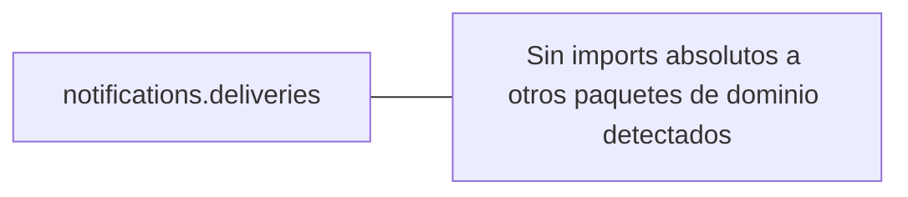

# notifications.deliveries

## Que hace

`notifications.deliveries` es el inbox persistente de la app.

Su responsabilidad es:

- almacenar entregas visibles por el usuario
- deduplicar mensajes cuando el bus reintenta
- permitir lectura, listado y marcado como leido
- conservar `notification_key`, categoria, prioridad, plantilla/version y ruta
  de accion sin depender del texto visible

## Alcance documental

Este README es derivado del documento canonico del modulo:

- [notifications/README.md](https://gitlab.com/vexxo-sas/vexxo_backend_api/-/blob/development/notifications/README.md)

Su foco es solo `NotificationDelivery` y la semantica del inbox durable.

## Flujo Principal

1. un listener consulta el catalogo versionado
2. el catalogo minimiza el payload y define la ruta de accion
3. `create_notification_delivery()` persiste la entrega idempotente
4. mobile/web consulta el inbox por API
5. el usuario marca una o varias entregas como leidas y navega al contexto

## Diferencia Frente a Otras Capas

- `alerts`
  modela la senal o interpretacion
- `notifications.deliveries`
  materializa un mensaje durable para el usuario
- `realtime.consumers`
  refleja una senal tecnica y liviana para interaccion

## Relacion Con Otros Modulos

- `notifications.listeners`
  productor principal de deliveries
- `finance.accounts`
  hoy es productor importante via eventos de membresias, sync y lifecycle
- `payments`
  sera productor natural de notificaciones operativas y de pago

## Encaje Con GCP

Es una pieza simple y robusta para Cloud SQL + Cloud Run:

- almacenamiento durable en OLTP
- API de lectura desde BFF
- posibilidad futura de fan-out a otros canales sin cambiar la semantica base

## Politicas Del Modulo

- el inbox debe ser durable
- la deduplicacion debe proteger frente a retries del bus
- el estado `read` no debe perder trazabilidad de `delivered`
- la UI no debe confundir inbox con realtime efimero
- el payload publico usa allowlist por tipo; no replica eventos financieros
  completos, tokens ni metadata de proveedor

## Estado Actual

Hoy el foco es canal `in_app`, pero el modelo ya deja espacio para `email`,
`push` y `system`.

## Casos De Uso

- “te compartieron una cuenta”
- “tu acceso fue revocado”
- “la sincronizacion se completo”
- “tu pago requiere accion”
- “una dispersion fallo”

<!-- backend-source-audit:start -->
## Evidencia del codigo y mapa de dependencias

Inventario estatico reproducible del checkout. Describe declaraciones e imports;
no prueba despliegue, permisos efectivos ni que todos los caminos se ejecuten.
Las rutas son locales a su URLConf: el prefijo publico se consulta en
[`api/v1/routers.py`](../../api/v1/routers.py).

- Archivos Python de implementacion: **7** (excluye tests y migraciones).
- Huella SHA-256 del codigo inventariado: `375cc7bb2805354a84bdc9d4616711e0c2662bbd1699b33451198e06fc5d55f2`.
- Familias detectadas: models, services, views.

### Declaraciones de modelos detectadas

- `NotificationDelivery` en [notifications/deliveries/models.py](models.py).

### Rutas declaradas

| Patron local | Fuente |
| --- | --- |
| `` | [notifications/deliveries/urls.py](urls.py) |
| `entregas-notificacion/ [DRF router]` | [notifications/deliveries/urls.py](urls.py) |

### Diagrama de dependencia estatica

Las flechas representan imports entre paquetes, no eventos ni orden de ejecucion.

Flujos transversales: [flujo actualizado](../../docs/BACKEND_CURRENT_FLOW.md).

Regeneracion: `py -3 scripts/audit_backend_docs.py --write`.
Comprobacion de deriva: `py -3 scripts/audit_backend_docs.py --check`.
<!-- backend-source-audit:end -->
