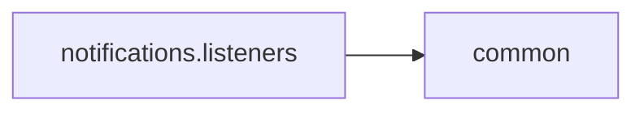

# notifications.listeners

## Que hace

`notifications.listeners` convierte eventos del dominio en notificaciones
persistentes para el usuario.

No reemplaza a `alerts` ni a `realtime`. Su foco es inbox y comunicacion
durable.

## Alcance documental

Este README es derivado del documento canonico del modulo:

- [notifications/README.md](https://gitlab.com/vexxo-sas/vexxo_backend_api/-/blob/development/notifications/README.md)

Su foco es la materializacion de inbox desde eventos; no explica todo el
bounded context `notifications`.

## Estado Actual Real

Este modulo si tiene una pieza operativa clara:

- `event_handlers.py`

Los modelos y vistas del app siguen en scaffold, pero los listeners ya
persisten entregas a traves de `notifications.deliveries`.

## Flujo Principal

1. ocurre un evento de dominio en `accounts`
2. un subscriber en `notifications.listeners.event_handlers` lo recibe
3. se decide usuario destino, titulo y mensaje
4. se construye `dedupe_key`
5. se crea `NotificationDelivery`

Eventos observados hoy:

- `accounts.membership.invited`
- `accounts.membership.accepted`
- `accounts.membership.revoked`
- `accounts.primary.changed`
- `accounts.archived`
- `accounts.sync.succeeded`

## Casos De Uso

### Invitacion a cuenta compartida

- se emite evento de invitacion
- el listener crea un item de inbox para el usuario invitado

### Aceptacion de colaborador

- se emite evento de aceptacion
- el owner recibe confirmacion durable

### Sincronizacion exitosa

- el usuario recibe feedback de una cuenta sincronizada

## Relacion Con Otros Modulos

- `common.domain_events`
  fuente de suscripcion y bus compartido.
- `notifications.deliveries`
  almacenamiento durable del mensaje.
- `finance.accounts`
  principal contexto emisor observado hoy.
- `realtime`
  puede complementar con feedback interactivo, pero no reemplaza el inbox.

## Encaje Con GCP

Hoy estos listeners pueden vivir en el proceso del backend o en workers, pero
la evolucion natural en GCP es:

- eventos de dominio publicados por outbox
- Pub/Sub o Cloud Tasks para fan-out externo
- Cloud Run workers para entrega por canal
- persistencia durable en Cloud SQL

## Estado Actual

El valor real del modulo ya existe en `event_handlers.py`.
Lo que aun no aparece aqui es un subdominio rico de configuracion o modelos
propios; esa parte sigue apoyandose en `notifications.deliveries`.

<!-- backend-source-audit:start -->
## Evidencia del codigo y mapa de dependencias

Inventario estatico reproducible del checkout. Describe declaraciones e imports;
no prueba despliegue, permisos efectivos ni que todos los caminos se ejecuten.
Las rutas son locales a su URLConf: el prefijo publico se consulta en
[`api/v1/routers.py`](../../api/v1/routers.py).

- Archivos Python de implementacion: **6** (excluye tests y migraciones).
- Huella SHA-256 del codigo inventariado: `ca6b6381bfc38460a9185deac19350834fa3ef8a7531c6ca878e338af8a52278`.
- Familias detectadas: listeners, models, views.

No se detectan declaraciones `path`/`re_path` propias en este alcance.
Esto no implica que el modulo carezca de consumidores internos.

### Diagrama de dependencia estatica

Las flechas representan imports entre paquetes, no eventos ni orden de ejecucion.

Flujos transversales: [flujo actualizado](../../docs/BACKEND_CURRENT_FLOW.md).

Regeneracion: `py -3 scripts/audit_backend_docs.py --write`.
Comprobacion de deriva: `py -3 scripts/audit_backend_docs.py --check`.
<!-- backend-source-audit:end -->
