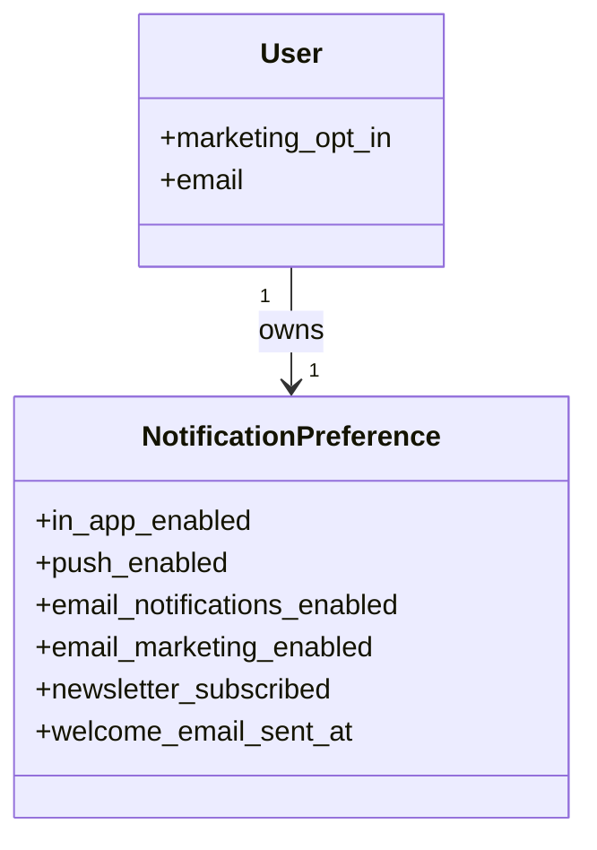

# notifications.preferences

## Que hace

`notifications.preferences` concentra las preferencias durables de
comunicacion del usuario:

- inbox in-app habilitado o no
- push habilitado o no
- correo transaccional general
- opt-in de marketing
- newsletter
- marca de envio de bienvenida

## Estado Del Codigo

Hoy el modulo ya esta materializado:

- `NotificationPreference` como `OneToOne` por usuario
- `GET/PUT/PATCH /api/notifications/preferences/me/`
- bootstrap desde `User.marketing_opt_in`
- sincronizacion bidireccional con `identity.users`

## Rol En El Producto

Vexxo necesita distinguir entre:

- notificaciones que el sistema puede generar
- notificaciones que realmente quiere recibir el usuario
- canal adecuado:
  - in-app
  - push
  - email

## Vista visual

## Flujo Operativo

1. `identity.users` registra o autentica al usuario.
2. `notifications.preferences.services.get_or_create_notification_preferences()`
   garantiza la fila de preferencias.
3. si el usuario cambia newsletter u opt-in, `/api/notifications/preferences/me/`
   actualiza la preferencia y sincroniza `User.marketing_opt_in`.
4. `identity.users.services.communication_service` consulta estas preferencias
   antes de enviar correos lifecycle.
5. `NotificationDelivery(channel=email)` deja trazabilidad del correo enviado o fallido.

## Relacion Con Otros Modulos

- `notifications.deliveries`
  persiste inbox y trazabilidad de correos.
- `notifications.listeners`
  transforma eventos de dominio en mensajes.
- `realtime`
  puede complementar la experiencia interactiva.
- `identity.users`
  aporta ownership, onboarding, auth y `marketing_opt_in`.

## Encaje Con GCP

En cloud este modulo encaja asi:

- Cloud Run para API de preferencias
- Cloud SQL para persistencia
- servicios de email/push externos desde adapters

No necesita Cloud Tasks por ahora porque el write path es liviano y la logica
de preferencias es OLTP directa.

## Estado Actual

El alcance actual cubre:

- preferencias consultables y editables por el usuario
- newsletter y marketing opt-in
- control de correo lifecycle
- marca de envio de bienvenida

No cubre aun:

- quiet hours
- reglas finas por tipo de evento
- campañas o journeys de marketing
- push provider real
