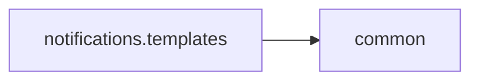

# notifications.templates

## Que hace

`notifications.templates` existe para alojar plantillas reutilizables de
mensajeria:

- textos base
- variantes por canal
- parametros dinamicos
- versionado de contenido

## Estado Del Codigo

El catalogo v1 vive en `catalog.py` y es la fuente canonica para el inbox:

- `notification_key` estable, independiente del copy
- evento de dominio origen
- categoria y prioridad
- titulo y mensaje estatico o derivado de campos permitidos
- deeplink Flutter
- allowlist de payload publico
- version de plantilla

`GET /api/notifications/deliveries/entregas-notificacion/catalog/` permite
inspeccionarlo. No hay modelos editables: por ahora los cambios de copy pasan
por revision de codigo, pruebas y despliegue.

## Rol En El Producto

En Vexxo las notificaciones no son solo un log tecnico. Son parte de la
experiencia del usuario. Un contexto de templates permite:

- unificar copy entre inbox, push y email
- mantener consistencia con negocio y soporte
- separar contenido de la logica que detecta el evento

## Relacion Con Otros Modulos

- `notifications.listeners`
  decide cuando y a quien notificar.
- `notifications.deliveries`
  materializa el mensaje generado.
- `alerts`
  puede originar mensajes derivados de alertas o IA.
- `support.audit`
  ayuda a rastrear que se genero y por que.

## Encaje Con GCP

Mas adelante este modulo podria trabajar con:

- Cloud Run para administracion y render
- Cloud SQL para plantillas y versionado
- Cloud Storage si aparecen artefactos ricos o assets
- workers para rendering o entrega por canal

## Cobertura V1

| Categoria | Acciones relevantes |
| --- | --- |
| Lifecycle | bienvenida y onboarding completado |
| Seguridad | dispositivo registrado o revocado |
| Finanzas | cuenta, gasto/ingreso, presupuesto, pago, deuda, meta y aportes |
| Colaboracion | cuenta compartida y lifecycle de gastos compartidos |
| Recordatorios | pagos programados y cuotas vencidas |
| Integraciones | importacion de movimientos y resultado de sincronizacion |
| Sistema | alertas accionables y resultado de procesamiento OCR |

No toda operacion produce inbox. Cambios tecnicos, callbacks, recalculos y
eventos de soporte permanecen observables sin interrumpir al usuario.

Cada entrega se deduplica por `notification_key + usuario + outbox_event_id`.
Un reintento del mismo evento no crea otra fila, mientras una nueva accion
sobre la misma cuenta, gasto o pago conserva su propia confirmacion.

<!-- backend-source-audit:start -->
## Evidencia del codigo y mapa de dependencias

Inventario estatico reproducible del checkout. Describe declaraciones e imports;
no prueba despliegue, permisos efectivos ni que todos los caminos se ejecuten.
Las rutas son locales a su URLConf: el prefijo publico se consulta en
[`api/v1/routers.py`](../../api/v1/routers.py).

- Archivos Python de implementacion: **6** (excluye tests y migraciones).
- Huella SHA-256 del codigo inventariado: `c87a9ee55019c28782aecb0c119edb9efdee569563c7dc94e7b3c059448a1f0b`.
- Familias detectadas: models, views.

No se detectan declaraciones `path`/`re_path` propias en este alcance.
Esto no implica que el modulo carezca de consumidores internos.

### Diagrama de dependencia estatica

Las flechas representan imports entre paquetes, no eventos ni orden de ejecucion.

Flujos transversales: [flujo actualizado](../../docs/BACKEND_CURRENT_FLOW.md).

Regeneracion: `py -3 scripts/audit_backend_docs.py --write`.
Comprobacion de deriva: `py -3 scripts/audit_backend_docs.py --check`.
<!-- backend-source-audit:end -->
