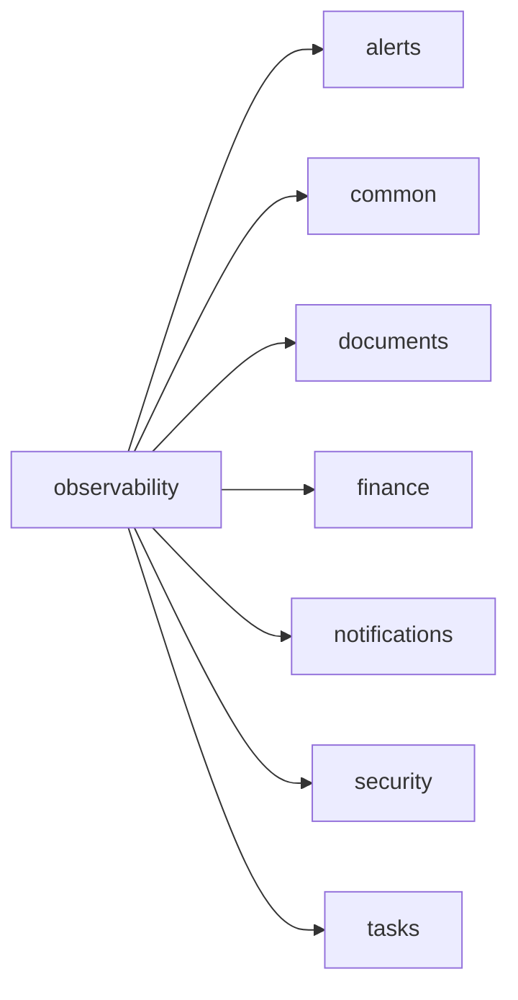

# Observability

La observabilidad local ofrece senales operativas sin depender de GCP.

## Superficie actual

- `GET /healthz/`: liveness del proceso.
- `GET /readyz/`: readiness de PostgreSQL.
- `GET /api/runtime/health/`: liveness bajo el namespace API.
- `GET /api/runtime/readiness/`: readiness bajo el namespace API.
- `manage.py runtime_status --strict`: configuracion y dependencias.
- `manage.py outbox_status [context]`: pendientes, fallos y dead letters.
- `manage.py worker_status [job_type]`: estado durable de workers y scheduler.
- `manage.py db_connection_budget --strict`: capacidad, uso y presupuesto de
  conexiones PostgreSQL para el perfil de rendimiento.
- `manage.py profile_mobile_queries --email ...`: conteo y fingerprints SQL
  repetidos de `mobile/bootstrap` o `mobile/sync-state`, sin exponer JWT.
- `manage.py benchmark_mobile_queries --max-query-growth 0`: fixtures
  transaccionales small/medium/large y guard contra crecimiento N+1.
- `GET /api/internal/support/operations/`: snapshot agregado, staff-only y
  auditado de outboxes, OCR, scheduler, notificaciones y pagos.
- `manage.py prune_operational_data`: previsualiza retencion; solo elimina con
  `--apply` y nunca toca ledger, pagos, deudas, metas o auditoria.

La linea base SQL incremental vigente es constante: 90 consultas para el
primer bootstrap completo, 18 para bootstrap con cache valida y 23 para
sync-state. El escenario cached verifica que ningun builder de payload se
ejecute cuando todas las versiones coinciden.

`worker_status scheduler` muestra cada job, estado, ejecuciones, fallos,
proxima corrida y ultimo error desde `ScheduledJobState`.
`worker_status documents.ocr` muestra pendientes, procesamiento, locks stale y
fallos del worker OCR durable.

Los logs salen por stdout en JSON e incluyen `request_id`, ruta, estado y
duracion. El middleware acepta `X-Request-ID` solo con caracteres seguros y
siempre lo devuelve en la respuesta.

No se deben registrar JWT, passwords, PIN, tokens de proveedor, audio completo,
payloads financieros crudos ni PII innecesaria.

Los scripts `backup_local_db.ps1`, `restore_local_db.ps1` y
`load_test_local.py` cubren el circuito operativo inicial. Antes de usuarios
reales deben medirse objetivos, ensayarse restauraciones en una base aislada y
agregarse alertas por lag; que el comando exista no demuestra recuperabilidad.

<!-- backend-source-audit:start -->
## Evidencia del codigo y mapa de dependencias

Inventario estatico reproducible del checkout. Describe declaraciones e imports;
no prueba despliegue, permisos efectivos ni que todos los caminos se ejecuten.
Las rutas son locales a su URLConf: el prefijo publico se consulta en
[`api/v1/routers.py`](../api/v1/routers.py).

- Archivos Python de implementacion: **16** (excluye tests y migraciones).
- Huella SHA-256 del codigo inventariado: `5bbec7d334b95828e31ea2d76fe310577a5febe8e4d8b19388e9531dd5831314`.
- Familias detectadas: management, views.

### Rutas declaradas

| Patron local | Fuente |
| --- | --- |
| `health/` | [observability/urls.py](urls.py) |
| `readiness/` | [observability/urls.py](urls.py) |

### Diagrama de dependencia estatica

Las flechas representan imports entre paquetes, no eventos ni orden de ejecucion.

Flujos transversales: [flujo actualizado](../docs/BACKEND_CURRENT_FLOW.md).

Regeneracion: `py -3 scripts/audit_backend_docs.py --write`.
Comprobacion de deriva: `py -3 scripts/audit_backend_docs.py --check`.
<!-- backend-source-audit:end -->
