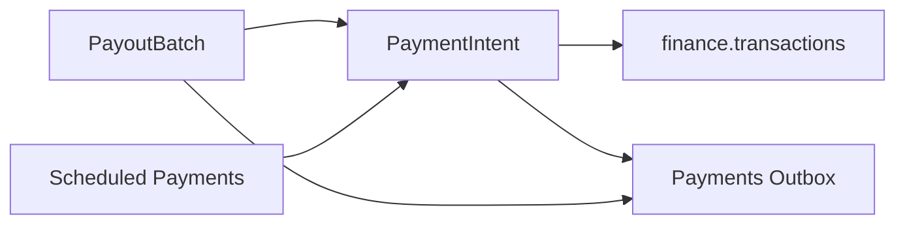
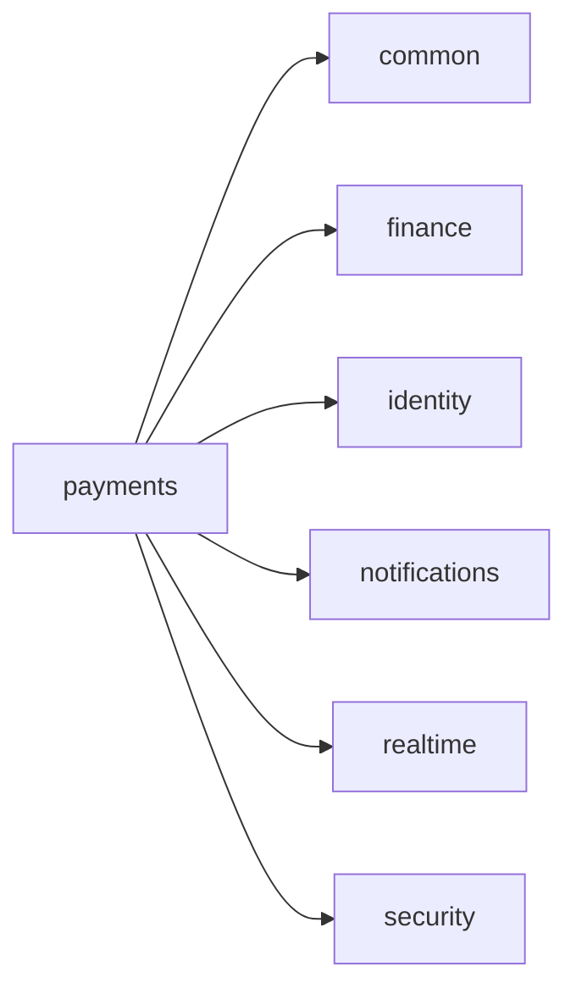

# payments

## Que hace

`payments` es la frontera de ejecucion externa de dinero en Vexxo.

Regla principal:

- pagar no es lo mismo que registrar una transaccion

Por eso el dominio se separa en:

- `payments.payment_intents`: intencion, ejecucion, callbacks, pricing y estado del rail
- `payments.scheduled_payments`: planificacion recurrente o programada
- `finance.transactions`: reflejo contable final en el ledger
- `payouts` se modela dentro de `payment_intents` por ahora mediante
  `PayoutBatch` y `PayoutInstruction`

## Documento canonico y subdocumentos

Este README es el mapa canonico del bounded context `payments`.

Subdocumentos derivados:

- [payment_intents/README.md](https://gitlab.com/vexxo-sas/vexxo_backend_api/-/blob/development/payments/payment_intents/README.md)
  detalle del aggregate operativo principal, callbacks, outbox y payouts
- [scheduled_payments/README.md](https://gitlab.com/vexxo-sas/vexxo_backend_api/-/blob/development/payments/scheduled_payments/README.md)
  planificacion recurrente y scheduling moderno
- [calendar/README.md](https://gitlab.com/vexxo-sas/vexxo_backend_api/-/blob/development/payments/calendar/README.md)
  capa reservada de calendario y agenda
- [reminders/README.md](https://gitlab.com/vexxo-sas/vexxo_backend_api/-/blob/development/payments/reminders/README.md)
  capa reservada de recordatorios

Regla editorial:

- este README explica el bounded context
- los subREADME profundizan una pieza concreta y no deben reescribir todo
  `payments`

## Vista visual

## Rol En El Producto

De cara al cliente, este contexto permite:

- pagar servicios, facturas o terceros desde la app
- convertir pagos exitosos en recurrencias futuras
- separar la experiencia de pago de la contabilidad final
- cobrar fees de forma transparente sin contaminar el ledger

## Flujos principales

### Pago saliente

1. el usuario pide pagar
2. nace `PaymentIntent`
3. el proveedor procesa
4. Vexxo recibe referencias/estado
5. se materializa `Transaction`

### Pago recurrente o programado

1. el usuario crea un template o convierte un pago exitoso en template
2. un scheduler pide una corrida
3. la corrida genera un `PaymentIntent`
4. el resultado confirmado se refleja en `Transaction`

### Dispersion

El modelo separa:

- pago saliente unitario
- lote de dispersion (`PayoutBatch`)
- instruccion individual (`PayoutInstruction`)

## Eventos

Desde aqui se definen eventos `payments.*` para:

- workers
- proyecciones de uso
- analytics
- futuras integraciones por Pub/Sub o Cloud Tasks

## Pricing y limites

El pricing canonico vive en `payments.payment_intents.pricing_service`.

Ese resolver separa:

- costo del proveedor
- impuestos del costo del proveedor
- fee de Vexxo
- impuestos del fee de Vexxo

Asi Vexxo puede:

- estimar el costo antes de pagar
- guardar un snapshot del precio usado al crear la orden
- comparar estimado vs callback real del PSP
- variar margen por plan, proveedor o rail

Los limites tambien se separan en dos capas:

- limites comerciales por plan:
  - monto maximo por pago
  - volumen diario
  - volumen mensual
  - cantidad mensual
  - payouts habilitados o no
- caps operativos internos por proveedor y rail:
  - cap maximo por instruccion
  - cap diario por proveedor/rail

Los caps operativos no representan upgrade. Representan proteccion de Vexxo
frente a conciliacion, fraude, reversos, soporte y salud del rail.

## Estado actual

El bounded context ya tiene:

- contratos de eventos `payments.*`
- `PaymentIntent`
- pricing base
- planificacion base
- materializacion contable base
- outbox propio
- intake de callbacks
- registry de adapters por proveedor
- contratos declarativos de callback y dispatch por proveedor
- settlement y operational cases basicos

Lo que falta despues:

- adapters PSP reales
- callbacks/webhooks con firma real por proveedor
- conciliacion contra operadores reales
- observabilidad y soporte operativo mas profundo

## Contratos por proveedor

`payments.payment_intents` ya expone una capa estable para integrar PSPs sin
redisenar el dominio:

- contrato declarativo por proveedor
- adapter por proveedor
- intake canonico de callbacks
- envelope canonico de dispatch
- outbox fuerte del bounded context
- senales realtime complementarias

Esto es importante para GCP porque separa claramente:

- API Gateway / BFF
- Cloud Run workers o integradores
- Pub/Sub / Cloud Tasks
- callbacks del proveedor
- materializacion contable en ledger

Cuando llegue Wompi u otro operador, la idea es cambiar:

- mapping de callback
- firma/autenticacion
- payload provider-specific

y no volver a tocar:

- `finance.transactions`
- guards de plan
- proyecciones de uso
- outbox de `payments`

## Encaje Con GCP

La topologia esperada es:

- API Gateway -> BFF Django/DRF para crear intents y consultar estado
- Cloud Run workers/integrations para dispatch a PSPs
- callbacks autenticados entrando por endpoints controlados
- outbox fuerte publicando eventos `payments.*`
- Pub/Sub o Cloud Tasks para pipelines y retries
- Cloud SQL guardando intents, callbacks, settlements y casos operativos

Esto permite que la logica del dominio siga estable aunque cambie el PSP.

<!-- backend-source-audit:start -->
## Evidencia del codigo y mapa de dependencias

Inventario estatico reproducible del checkout. Describe declaraciones e imports;
no prueba despliegue, permisos efectivos ni que todos los caminos se ejecuten.
Las rutas son locales a su URLConf: el prefijo publico se consulta en
[`api/v1/routers.py`](../api/v1/routers.py).

- Archivos Python de implementacion: **51** (excluye tests y migraciones).
- Huella SHA-256 del codigo inventariado: `c472107a8ac6c3ef52d4e22f71b3187f2812926c4aa611e22a2d12aa874acdaf`.
- Familias detectadas: management, models, serializers, services, views.

### Declaraciones de modelos detectadas

- `PaymentDomainEventOutbox` en [payments/payment_intents/models.py](payment_intents/models.py).
- `PaymentIntent` en [payments/payment_intents/models.py](payment_intents/models.py).
- `PaymentOperationalCase` en [payments/payment_intents/models.py](payment_intents/models.py).
- `PaymentProviderCallbackReceipt` en [payments/payment_intents/models.py](payment_intents/models.py).
- `PaymentScheduleRun` en [payments/scheduled_payments/models.py](scheduled_payments/models.py).
- `PaymentSettlementRecord` en [payments/payment_intents/models.py](payment_intents/models.py).
- `PaymentTemplate` en [payments/scheduled_payments/models.py](scheduled_payments/models.py).
- `PayoutBatch` en [payments/payment_intents/models.py](payment_intents/models.py).
- `PayoutInstruction` en [payments/payment_intents/models.py](payment_intents/models.py).

### Rutas declaradas

| Patron local | Fuente |
| --- | --- |
| `` | [payments/payment_intents/urls.py](payment_intents/urls.py) |
| `` | [payments/scheduled_payments/urls.py](scheduled_payments/urls.py) |
| `callback-receipts/ [DRF router]` | [payments/payment_intents/urls.py](payment_intents/urls.py) |
| `intents/ [DRF router]` | [payments/payment_intents/urls.py](payment_intents/urls.py) |
| `operational-cases/ [DRF router]` | [payments/payment_intents/urls.py](payment_intents/urls.py) |
| `outbox-pagos/ [DRF router]` | [payments/payment_intents/urls.py](payment_intents/urls.py) |
| `payouts/ [DRF router]` | [payments/payment_intents/urls.py](payment_intents/urls.py) |
| `programmed-payment-runs/ [DRF router]` | [payments/scheduled_payments/urls.py](scheduled_payments/urls.py) |
| `programmed-payments/ [DRF router]` | [payments/scheduled_payments/urls.py](scheduled_payments/urls.py) |
| `provider-callback/` | [payments/payment_intents/urls.py](payment_intents/urls.py) |
| `providers/<str:provider>/callback/` | [payments/payment_intents/urls.py](payment_intents/urls.py) |
| `providers/<str:provider>/contract/` | [payments/payment_intents/urls.py](payment_intents/urls.py) |
| `providers/contracts/` | [payments/payment_intents/urls.py](payment_intents/urls.py) |
| `runs/ [DRF router]` | [payments/scheduled_payments/urls.py](scheduled_payments/urls.py) |
| `settlements/ [DRF router]` | [payments/payment_intents/urls.py](payment_intents/urls.py) |
| `templates/ [DRF router]` | [payments/scheduled_payments/urls.py](scheduled_payments/urls.py) |
| `worker-report/` | [payments/payment_intents/internal_urls.py](payment_intents/internal_urls.py) |
| `worker-report/` | [payments/payment_intents/urls.py](payment_intents/urls.py) |

### Diagrama de dependencia estatica

Las flechas representan imports entre paquetes, no eventos ni orden de ejecucion.

Flujos transversales: [flujo actualizado](../docs/BACKEND_CURRENT_FLOW.md).

Regeneracion: `py -3 scripts/audit_backend_docs.py --write`.
Comprobacion de deriva: `py -3 scripts/audit_backend_docs.py --check`.
<!-- backend-source-audit:end -->
