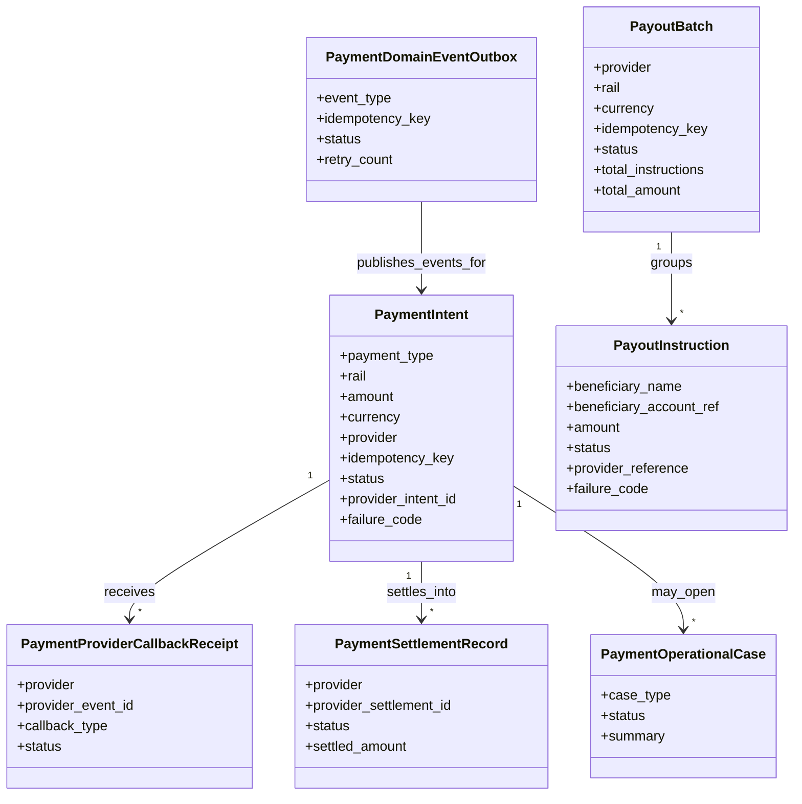
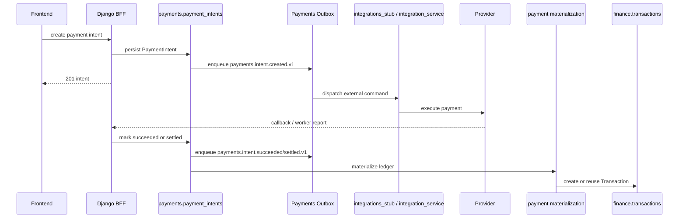

# payments.payment_intents

## Que hace

Este modulo es la frontera canonica de pagos externos en Vexxo.

Aqui vive:

- la intencion de pago (`PaymentIntent`)
- el estado del rail/proveedor
- referencias externas e internas
- pricing estimado y costos/fees/impuestos
- callbacks y transiciones de estado
- publicacion de eventos `payments.*`
- outbox propio del bounded context
- senales realtime complementarias para UI, polling o futuros gateways WebSocket
- receipts de callback autenticado del proveedor o worker
- records de settlement
- casos operativos:
  - reversal
  - dispute
  - refund
  - error
- dispersiones:
- `PayoutBatch`
- `PayoutInstruction`

No es el ledger final. El ledger final vive en `finance.transactions`.

## Alcance documental

Este README es derivado del documento canonico del bounded context:

- [payments/README.md](/c:/Users/Alamb/Documents/Vexxo_Backend_API/payments/README.md)

Su foco es el aggregate operativo `PaymentIntent`, callbacks, outbox,
settlement, casos operativos y payouts.

Documentos complementarios:

- [Catalogo de fuentes e integraciones](/c:/Users/Alamb/Documents/Vexxo_Backend_API/INTEGRATION_SOURCE_CATALOG.md)
- [Contratos canonicos por rail de transactions](/c:/Users/Alamb/Documents/Vexxo_Backend_API/finance/transactions/RAIL_NORMALIZATION_CONTRACTS.md)

## Rol En El Producto

De cara al cliente, este modulo sostiene la experiencia de pago externo dentro
de la app.

Eso incluye:

- iniciar un pago sin contaminar el ledger
- mostrar al usuario el costo estimado antes de confirmar
- reflejar estados intermedios del rail:
  - `processing`
  - `requires_action`
  - `succeeded`
  - `settled`
- soportar payouts o dispersiones sin mezclar lote, instruccion y ledger final

Su funcion de negocio es permitir ejecucion financiera con trazabilidad,
idempotencia y separacion clara entre:

- orden de pago
- ejecucion del rail
- resultado operativo
- reflejo contable

## Vista visual

## Secuencia critica: payment confirmed

## Nota operativa de rutas internas

El reporte de worker ya tiene ruta interna canonica:

- `POST /api/internal/payments/worker-report/`

La ruta legacy:

- `POST /api/payments/intents/worker-report/`

sigue viva por compatibilidad, pero ambas ya fallan cerrado si
`PAYMENTS_INTERNAL_TOKEN` no esta configurado.

## Flujos principales

### Pay now

1. el usuario entra a pagos
2. se crea `PaymentIntent`
3. se calcula pricing estimado
4. se emiten:
   - `payments.order.requested.v1`
   - `payments.fee.calculated.v1`
   - `payments.intent.created.v1`
5. el evento se guarda primero en outbox
6. un worker o adapter construye el comando al PSP
7. callbacks o workers actualizan estado:
   - `dispatched`
   - `processing`
   - `requires_action`
   - `succeeded`
   - `failed`
   - `cancelled`
   - `settled`
   - `reversed`
   - `disputed`
8. cuando el pago se confirma, se materializa `Transaction`

### Dispersion / payout

1. se crea `PayoutBatch`
2. cada salida se registra como `PayoutInstruction`
3. el guard comercial valida habilitacion, cantidad, monto, volumen diario y volumen mensual
4. el guard operativo valida caps internos por proveedor y rail
4. se emiten `payments.payout.*`
5. un integrador o worker ejecuta el rail real
6. el resultado individual se guarda por instruccion

### Metadata posterior del proveedor

Informacion como:

- referencia del proveedor
- CUS
- nombre del beneficiario
- impuestos
- breakdown de fees
- payload crudo del PSP

se guarda primero aqui, no en `finance.transactions`.

## Relacion con otros modulos

- `identity.users.services.product_access_service`: aplica limites y gating comercial
- `identity.users.services.product_usage_projection_service`: consume `payments.*`
  para conteo/volumen incremental
- `finance.transactions`: crea el reflejo contable final
- `payments.scheduled_payments`: puede generar `PaymentIntent` desde templates
- `integrations_stub` o futuros adapters: ejecutan el rail externo real
- `payments.payment_intents.adapters`: registry configurable por proveedor
- `payments.payment_intents.callback_service`: intake canonico de callbacks
- cuando el intent nace desde `PaymentTemplate`, la materializacion contable ya
  puede heredar `budget_scope/shared_budget` desde ese template
- `payments.payment_intents.reconciliation_service`: settlement y casos operativos
- `payments.payment_intents.realtime_services`: senales UX complementarias

## Politica de payloads JSON

Las superficies de este modulo se separan por confianza:

- `provider-only`
  - `PaymentProviderCallbackSerializer`
  - acepta payload variable por PSP, pero exige objeto JSON top-level
  - no acepta escalares o listas arbitrarias
- `internal worker/provider metadata`
  - `PaymentWorkerReportSerializer.provider_metadata`
  - exige objeto JSON acotado para no volver opaco el contrato operativo

Regla:

- el contrato puede ser flexible por proveedor
- pero la forma minima sigue siendo estructurada y validable
- el PSP no debe colarse como blob sin frontera semantica

## Contrato de rail vs reflejo contable

`payments.payment_intents` y `finance.transactions` no comparten exactamente el
mismo contrato de datos.

Regla:

- `payments` es dueno del contrato de ejecucion del rail
- `transactions` es dueno del contrato de reflejo contable

Por eso:

- autorizacion
- captura
- settlement
- callback del PSP
- wallet metadata
- tokenizacion
- risk metadata

viven primero aqui.

Solo cuando el pago ya vale para ledger, se refleja en `finance.transactions`
mediante el contrato `payment_reflection.normalized_payload`.

Documento relacionado:

- [Contratos canonicos por rail de transactions](/c:/Users/Alamb/Documents/Vexxo_Backend_API/finance/transactions/RAIL_NORMALIZATION_CONTRACTS.md)

## Casos De Uso

### Pago saliente simple

- el usuario paga una factura, servicio o tercero
- Vexxo crea `PaymentIntent`
- el rail externo procesa
- el callback normalizado actualiza estado
- el ledger recibe el reflejo final

### Pago con accion del usuario

- el PSP exige autenticacion o paso adicional
- `PaymentIntent` pasa a `requires_action`
- la app muestra esa friccion mediante realtime o polling
- cuando se resuelve, el intent continua a `processing` o `succeeded`

### Dispersion o payout

- se crea un lote
- cada instruccion conserva su propio resultado
- soporte y operaciones pueden revisar settlement, fallos o disputas por
  instruccion y por batch

### Callback operativo

- el proveedor envia estado
- el adapter valida firma y contrato
- el callback se normaliza
- el estado se aplica al intent
- se dejan receipts, settlement u operational cases

## Contratos por proveedor

Este modulo ya no depende de callbacks sueltos o payloads inventados por vista.
Ahora usa una capa declarativa en:

- `payments.payment_intents.provider_contracts`
- `payments.payment_intents.adapters`

La separacion es esta:

- `provider_contracts.py`
  - describe el contrato del proveedor
  - define paths de callback
  - define mapeo de estados externos -> estados canonicos
  - define firma/header esperado
  - define la forma publica del contrato para integradores o soporte
- `adapters.py`
  - implementa el comportamiento del proveedor
  - construye el payload de dispatch
  - verifica firma
  - normaliza callback bajo el contrato declarado

### Contrato de dispatch

Todos los proveedores parten del mismo envelope canonico:

- `schema`
- `provider`
- `provider_contract_version`
- `payment_intent`
- `beneficiary`
- `references`
- `pricing`
- `destination_payload`
- `provider_payload`

Eso permite que Cloud Run workers, Pub/Sub consumers o integradores externos
reciban una forma estable de Vexxo, y solo el `provider_payload` cambie por PSP.

### Contrato de callback

Todo callback se normaliza a estos campos:

- `provider`
- `contract_version`
- `provider_event_type`
- `callback_type`
- `status`
- `payment_intent_id`
- `provider_intent_id`
- `external_reference`
- `provider_reference`
- `provider_cus`
- `settlement_reference`
- `amount`
- `currency`
- `issue_kind`
- `issue_reference`
- `failure_code`
- `failure_message`
- `metadata`
- `signature_valid`
- `raw`

Reglas fuertes:

- debe existir al menos un identificador resoluble:
  - `payment_intent_id`
  - `provider_intent_id`
  - `external_reference`
  - `provider_reference`
- debe existir algun estado significativo:
  - `status`
  - `issue_kind`
  - `settlement_reference`
- si el contrato del proveedor falla, el callback queda registrado como
  `contract_error` en `PaymentProviderCallbackReceipt`

### Endpoints de contrato

Hay endpoints internos para inspeccionar contratos expuestos por provider:

- `GET /api/payments/intents/providers/contracts/`
- `GET /api/payments/intents/providers/<provider>/contract/`

Sirven para:

- integradores internos
- soporte
- observabilidad
- futuros servicios en GCP que necesiten saber como normalizar o despachar

No exponen secretos; solo esquema, mappings y autenticacion publica esperada.

## Pricing

`pricing_service.py` separa:

- `provider_cost`
- `provider_tax`
- `vexxo_fee`
- `vexxo_tax`
- `total_fee`
- `total_charge`

Asi el costo se puede:

- mostrar antes del pago
- guardar como snapshot
- comparar con el callback real del proveedor
- ajustar por plan/proveedor/rail sin contaminar el ledger

Politica comercial actual:

- el usuario siempre paga el fee del proveedor externo
- `free` paga ademas un fee fijo Vexxo de `500 COP`
- `pro` y `enterprise` no pagan fee adicional de Vexxo por pago

En payouts aplica la misma idea:

- costo proveedor
- impuestos del costo
- fee Vexxo
- impuestos del fee

## Politicas Del Modulo

- el usuario siempre ve o hereda pricing a partir de una formula centralizada
- el dominio de pagos no debe inventar fees por endpoint
- los callbacks no deben saltarse la capa de contrato por proveedor
- el outbox fuerte es la via canonica para eventos `payments.*`
- la capa realtime solo complementa UX, no reemplaza consistencia
- `transactions` no debe absorber detalles ricos del PSP

## Limites

El modulo distingue dos capas de limite:

- limite comercial por plan:
  - `max_daily_payment_volume`
  - `max_monthly_payment_volume`
  - `max_daily_payout_volume`
  - `max_monthly_payout_volume`
- cap operativo interno de Vexxo por proveedor y rail:
  - `platform_single_payment_cap`
  - `platform_daily_payment_cap`
  - `platform_single_payout_cap`
  - `platform_daily_payout_cap`

Los caps operativos no significan upgrade; significan proteccion operativa
frente a conciliacion, fraude, reversos, salud del rail y soporte.

Importante:

- por defecto los caps operativos salen de configuracion (`settings`) y pueden
  no existir
- eso evita acoplar el dominio a Wompi o a un PSP unico
- cuando entre un proveedor nuevo, se agrega o cambia su perfil sin romper la
  API ni el modelo de dominio

## Estado actual

Ya existe:

- modelo `PaymentIntent`
- modelos base de dispersión:
  - `PayoutBatch`
  - `PayoutInstruction`
- calculo de pricing
- idempotencia de request
- publicacion de eventos `payments.*`
- outbox propio con worker `payments_publish_outbox`
- listeners locales para publicar senales `RealtimeSignal` de pagos y payouts
- endpoints base para create/list/pricing preview
- endpoint de callback:
  - `/api/payments/intents/provider-callback/`
  - `/api/payments/intents/providers/<provider>/callback/`
- endpoint de worker report
- registry de adapters configurable por proveedor
- artifacts base de settlement y operational cases
- materializacion contable al confirmar el pago
- servicios base de payout con guard y eventos
- claim de outbox para workers concurrentes
- backoff exponencial y respeto de `next_attempt_at`

Todavia falta:

- adapter real de cada PSP/retailer
- autenticacion/firma real de cada callback de proveedor usando el algoritmo
  exacto de cada PSP
- conciliacion externa contra APIs reales del operador
- dispute/refund workflows profundos con soporte/ops
- webhooks publicos definitivos si el operador no usa callback interno
- trazabilidad operativa tan rica como `accounts` en publisher, duracion y fases

## Como agregar un proveedor nuevo

1. declarar contrato en `provider_contracts.py`
2. agregar adapter en `adapters.py`
3. registrar settings de proveedor:
   - secretos
   - auth callback
   - defaults del rail
4. si el proveedor necesita firma o payload especial, sobrescribir:
   - `build_provider_payload`
   - `verify_callback`
5. reutilizar el mismo `callback_service`, `outbox`, `views` y `reconciliation_service`

La regla es: cambiar mapping/configuracion o adapter, no redisenar el dominio.

## Nota importante

El antiguo path legacy basado en `finance.transactions.ScheduledPayment` ya fue
retirado. La semantica de pago externo vive en `PaymentIntent` y en las
ocurrencias modernas de `scheduled_payments`.

## Capa de entrega

`payments` ya trabaja con dos capas complementarias:

- capa fuerte:
  - outbox de dominio
  - eventos `payments.*`
  - lista para Pub/Sub, Cloud Run y workers
- capa liviana de UX:
  - `RealtimeSignal`
  - polling tecnico
  - SSE o futuros gateways WebSocket

La segunda no reemplaza la primera. Solo evita que mobile/web dependa del bus
de dominio para feedback interactivo.

## Nota operativa

`payments` ya no procesa el outbox de forma tan ingenua:

- los workers pueden reclamar filas con lock
- se respetan intentos futuros
- hay recuperacion de locks stale
- tambien puede operarse desde el wrapper unificado `manage.py publish_outbox payments`

Sigue pendiente igualar por completo la observabilidad de `accounts`.

La ultima pasada de endurecimiento ya dejo:

- `claim_for_processing()` en el outbox
- recuperacion de locks stale
- backoff exponencial con `next_attempt_at`

Lo que todavia no conviene vender como cerrado es:

- trazabilidad operativa por publisher/fase tan rica como `accounts`
- paridad completa de observabilidad entre bounded contexts

## Encaje Con GCP

El diseño del modulo asume una topologia cloud-first:

- API Gateway expone la superficie publica de intents y payouts
- Cloud Run ejecuta el BFF Django/DRF
- workers o integradores en Cloud Run consumen el envelope canonico de dispatch
- Pub/Sub y Cloud Tasks sirven como transporte y retry para procesos externos
- callbacks autenticados vuelven al backend por endpoints controlados
- Cloud SQL persiste intents, outbox, receipts, settlements y casos operativos

Esto permite cambiar de proveedor o rail sin mover:

- ledger
- guards comerciales
- usage projection
- contrato del dominio

## Documento canonico de `payment_execution`

La especificacion canonica de ejecucion del rail vive en:

- [PAYMENT_EXECUTION_CONTRACTS.md](/D:/Vexxo_Backend_API/payments/payment_intents/PAYMENT_EXECUTION_CONTRACTS.md)

Este README sigue explicando el contexto y sus flujos, pero el contrato de
payload operativo del rail ya tiene documento propio.

