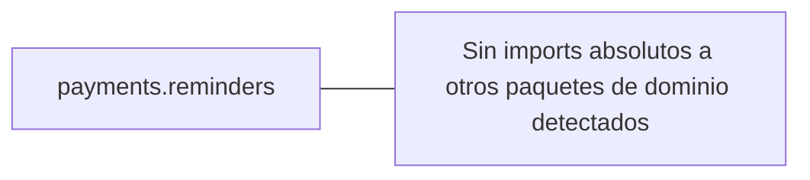

# payments.reminders

## Que hace

`payments.reminders` existe como submodulo para recordatorios relacionados con
pagos.

## Rol En El Producto

Tiene sentido para casos como:

- recordar una factura o servicio
- avisar vencimientos proximos
- reforzar pagos recurrentes o programados

## Flujo Esperado

1. una fecha relevante o regla temporal se aproxima
2. el sistema evalua si corresponde recordar
3. se dispara notificacion, alerta o señal programada
4. el usuario decide pagar, posponer o ignorar

## Relacion Con Otros Modulos

- `payments.scheduled_payments`
  origen natural de muchas fechas o compromisos.
- `notifications`
  canal de entrega.
- `tasks.scheduled`
  ejecucion periodica o programada.

## Encaje Con GCP

Puede apoyarse naturalmente en:

- Cloud Scheduler
- Cloud Tasks
- Cloud Run workers

## Estado Actual

Hoy la subapp aparece instalada en Django, pero no detecte una superficie
funcional rica en esta pasada. Debe leerse como frontera preparada, no como
recordatorio fully wired.

<!-- backend-source-audit:start -->
## Evidencia del codigo y mapa de dependencias

Inventario estatico reproducible del checkout. Describe declaraciones e imports;
no prueba despliegue, permisos efectivos ni que todos los caminos se ejecuten.
Las rutas son locales a su URLConf: el prefijo publico se consulta en
[`api/v1/routers.py`](../../api/v1/routers.py).

- Archivos Python de implementacion: **5** (excluye tests y migraciones).
- Huella SHA-256 del codigo inventariado: `0313ace7639ae66a271486087861a18fd0c3442c9df044ab10cea1c76576dac3`.
- Familias detectadas: models, views.

No se detectan declaraciones `path`/`re_path` propias en este alcance.
Esto no implica que el modulo carezca de consumidores internos.

### Diagrama de dependencia estatica

Las flechas representan imports entre paquetes, no eventos ni orden de ejecucion.

Flujos transversales: [flujo actualizado](../../docs/BACKEND_CURRENT_FLOW.md).

Regeneracion: `py -3 scripts/audit_backend_docs.py --write`.
Comprobacion de deriva: `py -3 scripts/audit_backend_docs.py --check`.
<!-- backend-source-audit:end -->
