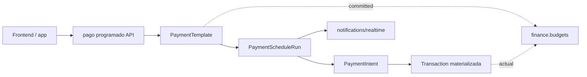
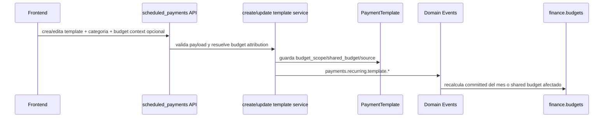
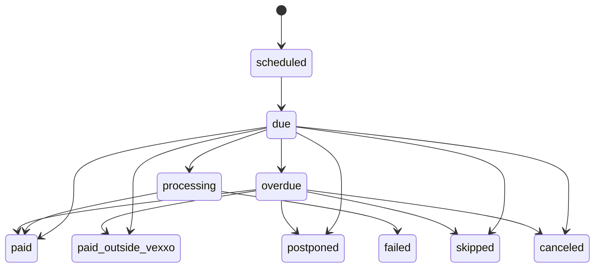

# payments.scheduled_payments

## Que hace

Este modulo modela la planificacion de pagos, no su ejecucion.

De cara al producto, la UX visible deberia converger a un solo concepto:

- `Pago programado`
  - una vez
  - repetir

El usuario no necesita conocer nombres internos como `PaymentTemplate` o
`PaymentScheduleRun`.

Aqui vive:

- `PaymentTemplate`: la plantilla recurrente o programada
- `PaymentScheduleRun`: la ocurrencia concreta de ese ciclo, con estado, fecha
  esperada, recordatorios y acciones de confirmacion
- `Transaction.payment_schedule_run`: el enlace canonico al ledger cuando la
  ocurrencia ya quedo pagada o reflejada contablemente

Ademas, esta capa ya puede transportar attribution presupuestaria:

- `budget_scope`
- `shared_budget`
- `budget_attribution_source`

## Rol En El Producto

Esta capa permite que Vexxo no obligue al usuario a preregistrar siempre antes
de pagar, pero si le ofrezca orden y automatizacion cuando la necesite.

De cara al cliente, sirve para:

- programar pagos futuros
- repetir pagos ya realizados
- crear una disciplina operativa sin mezclar scheduling con el rail externo
- dejar preatribuido si ese pago comprometido cuenta para presupuesto personal o
  compartido

## Politica de payloads JSON

Las superficies publicas de este modulo se tratan como `public strict`.

- `PaymentTemplateSerializer`
  - acepta `execution_defaults` solo como objeto JSON acotado
  - rechaza claves reservadas del scheduler, del lifecycle y del legado
- `PaymentScheduleRunRequestSerializer`
  - acepta `run_payload` solo como objeto JSON acotado
  - sirve para metadata ligera de UX o control de cliente
  - no sirve para inyectar `status`, ids internos o enlaces de retry

Regla operativa:

- el cliente puede adjuntar metadata ligera
- el backend conserva el control total de:
  - ownership
  - lifecycle del run
  - `payment_intent_id`
  - enlaces legacy/historicos
  - ids de materializacion o retry

## Vista visual

## Flujos principales

### Programar antes de pagar

1. el usuario crea un `Pago programado`
2. internamente se persiste un `PaymentTemplate`
3. se crea o mantiene una ocurrencia `PaymentScheduleRun`
4. cuando llega la fecha esperada, la ocurrencia pasa a `due` u `overdue`
5. la app puede recordar, confirmar manualmente, posponer o ejecutar con Vexxo
6. si aplica, `create_payment_intent_from_schedule_run(...)` genera el `PaymentIntent`
7. el rail externo se ejecuta desde `payments.payment_intents`

### Pagar ahora y convertir despues

1. el usuario paga ahora via `PaymentIntent`
2. despues Vexxo puede ofrecer convertir ese pago exitoso en template
3. `create_template_from_payment_intent(...)` copia los defaults relevantes

Este flujo es importante para app financiera personal porque no obliga a
preregistrar todo antes de pagar.

## Flujo de attribution

## Lifecycle de ocurrencia

Cada `PaymentScheduleRun` representa una ocurrencia concreta del pago programado
y ya puede vivir en estos estados:

- `scheduled`
- `due`
- `overdue`
- `processing`
- `paid`
- `paid_outside_vexxo`
- `postponed`
- `skipped`
- `canceled`
- `failed`

## Politicas Del Modulo

- planificar no es ejecutar
- una corrida puede terminar generando un intent, pero no equivale al pago real
- el resultado financiero final sigue viniendo de `payments.payment_intents`
- la materializacion contable final sigue entrando al ledger cuando el pago se
  confirma
- categoria no decide sola el presupuesto; la attribution viaja aparte
- una ocurrencia con `PaymentIntent` activo o ya liquidado no puede cerrarse
  manualmente como `paid` o `paid_outside_vexxo`
- `failed` se trata como estado terminal hasta definir retry explicito
- si cambia `next_run_at`, una ocurrencia abierta editable se marca
  `canceled` y queda reemplazada por la nueva fecha
- si la ocurrencia abierta ya esta en `processing` o atada a un
  `PaymentIntent`, se preserva y no se abre otra automaticamente
- si editas `default_amount` o `currency`, esos cambios se sincronizan sobre la
  ocurrencia abierta solo cuando sigue siendo editable
- cambios de `account`, `category`, `vendor` o attribution afectan la
  ejecucion de la ocurrencia abierta mientras todavia no exista `PaymentIntent`
  ni transaccion materializada; si ya existe una de esas dos, los cambios pasan
  a ser solo para futuro

## Relacion con otros modulos

- `payments.payment_intents`: ejecuta el pago externo real
- `finance.transactions.ScheduledPayment`: antecedente legacy ya retirado
  fisicamente del runtime y del esquema actual
- `finance.debts`: deuda y cuota ya pueden asociarse directamente al template
  moderno
- `finance.transactions`: recibe la transaccion final cuando el pago se confirma
- `finance.budgets`: consume templates como `committed` y escucha
  `payments.recurring.template.*`

## Politica De Legacy Y Compatibilidad

- toda UX nueva debe usar `programmed-payments` y `programmed-payment-runs`
- `finance.transactions.ScheduledPayment` ya no existe como tabla operativa en
  Cloud SQL actual; solo sobrevive en migraciones antiguas y metadata de
  backfill
- deudas/cuotas ya viajan en `PaymentTemplate.debt/installment`
- la migracion de backfill enlazo scheduled payments legacy con templates y
  creo corridas modernas para los pendientes
- la ruta legacy ya no esta registrada
- para limites de plan y usage projection, el conteo activo se basa solo en
  `PaymentTemplate.is_active`

## Politica De Cancelacion Frente A PaymentIntent

La decision operativa actual es explicita:

- `scheduled_payments` no intenta cancelar rail externo ni `PaymentIntent`
  automaticamente
- si una ocurrencia ya tiene `PaymentIntent` activo o liquidado:
  - no se puede `mark-paid`
  - no se puede `mark-paid-outside`
  - no se puede `cancel`
- primero debe resolverse el flujo externo desde `payments.payment_intents`
  o desde el proveedor
- cuando el intent termina en `failed` o `cancelled`, se conserva historial
- si el usuario quiere insistir, usa `retry` y se crea una nueva ocurrencia
  derivada

## Encaje Con GCP

La evolucion natural de este modulo es:

- Cloud Scheduler o workers de Cloud Run detectan runs pendientes
- un job/command procesa lifecycle `scheduled -> due -> overdue`
- ese job emite recordatorios correlacionados por ocurrencia
- Cloud Tasks dispara la ejecucion concreta
- el modulo genera `PaymentIntent`
- `payments.payment_intents` hace el trabajo externo

Eso evita mezclar scheduler, rail y ledger en una sola capa.

## Casos De Uso

- pago mensual de una factura
- transferencia recurrente a una cuenta propia
- tomar un pago exitoso y convertirlo en rutina mensual
- preparar una corrida futura y dejar que el rail se ejecute despues

## Estado actual

Ya existe:

- `PaymentTemplate`
- `PaymentScheduleRun`
- servicios para crear/actualizar templates
- servicio para pedir corridas recurrentes
- servicio para convertir una corrida en `PaymentIntent`
- servicio para convertir un pago exitoso en template

Todavia falta:

- scheduler real
- workers que conviertan corridas en intents automaticamente
- vigilar que no reaparezcan supuestos legacy en nuevas features, serializers o
  docs

Ya existe API base para:

- CRUD de templates
- pedir una corrida
- materializar un `PaymentIntent` desde una corrida
- convertir un `PaymentIntent` exitoso en template
- confirmar una ocurrencia como pagada
- marcar una ocurrencia como pagada fuera de Vexxo
- posponer una ocurrencia
- omitir una ocurrencia
- cancelar una ocurrencia
- reintentar una ocurrencia `failed`
- consultar metricas operativas agregadas

Contrato visible recomendado:

- `/api/payments/scheduled/programmed-payments/`
- `/api/payments/scheduled/programmed-payment-runs/`

Compatibilidad tecnica todavia expuesta:

- `/api/payments/scheduled/templates/`
- `/api/payments/scheduled/runs/`

Esas rutas ya deberian tratarse como deprecadas para cliente nuevo:

- responden con `X-Vexxo-Deprecated: true`
- publican la ruta visible sucesora en `X-Vexxo-Successor`

Hoy los templates tambien publican eventos utiles para budgets:

- `payments.recurring.template.created.v1`
- `payments.recurring.template.updated.v1`
- `payments.recurring.template.deleted.v1`
- `payments.recurring.template.activated.v1`
- `payments.recurring.template.deactivated.v1`

Esos payloads ya incluyen:

- `category_id`
- `budget_scope`
- `shared_budget_id`
- `default_amount`
- `next_run_at`
- `is_active`
- `before/after`
- `changed_fields`

La API tambien puede recibir un contexto interno opcional:

- `budget_context_shared_budget`

Sirve para que la app sugiera un `shared_budget` cuando el usuario ya esta
operando dentro de una salida o presupuesto compartido, sin obligarlo a
seleccionar IDs manualmente.

La politica vigente es:

- si el template es gasto y no se manda nada, cae a `personal`
- si la app manda `budget_context_shared_budget`, el backend puede sugerir
  `shared`
- si el usuario elige manualmente otro scope o presupuesto, esa decision gana
- cuando el template materializa una transaccion, esa attribution puede
  heredarse al `Transaction`

## Recordatorios correlacionados

Los recordatorios ya no deben pegarse al template abstracto, sino a la
ocurrencia `PaymentScheduleRun`.

Politica actual:

- dia 0: notificacion `due`
- dias 1, 2 y 3 si sigue sin confirmar: recordatorios `overdue`
- despues de eso no se sigue spameando
- el pago sigue visible como pendiente/vencido dentro de la app

Acciones previstas sobre la ocurrencia:

- `mark-paid`
- `mark-paid-outside`
- `postpone`
- `skip`
- `cancel`
- `retry`
- `materialize-intent` si aplica pagar con Vexxo

## Retry y reemplazo

Cuando una ocurrencia queda en `failed`, no se reabre sola.

La politica vigente es:

- `failed` conserva el historial del intento original
- si el usuario quiere insistir, se crea una nueva ocurrencia derivada
- la corrida fallida queda enlazada a la nueva via `run_payload`
- el replacement vuelve a empezar en `scheduled`

Eso evita recontaminar el estado historico del run que ya fallo.

## Metricas operativas

El modulo ya puede entregar un resumen operativo por owner con:

- runs `due`, `overdue`, `failed`, `processing`
- cierres manuales por tipo
- total de recordatorios enviados
- conflictos `manual_vs_intent`
- templates con multiples runs abiertos
- corridas canceladas por supersedencia

En local:

- `manage.py scheduled_payments_process_runs`
- `manage.py scheduled_payments_operational_metrics`
- `scheduler-local` ejecuta automaticamente el procesamiento canonico

El comando manual se conserva para diagnostico y cortes reproducibles. La
operacion diaria no exige abrir una segunda terminal ni ejecutar cron externo.

En cloud:

- Cloud Scheduler o job equivalente puede invocar el mismo procesamiento sobre
  el contenedor/API interna.
- el job de metricas puede enviarse a stdout/logging y fallar si detecta
  anomalias con `--fail-on-anomalies`

## Nota final

El sistema ya no conserva `finance.transactions.ScheduledPayment` como modelo
activo.

Ese camino fue retirado fisicamente del runtime y del esquema actual.
`payments.scheduled_payments` es la capa nueva y mas limpia de planificacion y
deberia volverse el motor interno canonico del concepto visible `Pago
programado`.

La ruta legacy ya no esta registrada.

## Idempotencia mobile

La creacion de templates acepta `Idempotency-Key`. La unicidad es por owner:
un replay identico devuelve `200`, mientras reutilizar la clave con otro
payload devuelve `400`. Esto permite sincronizar pagos programados creados
offline desde mobile sin duplicarlos.
