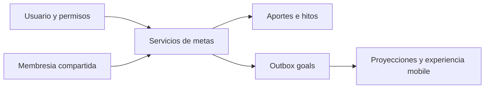
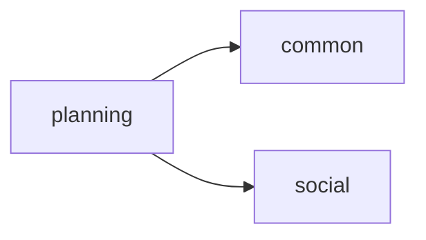

# planning

Planning organiza metas, hitos, proyecciones y colaboracion. La persistencia y
los servicios canonicos se consultan en cada submodulo.

- [goals](goals/README.md): metas, aportes, milestones y proyeccion explicable.
- [shared_goals](shared_goals/README.md): colaboracion y membresias.
- [milestones](milestones/README.md) y [projections](projections/README.md): capas reservadas o especializadas segun su evidencia local.

La vinculacion automatica de metas a movimientos no se considera implementada
sin una regla explicita; los aportes deben conservar atribucion y permisos.

<!-- backend-source-audit:start -->
## Evidencia del codigo y mapa de dependencias

Inventario estatico reproducible del checkout. Describe declaraciones e imports;
no prueba despliegue, permisos efectivos ni que todos los caminos se ejecuten.
Las rutas son locales a su URLConf: el prefijo publico se consulta en
[`api/v1/routers.py`](../api/v1/routers.py).

- Archivos Python de implementacion: **30** (excluye tests y migraciones).
- Huella SHA-256 del codigo inventariado: `49c3da1cf06baa7330bf0bf02203abeeab6e68d7ed0a932f4666c7c62c380b48`.
- Familias detectadas: models, serializers, services, views.

### Declaraciones de modelos detectadas

- `Goal` en [planning/goals/models/goals.py](goals/models/goals.py).
- `GoalContribution` en [planning/goals/models/goals.py](goals/models/goals.py).
- `GoalDomainEventOutbox` en [planning/goals/models/outbox.py](goals/models/outbox.py).
- `GoalMilestone` en [planning/goals/models/goals.py](goals/models/goals.py).
- `SharedGoal` en [planning/shared_goals/models.py](shared_goals/models.py).

### Rutas declaradas

| Patron local | Fuente |
| --- | --- |
| `` | [planning/goals/urls.py](goals/urls.py) |
| `` | [planning/shared_goals/urls.py](shared_goals/urls.py) |
| `aportes/ [DRF router]` | [planning/goals/urls.py](goals/urls.py) |
| `goals/ [DRF router]` | [planning/shared_goals/urls.py](shared_goals/urls.py) |
| `metas/ [DRF router]` | [planning/goals/urls.py](goals/urls.py) |
| `milestones/ [DRF router]` | [planning/goals/urls.py](goals/urls.py) |

### Diagrama de dependencia estatica

Las flechas representan imports entre paquetes, no eventos ni orden de ejecucion.

Flujos transversales: [flujo actualizado](../docs/BACKEND_CURRENT_FLOW.md).

Regeneracion: `py -3 scripts/audit_backend_docs.py --write`.
Comprobacion de deriva: `py -3 scripts/audit_backend_docs.py --check`.
<!-- backend-source-audit:end -->
