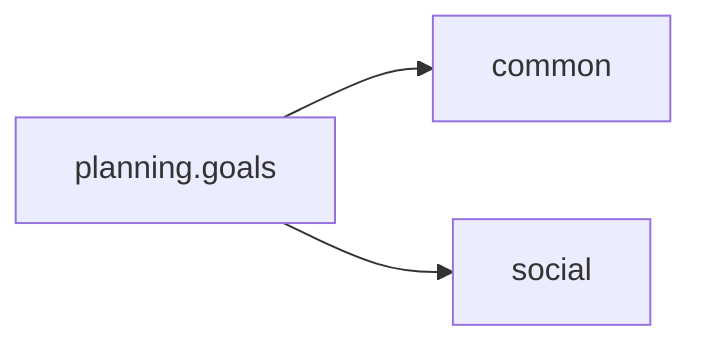

# planning.goals

## Responsabilidad

`planning.goals` modela metas financieras y conserva el ledger de aportes que
explica su progreso. El frontend muestra y captura decisiones; no escribe
`progress` directamente.

Entidades principales:

- `Goal`: objetivo, fecha, cuenta opcional, estado y progreso materializado
- `GoalContribution`: aporte inmutable o revertido con evidencia
- `GoalMilestone`: umbral auditable que se alcanza o reabre con el progreso
- `GoalDomainEventOutbox`: eventos durables del bounded context

## Flujo Del Usuario

1. crea una meta con objetivo mayor que cero
2. opcionalmente la vincula a una cuenta propia
3. registra aportes usando `Idempotency-Key`
4. el servicio bloquea la meta, persiste el aporte y recalcula `progress`
5. al alcanzar el objetivo, la meta pasa a `completed`
6. un aporte incorrecto se revierte; no se elimina
7. si el progreso vuelve a quedar bajo el objetivo, la meta se reabre

Estados:

- `active`: admite aportes
- `paused`: conserva progreso pero no admite aportes
- `completed`: alcanzo el objetivo
- `canceled`: cierre explicito con motivo

Transiciones HTTP:

- `POST /api/planning/goals/metas/<id>/pause/`
- `POST /api/planning/goals/metas/<id>/resume/`
- `POST /api/planning/goals/metas/<id>/cancel/`

## Aportes

- `POST /api/planning/goals/aportes/`
- `GET /api/planning/goals/aportes/?goal=<id>`
- `POST /api/planning/goals/aportes/<id>/reverse/`

El alta exige `Idempotency-Key` de 8 a 160 caracteres. Repetir la misma clave
con el mismo payload devuelve el aporte existente. Reutilizarla con datos
distintos devuelve error.

Un aporte puede referenciar una cuenta o transaccion propia. Si la meta ya
tiene cuenta, el aporte debe usar esa misma cuenta.

## Seguridad

- todos los querysets se filtran por `request.user`
- owner, progreso, estado y timestamps son de solo lectura
- cuentas y transacciones relacionadas se limitan al propietario
- no existe DELETE de metas con historia; se usa cancelacion
- los aportes se revierten y conservan monto, origen y motivo

## Eventos Y Runtime

Cada escritura relevante crea un evento en `goals_goaldomaineventoutbox` dentro
de la misma transaccion. El proceso local `domain-outbox` publica los eventos
de debts y goals sin introducir Celery, Redis o una cola adicional.

Eventos actuales:

- `goals.created.v1`
- `goals.updated.v1`
- `goals.status.changed.v1`
- `goals.contribution.recorded.v1`
- `goals.contribution.reversed.v1`
- `goals.progress.updated.v1`
- `goals.milestone.achieved.v1`
- `goals.milestone.reopened.v1`

## Migracion De Datos

El `progress` historico se preserva como un aporte `opening_balance`. Desde esa
migracion, `GoalContribution` es la fuente explicable y `Goal.progress` es una
proyeccion materializada.

## Soporte Y Administracion

La vista 360 solo muestra conteos. Django Admin permite consultar metas,
aportes y outbox, pero los aportes y eventos son read-only. Una correccion se
hace mediante reversion, nunca editando el ledger manualmente.

## Hitos, proyecciones y metas compartidas

- `POST /api/planning/goals/milestones/` administra hitos del owner.
- `GET /api/planning/goals/metas/<id>/projection/` calcula una proyeccion
  reproducible desde el historial; no escribe verdad contable.
- `planning.shared_goals` autoriza aportes de equipos activos sin transferir la
  propiedad de la meta ni de la cuenta.
- Toda contribucion conserva actor, cuenta, idempotencia y evidencia de
  reversion.

La vinculacion automatica a transacciones sigue pendiente de una regla
explicita y confirmable; una inferencia nunca crea un aporte silencioso.

<!-- backend-source-audit:start -->
## Evidencia del codigo y mapa de dependencias

Inventario estatico reproducible del checkout. Describe declaraciones e imports;
no prueba despliegue, permisos efectivos ni que todos los caminos se ejecuten.
Las rutas son locales a su URLConf: el prefijo publico se consulta en
[`api/v1/routers.py`](../../api/v1/routers.py).

- Archivos Python de implementacion: **12** (excluye tests y migraciones).
- Huella SHA-256 del codigo inventariado: `ebeb377dd492d36087ef69b185f2f2269a5c0e4b79dd898a62fe0d62a7aee8a2`.
- Familias detectadas: models, serializers, services, views.

### Declaraciones de modelos detectadas

- `Goal` en [planning/goals/models/goals.py](models/goals.py).
- `GoalContribution` en [planning/goals/models/goals.py](models/goals.py).
- `GoalDomainEventOutbox` en [planning/goals/models/outbox.py](models/outbox.py).
- `GoalMilestone` en [planning/goals/models/goals.py](models/goals.py).

### Rutas declaradas

| Patron local | Fuente |
| --- | --- |
| `` | [planning/goals/urls.py](urls.py) |
| `aportes/ [DRF router]` | [planning/goals/urls.py](urls.py) |
| `metas/ [DRF router]` | [planning/goals/urls.py](urls.py) |
| `milestones/ [DRF router]` | [planning/goals/urls.py](urls.py) |

### Diagrama de dependencia estatica

Las flechas representan imports entre paquetes, no eventos ni orden de ejecucion.

Flujos transversales: [flujo actualizado](../../docs/BACKEND_CURRENT_FLOW.md).

Regeneracion: `py -3 scripts/audit_backend_docs.py --write`.
Comprobacion de deriva: `py -3 scripts/audit_backend_docs.py --check`.
<!-- backend-source-audit:end -->
