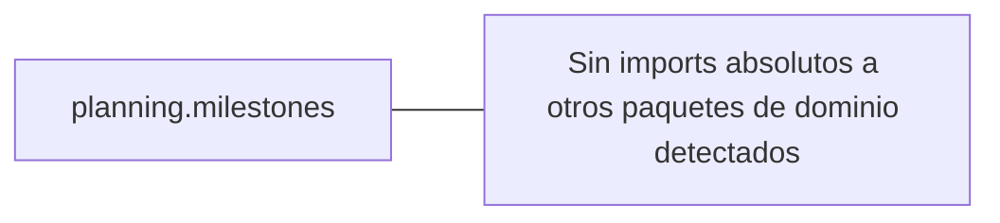

# planning.milestones

## Que hace

`planning.milestones` existe como contexto para hitos intermedios dentro de un
proceso de planning financiero.

Ejemplos conceptuales:

- pasos dentro de una meta
- puntos de seguimiento
- checkpoints de progreso

## Estado Del Codigo

El paquete permanece reservado para una futura separacion de bounded context.
La capacidad operativa actual vive deliberadamente en `planning.goals` como
`GoalMilestone`, porque el hito comparte aggregate, lock y outbox con la meta.

## Relacion Con Otros Modulos

- `planning.goals`
  ya modela metas como el contexto mas visible de planning.
- `planning.projections`
  puede aportar escenarios futuros.
- `planning.shared_goals`
  podria abrir colaboracion sobre objetivos.

## Encaje Con El Negocio

La idea encaja con el core de Vexxo porque el producto no solo observa dinero;
tambien deberia ayudar a decidir y planear. Los hitos son una forma natural de
convertir una meta grande en pasos comprensibles.

## Encaje Con GCP

Cuando madure, este contexto probablemente sera una capa CRUD y de proyeccion
sobre Cloud SQL, con derivaciones async por eventos o workers.

## Estado Actual

La API activa es `POST /api/planning/goals/milestones/`. No se duplica aqui
para evitar dos fuentes de verdad. Una separacion futura requerira migracion de
datos, contrato versionado y compatibilidad explicita.

<!-- backend-source-audit:start -->
## Evidencia del codigo y mapa de dependencias

Inventario estatico reproducible del checkout. Describe declaraciones e imports;
no prueba despliegue, permisos efectivos ni que todos los caminos se ejecuten.
Las rutas son locales a su URLConf: el prefijo publico se consulta en
[`api/v1/routers.py`](../../api/v1/routers.py).

- Archivos Python de implementacion: **5** (excluye tests y migraciones).
- Huella SHA-256 del codigo inventariado: `8b5cb05accb30fbbf148241275ba54b1ed2fabd804282bdcf11f79ff00eb6934`.
- Familias detectadas: models, views.

No se detectan declaraciones `path`/`re_path` propias en este alcance.
Esto no implica que el modulo carezca de consumidores internos.

### Diagrama de dependencia estatica

Las flechas representan imports entre paquetes, no eventos ni orden de ejecucion.

Flujos transversales: [flujo actualizado](../../docs/BACKEND_CURRENT_FLOW.md).

Regeneracion: `py -3 scripts/audit_backend_docs.py --write`.
Comprobacion de deriva: `py -3 scripts/audit_backend_docs.py --check`.
<!-- backend-source-audit:end -->
