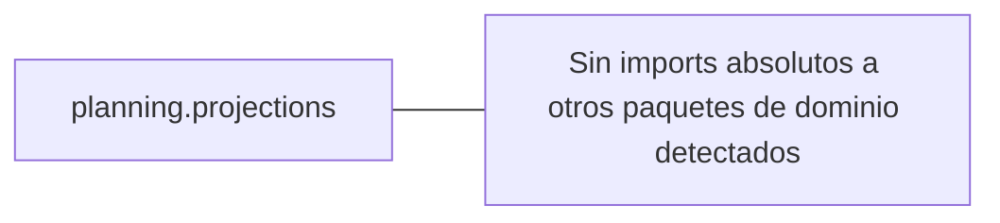

# planning.projections

## Que hace

`planning.projections` existe como lugar para escenarios y proyecciones
financieras futuras.

Ejemplos conceptuales:

- evolucion estimada de una meta
- cashflow futuro
- simulaciones de ahorro, deuda o inversion

## Estado Del Codigo

El paquete permanece reservado para escenarios multi-dominio. La proyeccion
operativa inicial de metas vive en `planning.goals` para mantener juntas sus
reglas, permisos y supuestos.

## Relacion Con Otros Modulos

- `planning.goals`
  metas sobre las que pueden construirse proyecciones.
- `reports.reports` y `reports.summaries`
  consumen pasado y presente; este modulo apunta a futuro.
- `alerts`
  podria usar proyecciones para alertas inteligentes.

## Rol En El Producto

Esto toca directamente el loop de Vexxo:

- observar
- interpretar
- decidir

Las proyecciones son una pieza natural del paso de interpretar a decidir.

## Encaje Con GCP

Cuando se materialice, podria apoyarse en:

- Cloud Run para calculo y API
- BigQuery o pipelines analiticos para features
- Gemini o modelos auxiliares para explicacion

## Estado Actual

`GET /api/planning/goals/metas/<id>/projection/` calcula velocidad historica,
fecha estimada y aporte mensual requerido. Es determinista y no modifica el
ledger. Este paquete no expone una segunda API hasta que existan escenarios
transversales versionados.

<!-- backend-source-audit:start -->
## Evidencia del codigo y mapa de dependencias

Inventario estatico reproducible del checkout. Describe declaraciones e imports;
no prueba despliegue, permisos efectivos ni que todos los caminos se ejecuten.
Las rutas son locales a su URLConf: el prefijo publico se consulta en
[`api/v1/routers.py`](../../api/v1/routers.py).

- Archivos Python de implementacion: **5** (excluye tests y migraciones).
- Huella SHA-256 del codigo inventariado: `7c78005074e5b8949ea1527409d128b5cae5d789a7c059b8d707ec4a75ace95c`.
- Familias detectadas: models, views.

No se detectan declaraciones `path`/`re_path` propias en este alcance.
Esto no implica que el modulo carezca de consumidores internos.

### Diagrama de dependencia estatica

Las flechas representan imports entre paquetes, no eventos ni orden de ejecucion.

Flujos transversales: [flujo actualizado](../../docs/BACKEND_CURRENT_FLOW.md).

Regeneracion: `py -3 scripts/audit_backend_docs.py --write`.
Comprobacion de deriva: `py -3 scripts/audit_backend_docs.py --check`.
<!-- backend-source-audit:end -->
