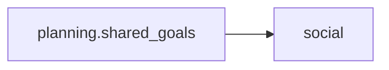

# planning.shared_goals

## Responsabilidad

Comparte una meta existente con un `social.teams.Team` sin transferir su
ownership. La meta y su verdad financiera conservan un owner; cada aporte
conserva su propio contributor, cuenta y transaccion.

## API

- `GET|POST /api/planning/shared-goals/goals/`
- `PATCH /api/planning/shared-goals/goals/{id}/`
- `POST .../{id}/revoke/`
- `GET .../{id}/projection/`

`contribution_policy=members` permite aportar a miembros activos.
`contribution_policy=managers` limita aportes a owner/accountant. Revocar es
explicito, requiere motivo y no elimina aportes historicos.

## Limites

- usa las membresias e invitaciones existentes de teams
- todavia no hay invitacion exclusiva por meta
- no distribuye ownership contable ni permite usar cuentas de otro miembro

<!-- backend-source-audit:start -->
## Evidencia del codigo y mapa de dependencias

Inventario estatico reproducible del checkout. Describe declaraciones e imports;
no prueba despliegue, permisos efectivos ni que todos los caminos se ejecuten.
Las rutas son locales a su URLConf: el prefijo publico se consulta en
[`api/v1/routers.py`](../../api/v1/routers.py).

- Archivos Python de implementacion: **8** (excluye tests y migraciones).
- Huella SHA-256 del codigo inventariado: `d2024527d82a50c8f8c460510ebb8e244dfe6e8a0d42f463c17c638a996d9e14`.
- Familias detectadas: models, serializers, services, views.

### Declaraciones de modelos detectadas

- `SharedGoal` en [planning/shared_goals/models.py](models.py).

### Rutas declaradas

| Patron local | Fuente |
| --- | --- |
| `` | [planning/shared_goals/urls.py](urls.py) |
| `goals/ [DRF router]` | [planning/shared_goals/urls.py](urls.py) |

### Diagrama de dependencia estatica

Las flechas representan imports entre paquetes, no eventos ni orden de ejecucion.

Flujos transversales: [flujo actualizado](../../docs/BACKEND_CURRENT_FLOW.md).

Regeneracion: `py -3 scripts/audit_backend_docs.py --write`.
Comprobacion de deriva: `py -3 scripts/audit_backend_docs.py --check`.
<!-- backend-source-audit:end -->
