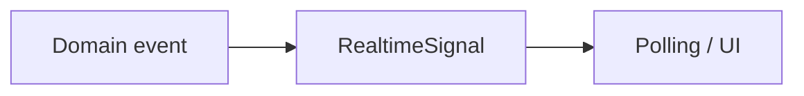
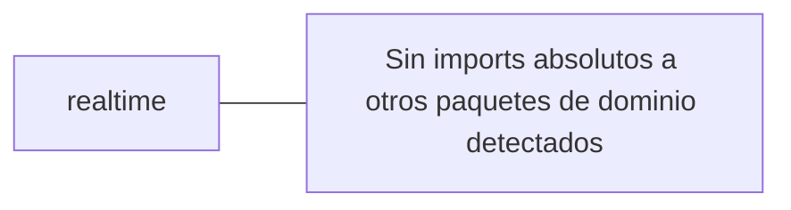

# realtime

## Modulos reservados importables

`redis_channels.py`, `routing.py`, `typing.py` y `unread_counters.py` contienen
documentacion en docstrings validos. No inicializan Redis, Channels ni sockets.
El routing HTTP vigente sigue en `realtime.consumers.urls`; ASGI sigue usando
Django. Se validan sus imports en `identity.users.test_import_contracts`.

## Que hace

`realtime` guarda senales tecnicas livianas para feedback rapido de la app.

No es un inbox funcional ni un stream de negocio duradero. Es una capa de UX y
observabilidad de bajo costo.

## Documento canonico y subdocumentos

Este README es el documento canonico del modulo `realtime`.

Subdocumento derivado:

- [consumers/README.md](https://gitlab.com/vexxo-sas/vexxo_backend_api/-/blob/development/realtime/consumers/README.md)
  detalle del modelo `RealtimeSignal`, lectura por API y semantica operativa

## Vista visual

## Estado Actual

Hoy el modulo funciona principalmente con `RealtimeSignal` persistido.

Eso permite:

- polling barato desde mobile/web
- inspeccion operativa por soporte
- desacoplar feedback interactivo del bus de dominio fuerte

## Por Que Existe

La app necesita feedback rapido, pero no todo merece:

- inbox durable
- notificacion funcional
- dependencia directa del bus fuerte

`realtime` existe para cubrir ese espacio intermedio.

## Diferencia Frente a Notifications

- `notifications`:
  mensaje funcional y durable para el usuario
- `realtime`:
  señal tecnica corta para superficies interactivas

Ejemplo:

- `payments.intent.processing` puede reflejarse como `RealtimeSignal`
- un problema serio o una accion importante puede terminar tambien en inbox

## Flujo General

1. un bounded context emite evento fuerte
2. listener local o servicio especifico traduce eso a `RealtimeSignal`
3. mobile/web consulta `realtime/consumers`
4. la UI actualiza estado o badges sin tener que esperar procesamiento largo

## Relacion Con Otros Modulos

- `finance.accounts`: publica cambios de balance, sync y membresias
- `payments.payment_intents`: publica progreso de intents y payouts
- `notifications`: cubre la capa durable que `realtime` no pretende cubrir

## Encaje Con GCP

La estrategia esperada es:

- hoy: polling desde API Gateway/BFF contra Cloud SQL
- mañana: SSE, WebSocket gateway o Redis/Memorystore para presencia y baja latencia

Este modulo ya deja la semantica lista para migrar a una capa mas viva sin
romper el contrato de la app.

## Futuro Natural

Los archivos vacios actuales (`presence.py`, `redis_channels.py`, `routing.py`,
`unread_counters.py`) son placeholders del camino cloud-native:

- presencia
- fan-out por canales
- gateways WebSocket/SSE
- contadores en memoria o Redis

La fuente semantica actual sigue siendo `RealtimeSignal`.

## Politicas Del Modulo

- una senal realtime debe ser barata y simple
- no debe cargar logica de negocio rica
- no debe reemplazar outbox ni auditoria
- debe poder migrar a gateways vivos sin romper el contrato de lectura

<!-- backend-source-audit:start -->
## Evidencia del codigo y mapa de dependencias

Inventario estatico reproducible del checkout. Describe declaraciones e imports;
no prueba despliegue, permisos efectivos ni que todos los caminos se ejecuten.
Las rutas son locales a su URLConf: el prefijo publico se consulta en
[`api/v1/routers.py`](../api/v1/routers.py).

- Archivos Python de implementacion: **11** (excluye tests y migraciones).
- Huella SHA-256 del codigo inventariado: `6d26bb85b2c58f5489ac523a675005cba7b4e1eed8bbd5dbad22bfe9333fa905`.
- Familias detectadas: models, views.

### Declaraciones de modelos detectadas

- `RealtimeSignal` en [realtime/consumers/models.py](consumers/models.py).

### Rutas declaradas

| Patron local | Fuente |
| --- | --- |
| `` | [realtime/consumers/urls.py](consumers/urls.py) |
| `senales-realtime/ [DRF router]` | [realtime/consumers/urls.py](consumers/urls.py) |

### Diagrama de dependencia estatica

Las flechas representan imports entre paquetes, no eventos ni orden de ejecucion.

Flujos transversales: [flujo actualizado](../docs/BACKEND_CURRENT_FLOW.md).

Regeneracion: `py -3 scripts/audit_backend_docs.py --write`.
Comprobacion de deriva: `py -3 scripts/audit_backend_docs.py --check`.
<!-- backend-source-audit:end -->
