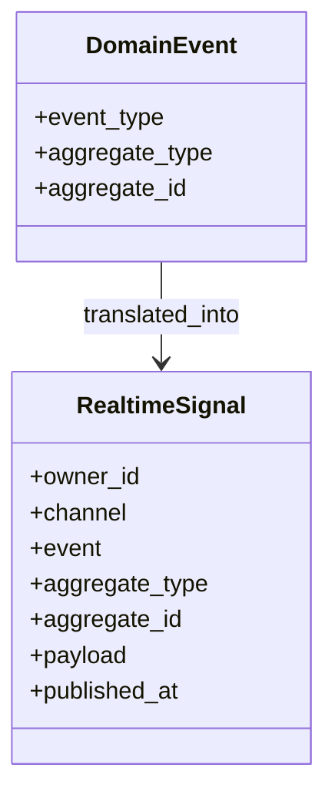
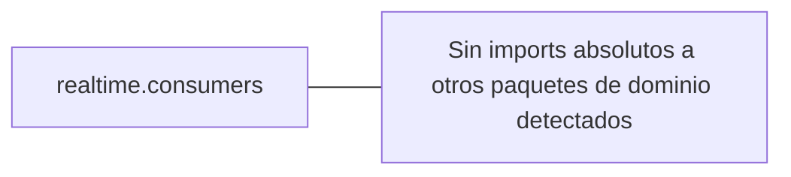

# realtime.consumers

## Que hace

`realtime.consumers` persiste `RealtimeSignal`, una capa liviana de feedback
interactivo para mobile/web.

No pretende ser:

- el bus de dominio
- el inbox durable
- un stream garantizado de negocio

Su objetivo es dar a la UI una superficie barata para polling y depuracion.

## Alcance documental

Este README es derivado del documento canonico del modulo:

- [realtime/README.md](https://gitlab.com/vexxo-sas/vexxo_backend_api/-/blob/development/realtime/README.md)

Su foco es `RealtimeSignal` y la capa de consumo/lectura.

## Vista visual

## Flujo Principal

1. un bounded context produce un cambio relevante
2. un listener o servicio lo traduce a `RealtimeSignal`
3. mobile/web consulta la API de senales
4. la UI actualiza estado, badges o progresos sin esperar procesos mas pesados

## Campos Semanticos

Una `RealtimeSignal` suele guardar:

- `channel`
- `event`
- `aggregate_type`
- `aggregate_id`
- `payload`

Eso permite filtrar por recurso y por tipo de evento sin depender del bus
interno completo.

## Relacion Con Otros Modulos

- `finance.accounts`
  publica cambios de balance, sync y memberships
- `payments.payment_intents`
  publica progreso de intents y payouts
- `notifications`
  cubre lo durable que `RealtimeSignal` no quiere cubrir

## Encaje Con GCP

Hoy funciona bien con Cloud SQL + polling.

Mañana puede evolucionar a:

- SSE
- WebSocket gateway
- Redis/Memorystore
- canales por usuario o aggregate

sin cambiar la semantica de `event`, `channel` y `aggregate`.

## Casos De Uso

- estado de un pago: `processing -> requires_action -> succeeded`
- cambio rapido de saldo o sync de cuenta
- señal tecnica para refrescar una vista especifica

## Politicas Del Modulo

- una señal debe ser pequeña y facil de interpretar
- no debe reemplazar el feed de notificaciones ni el audit log
- debe estar alineada con eventos fuertes, no inventar semantica paralela

## Estado Actual

Hoy se expone por API de lectura y sirve para polling.

La evolucion futura puede mover el transporte, pero no deberia romper la forma
de `channel`, `event`, `aggregate_type` y `aggregate_id`.

<!-- backend-source-audit:start -->
## Evidencia del codigo y mapa de dependencias

Inventario estatico reproducible del checkout. Describe declaraciones e imports;
no prueba despliegue, permisos efectivos ni que todos los caminos se ejecuten.
Las rutas son locales a su URLConf: el prefijo publico se consulta en
[`api/v1/routers.py`](../../api/v1/routers.py).

- Archivos Python de implementacion: **6** (excluye tests y migraciones).
- Huella SHA-256 del codigo inventariado: `639f0094bb353afe9f85a411ce29f595e12f54d391b4d06396f0a8a8b3796ddb`.
- Familias detectadas: models, views.

### Declaraciones de modelos detectadas

- `RealtimeSignal` en [realtime/consumers/models.py](models.py).

### Rutas declaradas

| Patron local | Fuente |
| --- | --- |
| `` | [realtime/consumers/urls.py](urls.py) |
| `senales-realtime/ [DRF router]` | [realtime/consumers/urls.py](urls.py) |

### Diagrama de dependencia estatica

Las flechas representan imports entre paquetes, no eventos ni orden de ejecucion.

Flujos transversales: [flujo actualizado](../../docs/BACKEND_CURRENT_FLOW.md).

Regeneracion: `py -3 scripts/audit_backend_docs.py --write`.
Comprobacion de deriva: `py -3 scripts/audit_backend_docs.py --check`.
<!-- backend-source-audit:end -->
