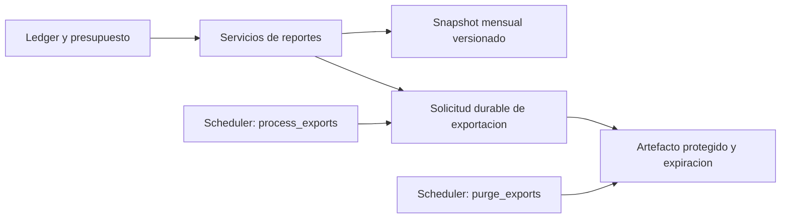
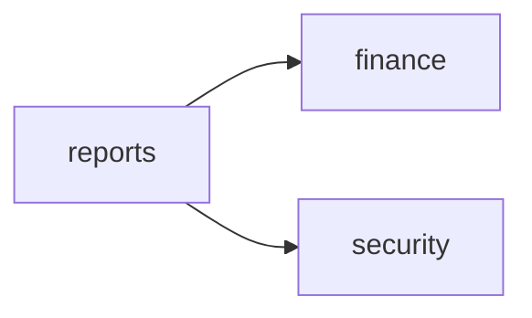

# reports

Reports ofrece lectura financiera, cierres mensuales y exports. Los snapshots
son resultados versionados; no sustituyen la fuente contable transactions.

- [reports](reports/README.md): API y servicios de consultas y exportacion.
- [monthly_reports](monthly_reports/README.md): cierres por periodo.
- [snapshots](snapshots/README.md): persistencia de snapshots.
- [exports](exports/README.md): exportacion y su ciclo de vida.
- [summaries](summaries/README.md): alcance de la capa de resumen.

El scheduler registra procesamiento cada 15 segundos y purga cada 3600 segundos;
estos son intervalos del catalogo, no SLA de finalizacion. Consultar retencion y
autorizacion en los servicios de exports antes de operar sobre artefactos.

<!-- backend-source-audit:start -->
## Evidencia del codigo y mapa de dependencias

Inventario estatico reproducible del checkout. Describe declaraciones e imports;
no prueba despliegue, permisos efectivos ni que todos los caminos se ejecuten.
Las rutas son locales a su URLConf: el prefijo publico se consulta en
[`api/v1/routers.py`](../api/v1/routers.py).

- Archivos Python de implementacion: **31** (excluye tests y migraciones).
- Huella SHA-256 del codigo inventariado: `0ac68d19fddda0e603aa73e8a46e97684973c97957322ab93c7592be639271ec`.
- Familias detectadas: models, serializers, services, views.

### Declaraciones de modelos detectadas

- `MonthlyReportClose` en [reports/monthly_reports/models.py](monthly_reports/models.py).
- `ReportExport` en [reports/exports/models.py](exports/models.py).
- `ReportSnapshot` en [reports/snapshots/models.py](snapshots/models.py).

### Rutas declaradas

| Patron local | Fuente |
| --- | --- |
| `exports/` | [reports/reports/urls.py](reports/urls.py) |
| `exports/<uuid:export_id>/download/` | [reports/reports/urls.py](reports/urls.py) |
| `monthly-closes/` | [reports/monthly_reports/urls.py](monthly_reports/urls.py) |
| `reportes/cashflow` | [reports/reports/urls.py](reports/urls.py) |
| `reportes/gastos-por-categoria` | [reports/reports/urls.py](reports/urls.py) |
| `reportes/presupuestos-mensuales` | [reports/reports/urls.py](reports/urls.py) |
| `snapshots/` | [reports/reports/urls.py](reports/urls.py) |

### Diagrama de dependencia estatica

Las flechas representan imports entre paquetes, no eventos ni orden de ejecucion.

Flujos transversales: [flujo actualizado](../docs/BACKEND_CURRENT_FLOW.md).

Regeneracion: `py -3 scripts/audit_backend_docs.py --write`.
Comprobacion de deriva: `py -3 scripts/audit_backend_docs.py --check`.
<!-- backend-source-audit:end -->
