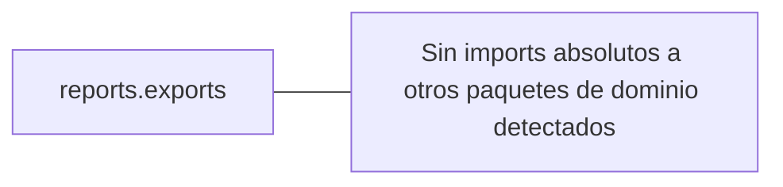

# reports.exports

## Que hace

`reports.exports` existe como contexto para exportaciones de reporting:

- archivos descargables
- paquetes para soporte
- artefactos de analitica o auditoria

## Estado Del Codigo

El modulo esta operativo con jobs durables, cifrado obligatorio, expiracion,
descarga de un solo uso y purga criptografica del artefacto.

## Relacion Con Otros Modulos

- `reports.reports`
  agrega datos de ledger.
- `reports.summaries`
  podria producir snapshots compactos.
- `documents.storage`
  destino natural de archivos de export.
- `support.audit`
  trazabilidad de quien exporto que.

## Encaje Con GCP

Cuando madure, este modulo tiene una relacion muy clara con:

- Cloud Storage para archivos
- Cloud Run workers para generar exports
- Cloud Tasks o Scheduler para jobs asincronos

## Estado Actual

Los exports se crean desde snapshots inmutables, se procesan mediante
`scheduler-local`, se cifran y expiran 24 horas despues de quedar listos. El
token de descarga se entrega una vez y solo se persiste su hash.

`reports.process_exports` genera los artefactos y `reports.purge_exports`
elimina ciphertext, nonce y DEK envuelto una vez vencida la retencion. Un
`legal_hold` impide la purga y el registro restante funciona como tombstone de
auditoria.

API: `POST /api/reports/exports/` y `GET
/api/reports/exports/{uuid}/download/` con `X-Download-Token`. El keyring es
obligatorio: nunca se produce un export sensible sin cifrar.

<!-- backend-source-audit:start -->
## Evidencia del codigo y mapa de dependencias

Inventario estatico reproducible del checkout. Describe declaraciones e imports;
no prueba despliegue, permisos efectivos ni que todos los caminos se ejecuten.
Las rutas son locales a su URLConf: el prefijo publico se consulta en
[`api/v1/routers.py`](../../api/v1/routers.py).

- Archivos Python de implementacion: **5** (excluye tests y migraciones).
- Huella SHA-256 del codigo inventariado: `b6e4616057cfbb30c70093ac4a34c78955040c348a922a2c63a604efc954e01d`.
- Familias detectadas: models, views.

### Declaraciones de modelos detectadas

- `ReportExport` en [reports/exports/models.py](models.py).

No se detectan declaraciones `path`/`re_path` propias en este alcance.
Esto no implica que el modulo carezca de consumidores internos.

### Diagrama de dependencia estatica

Las flechas representan imports entre paquetes, no eventos ni orden de ejecucion.

Flujos transversales: [flujo actualizado](../../docs/BACKEND_CURRENT_FLOW.md).

Regeneracion: `py -3 scripts/audit_backend_docs.py --write`.
Comprobacion de deriva: `py -3 scripts/audit_backend_docs.py --check`.
<!-- backend-source-audit:end -->
