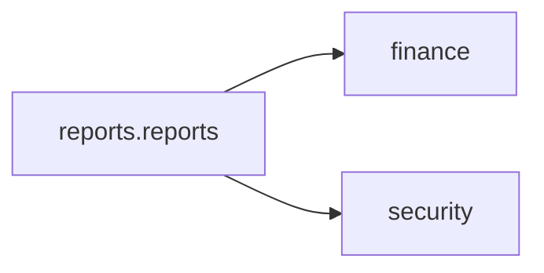

# reports.reports

## Que hace

`reports.reports` expone reportes agregados simples sobre el ledger.

Su responsabilidad actual es:

- cashflow
- gastos por categoria
- resumen mensual de presupuestos personales y compartidos

## Rol En El Producto

Este contexto convierte transacciones en lectura agregada para el usuario.

De cara al cliente sirve para:

- ver ingresos, gastos y neto
- entender distribucion de gasto por categoria

## Flujo Principal

1. el API recibe filtros o periodo
2. consulta `finance.transactions`
3. agrega resultados
4. devuelve un resumen listo para la app

## Relacion Con Otros Modulos

- `finance.transactions`
  es la fuente principal de datos
- `finance.categories`
  aporta la dimension por categoria
- `finance.accounts`
  puede complementar vistas futuras por cuenta
- `finance.budgets`
  aporta el resumen mensual de presupuestos:
  - personales por categoria
  - compartidos por equipo
  - con metricas `planned/actual/committed/projected`

## Encaje Con GCP

Hoy estos reportes salen de Cloud SQL y sirven para lecturas operativas simples.

Importante:

- para analitica compleja o dashboards grandes, la evolucion natural es usar
  BigQuery
- este modulo no deberia crecer hacia queries muy pesadas en OLTP

## Estado Actual

Hoy expone tres vistas:

- `CashflowView`
- `GastosPorCategoriaView`
- `BudgetMonthlySummaryView`

Son reportes directos y utiles, pero aun no constituyen una capa analitica
amplia ni un data product separado.

<!-- backend-source-audit:start -->
## Evidencia del codigo y mapa de dependencias

Inventario estatico reproducible del checkout. Describe declaraciones e imports;
no prueba despliegue, permisos efectivos ni que todos los caminos se ejecuten.
Las rutas son locales a su URLConf: el prefijo publico se consulta en
[`api/v1/routers.py`](../../api/v1/routers.py).

- Archivos Python de implementacion: **9** (excluye tests y migraciones).
- Huella SHA-256 del codigo inventariado: `e030257d777366ea2eeb9285029c927beb6a7df9299c858ad70152122a3cacba`.
- Familias detectadas: models, serializers, services, views.

### Rutas declaradas

| Patron local | Fuente |
| --- | --- |
| `exports/` | [reports/reports/urls.py](urls.py) |
| `exports/<uuid:export_id>/download/` | [reports/reports/urls.py](urls.py) |
| `reportes/cashflow` | [reports/reports/urls.py](urls.py) |
| `reportes/gastos-por-categoria` | [reports/reports/urls.py](urls.py) |
| `reportes/presupuestos-mensuales` | [reports/reports/urls.py](urls.py) |
| `snapshots/` | [reports/reports/urls.py](urls.py) |

### Diagrama de dependencia estatica

Las flechas representan imports entre paquetes, no eventos ni orden de ejecucion.

Flujos transversales: [flujo actualizado](../../docs/BACKEND_CURRENT_FLOW.md).

Regeneracion: `py -3 scripts/audit_backend_docs.py --write`.
Comprobacion de deriva: `py -3 scripts/audit_backend_docs.py --check`.
<!-- backend-source-audit:end -->
