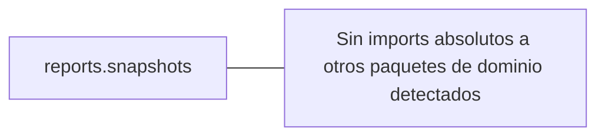

# reports.snapshots

## Que hace

`reports.snapshots` existe como contexto para snapshots persistidos de
reporting.

## Estado Del Codigo

El modulo esta operativo. Persiste snapshots inmutables con periodo, moneda,
zona horaria, `as_of`, version, hash canonico y lineage de regeneracion.

## Por Que Existe

Los snapshots sirven para separar:

- calculo costoso o agregacion historica
- lectura rapida para mobile o soporte

Eso encaja con una arquitectura donde los requests web deben ser ligeros y
parte del trabajo se mueve a jobs o proyecciones.

## Relacion Con Otros Modulos

- `reports.reports`
  lecturas agregadas basadas en ledger.
- `reports.monthly_reports`
  posible consumidor o publicador de snapshots.
- `common` e `identity.eventing`
  patron general de read models del sistema.

## Encaje Con GCP

Cuando se materialice:

- Cloud Run workers pueden construir snapshots
- Cloud SQL o BigQuery pueden alojar resultados segun el caso
- Scheduler puede disparar cierres periodicos

## Estado Actual

`POST /api/reports/snapshots/` exige `Idempotency-Key`. Los tipos activos son
`cashflow`, `expenses_by_category` y `monthly_close`, siempre sobre ledger
autorizado. Una regeneracion nunca modifica el snapshot anterior: crea una
nueva version y conserva `supersedes` y el motivo.

<!-- backend-source-audit:start -->
## Evidencia del codigo y mapa de dependencias

Inventario estatico reproducible del checkout. Describe declaraciones e imports;
no prueba despliegue, permisos efectivos ni que todos los caminos se ejecuten.
Las rutas son locales a su URLConf: el prefijo publico se consulta en
[`api/v1/routers.py`](../../api/v1/routers.py).

- Archivos Python de implementacion: **5** (excluye tests y migraciones).
- Huella SHA-256 del codigo inventariado: `7959a40ef520f278ee764c3dd6a803f0e4967a8ec4e4fa55f48931653dae78a0`.
- Familias detectadas: models, views.

### Declaraciones de modelos detectadas

- `ReportSnapshot` en [reports/snapshots/models.py](models.py).

No se detectan declaraciones `path`/`re_path` propias en este alcance.
Esto no implica que el modulo carezca de consumidores internos.

### Diagrama de dependencia estatica

Las flechas representan imports entre paquetes, no eventos ni orden de ejecucion.

Flujos transversales: [flujo actualizado](../../docs/BACKEND_CURRENT_FLOW.md).

Regeneracion: `py -3 scripts/audit_backend_docs.py --write`.
Comprobacion de deriva: `py -3 scripts/audit_backend_docs.py --check`.
<!-- backend-source-audit:end -->
