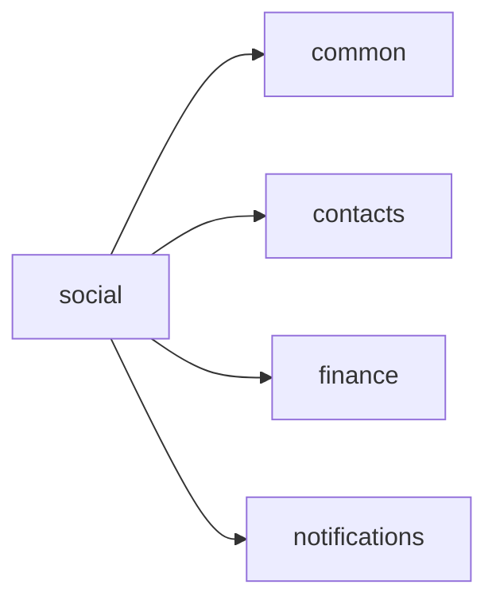

# social

## Que hace

`social` agrupa contextos relacionados con colaboracion, pertenencia y
experiencias compartidas entre usuarios.

No todos los submodulos estan igual de maduros. Hoy conviven:

- un modulo operativo claro: `social.teams`
- varios contextos reservados o scaffold:
  - `chat`
  - `contacts`
  - `documents_shared`
  - `groups`
  - `invitations`
  - `memberships`
  - `shared_expenses`

## Rol En El Producto

Vexxo no solo quiere mostrar dinero individual. Tambien busca soportar
colaboracion real:

- trabajo en equipo
- gastos compartidos
- invitaciones
- pertenencias y grupos

## Relacion Con Otros Modulos

- `finance.accounts`
  sharing financiero y membresias operativas.
- `planning.shared_goals`
  metas compartidas futuras.
- `documents`
  contenido o comprobantes compartibles.
- `notifications` y `realtime`
  feedback para experiencias colaborativas.

## Encaje Con GCP

Estos contextos pueden evolucionar en Cloud Run y Cloud SQL, con realtime
liviano o consumidores dedicados si la experiencia colaborativa crece.

## Estado Actual

`social.teams` es hoy la pieza mas concreta del bloque social. Los demas
submodulos deben leerse como contexto reservado salvo que su README indique una
superficie funcional mas real.

<!-- backend-source-audit:start -->
## Evidencia del codigo y mapa de dependencias

Inventario estatico reproducible del checkout. Describe declaraciones e imports;
no prueba despliegue, permisos efectivos ni que todos los caminos se ejecuten.
Las rutas son locales a su URLConf: el prefijo publico se consulta en
[`api/v1/routers.py`](../api/v1/routers.py).

- Archivos Python de implementacion: **53** (excluye tests y migraciones).
- Huella SHA-256 del codigo inventariado: `d9ba8fbc2491a5233d58a343ef10c60b2a7aa3ebc224ec2d26de691ef31dcf52`.
- Familias detectadas: models, serializers, services, views.

### Declaraciones de modelos detectadas

- `Membership` en [social/teams/models/membership.py](teams/models/membership.py).
- `SharedExpense` en [social/shared_expenses/models.py](shared_expenses/models.py).
- `SharedExpenseDomainEventOutbox` en [social/shared_expenses/models.py](shared_expenses/models.py).
- `SharedExpenseSettlement` en [social/shared_expenses/models.py](shared_expenses/models.py).
- `SharedExpenseShare` en [social/shared_expenses/models.py](shared_expenses/models.py).
- `Team` en [social/teams/models/team.py](teams/models/team.py).
- `TeamInvitation` en [social/invitations/models.py](invitations/models.py).

### Rutas declaradas

| Patron local | Fuente |
| --- | --- |
| `` | [social/invitations/urls.py](invitations/urls.py) |
| `` | [social/shared_expenses/urls.py](shared_expenses/urls.py) |
| `` | [social/teams/urls.py](teams/urls.py) |
| `equipos/ [DRF router]` | [social/teams/urls.py](teams/urls.py) |
| `miembros/ [DRF router]` | [social/teams/urls.py](teams/urls.py) |
| `shared-expenses/ [DRF router]` | [social/shared_expenses/urls.py](shared_expenses/urls.py) |
| `team-invitations/ [DRF router]` | [social/invitations/urls.py](invitations/urls.py) |

### Diagrama de dependencia estatica

Las flechas representan imports entre paquetes, no eventos ni orden de ejecucion.

Flujos transversales: [flujo actualizado](../docs/BACKEND_CURRENT_FLOW.md).

Regeneracion: `py -3 scripts/audit_backend_docs.py --write`.
Comprobacion de deriva: `py -3 scripts/audit_backend_docs.py --check`.
<!-- backend-source-audit:end -->
