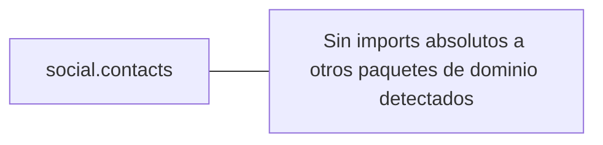

# social.contacts

## Que hace

`social.contacts` existe como contexto social reservado para relaciones entre
usuarios o participantes, distinto del modulo operativo `contacts/`.

## Importante

Hoy el modulo real de contactos financieros reutilizables del producto es
`contacts`, no este app.

## Estado Del Codigo

Este submodulo social esta en scaffold:

- `models.py` vacio
- `views.py` vacio

## Relacion Con Otros Modulos

- `contacts`
  resuelve el caso operativo actual de contactos financieros.
- `social.teams`
  puede aportar relaciones de grupo.
- `payments`
  podria usar contactos como beneficiarios futuros.

## Estado Actual

No debe documentarse como capacidad activa. El contexto existente y usable hoy
para contactos es `contacts/`.

<!-- backend-source-audit:start -->
## Evidencia del codigo y mapa de dependencias

Inventario estatico reproducible del checkout. Describe declaraciones e imports;
no prueba despliegue, permisos efectivos ni que todos los caminos se ejecuten.
Las rutas son locales a su URLConf: el prefijo publico se consulta en
[`api/v1/routers.py`](../../api/v1/routers.py).

- Archivos Python de implementacion: **5** (excluye tests y migraciones).
- Huella SHA-256 del codigo inventariado: `a926af09b5a0209d7db84f0e083602da90fcf1b1ac776f3748a48d5912e9d1bc`.
- Familias detectadas: models, views.

No se detectan declaraciones `path`/`re_path` propias en este alcance.
Esto no implica que el modulo carezca de consumidores internos.

### Diagrama de dependencia estatica

Las flechas representan imports entre paquetes, no eventos ni orden de ejecucion.

Flujos transversales: [flujo actualizado](../../docs/BACKEND_CURRENT_FLOW.md).

Regeneracion: `py -3 scripts/audit_backend_docs.py --write`.
Comprobacion de deriva: `py -3 scripts/audit_backend_docs.py --check`.
<!-- backend-source-audit:end -->
