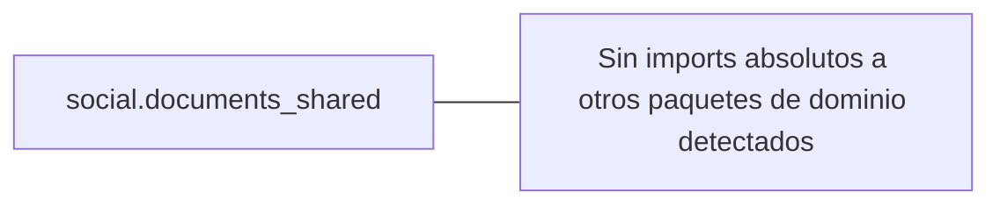

# social.documents_shared

## Que hace

`social.documents_shared` existe para compartir documentos o evidencias entre
usuarios, equipos o grupos.

## Estado Del Codigo

Hoy esta en scaffold:

- `models.py` vacio
- `views.py` vacio

## Relacion Con Otros Modulos

- `documents`
  almacenamiento, metadata, OCR y links documentales.
- `social.teams`
  podria aportar ownership grupal.
- `social.shared_expenses`
  podria necesitar comprobantes compartidos.

## Encaje Con El Negocio

Tiene sentido para:

- comprobantes de gastos compartidos
- soportes de pago
- evidencia de acuerdos o metas grupales

## Estado Actual

Contexto reservado sin implementacion publica detectada.

<!-- backend-source-audit:start -->
## Evidencia del codigo y mapa de dependencias

Inventario estatico reproducible del checkout. Describe declaraciones e imports;
no prueba despliegue, permisos efectivos ni que todos los caminos se ejecuten.
Las rutas son locales a su URLConf: el prefijo publico se consulta en
[`api/v1/routers.py`](../../api/v1/routers.py).

- Archivos Python de implementacion: **5** (excluye tests y migraciones).
- Huella SHA-256 del codigo inventariado: `55715a3a53fd5b4be38df089468c97d5d0b53fc351350f4f338b0b9f474a16f3`.
- Familias detectadas: models, views.

No se detectan declaraciones `path`/`re_path` propias en este alcance.
Esto no implica que el modulo carezca de consumidores internos.

### Diagrama de dependencia estatica

Las flechas representan imports entre paquetes, no eventos ni orden de ejecucion.

Flujos transversales: [flujo actualizado](../../docs/BACKEND_CURRENT_FLOW.md).

Regeneracion: `py -3 scripts/audit_backend_docs.py --write`.
Comprobacion de deriva: `py -3 scripts/audit_backend_docs.py --check`.
<!-- backend-source-audit:end -->
