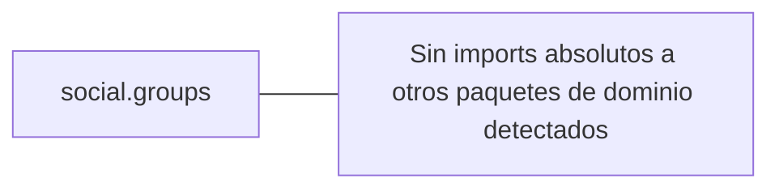

# social.groups

## Que hace

`social.groups` existe como contexto para grupos sociales generales mas amplios
que una sola cuenta o una sola meta.

## Estado Del Codigo

Hoy el modulo esta en scaffold:

- `models.py` vacio
- `views.py` vacio

## Relacion Con Otros Modulos

- `social.teams`
  hoy es el contexto operativo mas cercano a grupos.
- `social.memberships`
  podria modelar pertenencia general.
- `planning.shared_goals`
  podria reutilizar grupos en el futuro.

## Estado Actual

El contexto esta reservado, pero la implementacion visible hoy para pertenencia
y colaboracion general esta mas en `social.teams`.

<!-- backend-source-audit:start -->
## Evidencia del codigo y mapa de dependencias

Inventario estatico reproducible del checkout. Describe declaraciones e imports;
no prueba despliegue, permisos efectivos ni que todos los caminos se ejecuten.
Las rutas son locales a su URLConf: el prefijo publico se consulta en
[`api/v1/routers.py`](../../api/v1/routers.py).

- Archivos Python de implementacion: **5** (excluye tests y migraciones).
- Huella SHA-256 del codigo inventariado: `92d9b73ec6f81c97439eb6a91953659f3052dacc9914d7fa4688029f9fde9d60`.
- Familias detectadas: models, views.

No se detectan declaraciones `path`/`re_path` propias en este alcance.
Esto no implica que el modulo carezca de consumidores internos.

### Diagrama de dependencia estatica

Las flechas representan imports entre paquetes, no eventos ni orden de ejecucion.

Flujos transversales: [flujo actualizado](../../docs/BACKEND_CURRENT_FLOW.md).

Regeneracion: `py -3 scripts/audit_backend_docs.py --write`.
Comprobacion de deriva: `py -3 scripts/audit_backend_docs.py --check`.
<!-- backend-source-audit:end -->
