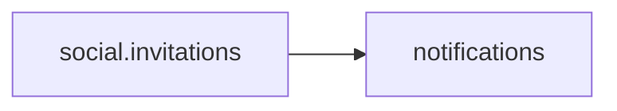

# social.invitations

## Responsabilidad

Gestiona invitaciones a equipos con token publico, rol, vencimiento,
idempotencia y lifecycle explicito. Las invitaciones para compartir una cuenta
financiera permanecen en `finance.accounts`; ambos contratos son distintos.

## Flujo

1. El owner emite una invitacion para un correo y un rol permitido.
2. El destinatario la consulta con su identidad autenticada.
3. La apertura puede registrarse sin crear permisos.
4. Solo una aceptacion explicita crea o reactiva `social.teams.Membership`.
5. El owner puede revocar mientras siga pendiente o abierta.
6. La entrega al usuario se registra en `notifications.deliveries`.

La API vive en `/api/social/invitations/team-invitations/` y expone acciones
`opened`, `accept` y `revoke`. Listados y acciones se filtran por owner,
remitente, destinatario o correo autenticado.

## Evolucion

El flujo local ya esta conectado a Flutter. Si aparecen consumidores aparte
de notificaciones, se agregara un outbox contextual; no se usaran signals para
ocultar cambios de permisos.

<!-- backend-source-audit:start -->
## Evidencia del codigo y mapa de dependencias

Inventario estatico reproducible del checkout. Describe declaraciones e imports;
no prueba despliegue, permisos efectivos ni que todos los caminos se ejecuten.
Las rutas son locales a su URLConf: el prefijo publico se consulta en
[`api/v1/routers.py`](../../api/v1/routers.py).

- Archivos Python de implementacion: **8** (excluye tests y migraciones).
- Huella SHA-256 del codigo inventariado: `63bd52fb5564a8d60f2ddb042417d870f0854d66bff793bc7055ebe71a91e95d`.
- Familias detectadas: models, serializers, services, views.

### Declaraciones de modelos detectadas

- `TeamInvitation` en [social/invitations/models.py](models.py).

### Rutas declaradas

| Patron local | Fuente |
| --- | --- |
| `` | [social/invitations/urls.py](urls.py) |
| `team-invitations/ [DRF router]` | [social/invitations/urls.py](urls.py) |

### Diagrama de dependencia estatica

Las flechas representan imports entre paquetes, no eventos ni orden de ejecucion.

Flujos transversales: [flujo actualizado](../../docs/BACKEND_CURRENT_FLOW.md).

Regeneracion: `py -3 scripts/audit_backend_docs.py --write`.
Comprobacion de deriva: `py -3 scripts/audit_backend_docs.py --check`.
<!-- backend-source-audit:end -->
