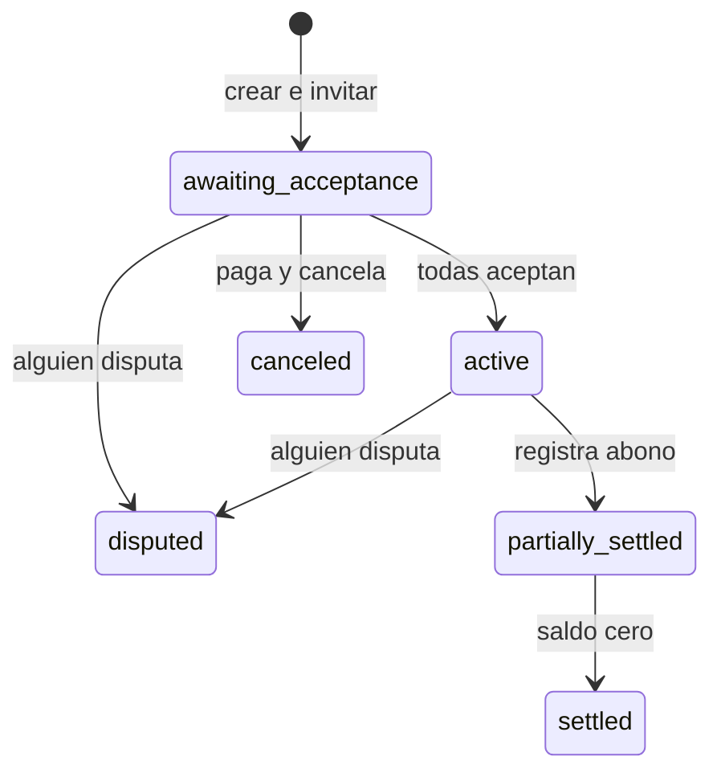

# social.shared_expenses

## Responsabilidad

Este contexto coordina la division verificable de un gasto ya perteneciente al
ledger. `finance.transactions.Transaction` sigue siendo la verdad contable;
`SharedExpense` conserva el acuerdo social, sus aceptaciones y liquidaciones.

No usa signals. Cada cambio pasa por servicios atomicos y emite eventos en
`SharedExpenseDomainEventOutbox`, publicado por el proceso local
`domain-outbox`.

## Modelo

- `SharedExpense`: aggregate versionado ligado uno a uno al gasto origen.
- `SharedExpenseShare`: parte esperada, invitacion y estado de cada persona.
- `SharedExpenseSettlement`: evidencia que enlaza una parte con otra
  transaccion real; nunca fabrica dinero ni modifica el gasto origen.
- `SharedExpenseDomainEventOutbox`: eventos durables para notificaciones,
  soporte y futuras proyecciones.

Metodos soportados: partes iguales, montos exactos, porcentajes y ponderacion.
El residuo de centavos se asigna de forma determinista y la suma siempre debe
coincidir con el total.

## Lifecycle



Una invitacion solo crea `TransactionParticipant` cuando la persona la acepta.
Esto evita presentar inferencias o contactos como obligaciones confirmadas.
Cada mutacion usa `base_version`; un dispositivo atrasado recibe `409` con el
aggregate actual. Creacion y settlement tambien exigen `Idempotency-Key`.

## API

Base: `/api/social/shared-expenses/shared-expenses/`

- `GET /`: gastos propios, invitaciones y equipos visibles.
- `POST /`: usa una transaccion existente o `transaction_payload`; la segunda
  opcion crea ledger y reparto en una sola transaccion de base de datos.
- `POST /{public_id}/accept/`: acepta una parte.
- `POST /{public_id}/revise/`: el pagador revisa antes de aceptaciones ajenas.
- `POST /{public_id}/dispute/`: abre disputa.
- `POST /{public_id}/settle/`: enlaza un movimiento real a un pago aceptado.
- `POST /{public_id}/cancel/`: cancela antes de liquidaciones.

Los querysets son owner/participant/team scoped. Un usuario externo recibe
`404`; no se revela la existencia del aggregate.

## Mobile Y Offline

Flutter puede encolar de forma cifrada:

- crear gasto + reparto mediante el endpoint compuesto;
- aceptar una invitacion.

Liquidar requiere conexion porque debe comprobar ownership, version vigente y
la transaccion real usada como evidencia. Si el sync encuentra conflicto, la
mutacion queda pendiente para revision humana; el cliente no decide verdad
contable ni fusiona versiones silenciosamente.

## Operacion

La migracion inicial crea cuatro tablas. En local:

```powershell
.\scripts\run_stack.cmd local up full
.\scripts\run_stack.cmd local status full
docker compose --env-file .env.local -f docker-compose.local.yml exec -T api python manage.py test social.shared_expenses.tests --noinput
```

Cobertura actual: redondeo determinista, porcentaje invalido, creacion atomica,
idempotencia, acceptance/projection, version conflict, settlement y aislamiento
de usuarios.
