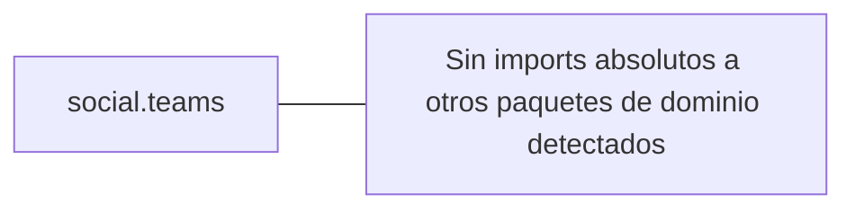

# social.teams

## Responsabilidad

Modela grupos y membresias sociales. No reemplaza el sharing financiero de
`finance.accounts` ni decide permisos sobre el ledger.

## Flujo

1. El usuario crea un equipo y se convierte en owner activo.
2. El owner emite una invitacion desde `social.invitations`.
3. El destinatario acepta de forma explicita.
4. El servicio crea o reactiva la membresia con el rol invitado.
5. Solo miembros activos ven el equipo.
6. Solo el owner administra roles, desactiva miembros o elimina el equipo.

La API de membresias no permite alta directa por `POST`; el camino normal de
ingreso es la invitacion aceptada. `updated_at` participa en las versiones del
BFF mobile para que Flutter detecte cambios incrementales.

## Evolucion

Los equipos pueden ser contexto para presupuestos compartidos, planning y
gastos colaborativos, pero cada bounded context conserva sus propias reglas y
verifica membresia activa antes de operar.

<!-- backend-source-audit:start -->
## Evidencia del codigo y mapa de dependencias

Inventario estatico reproducible del checkout. Describe declaraciones e imports;
no prueba despliegue, permisos efectivos ni que todos los caminos se ejecuten.
Las rutas son locales a su URLConf: el prefijo publico se consulta en
[`api/v1/routers.py`](../../api/v1/routers.py).

- Archivos Python de implementacion: **11** (excluye tests y migraciones).
- Huella SHA-256 del codigo inventariado: `a256c7bedd996a187d9201ce03c89c486093f17e55aaaf49c48fae9a19598fe7`.
- Familias detectadas: models, serializers, views.

### Declaraciones de modelos detectadas

- `Membership` en [social/teams/models/membership.py](models/membership.py).
- `Team` en [social/teams/models/team.py](models/team.py).

### Rutas declaradas

| Patron local | Fuente |
| --- | --- |
| `` | [social/teams/urls.py](urls.py) |
| `equipos/ [DRF router]` | [social/teams/urls.py](urls.py) |
| `miembros/ [DRF router]` | [social/teams/urls.py](urls.py) |

### Diagrama de dependencia estatica

Las flechas representan imports entre paquetes, no eventos ni orden de ejecucion.

Flujos transversales: [flujo actualizado](../../docs/BACKEND_CURRENT_FLOW.md).

Regeneracion: `py -3 scripts/audit_backend_docs.py --write`.
Comprobacion de deriva: `py -3 scripts/audit_backend_docs.py --check`.
<!-- backend-source-audit:end -->
