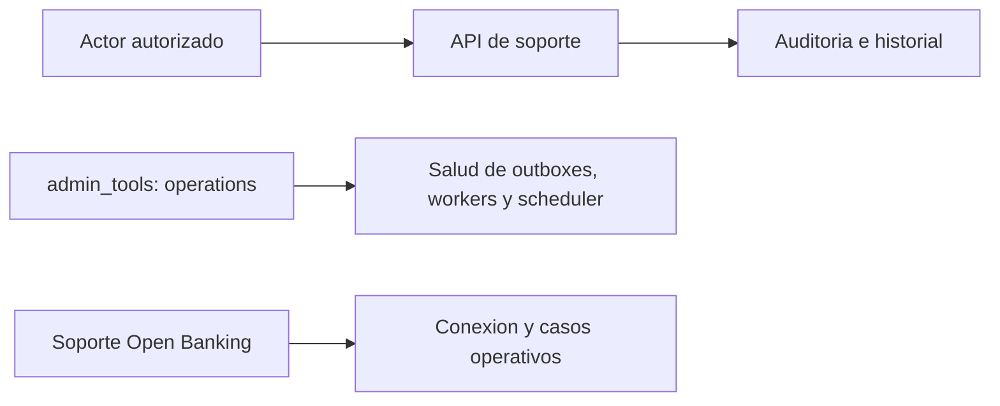
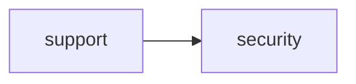

# support

Support contiene superficies y persistencia de auditoria y soporte. Las
operaciones staff tambien se exponen desde admin_tools e integrations.

- [audit](audit/README.md): consulta de auditoria.
- [access_history](access_history/README.md): historial de acceso.
- [consent_audit](consent_audit/README.md): alcance de auditoria de consentimiento.
- [support_views](support_views/README.md): vistas y estado del submodulo.

El prefijo interno no concede permisos por si mismo: revisar las clases de
autenticacion y permisos de cada vista. Los logs y ejemplos no deben exponer
tokens, claves o payloads financieros completos.

<!-- backend-source-audit:start -->
## Evidencia del codigo y mapa de dependencias

Inventario estatico reproducible del checkout. Describe declaraciones e imports;
no prueba despliegue, permisos efectivos ni que todos los caminos se ejecuten.
Las rutas son locales a su URLConf: el prefijo publico se consulta en
[`api/v1/routers.py`](../api/v1/routers.py).

- Archivos Python de implementacion: **26** (excluye tests y migraciones).
- Huella SHA-256 del codigo inventariado: `65de15e5cb8d29900eb0f6eb1ae3c2de9914b11721021b655acb2910e7a80978`.
- Familias detectadas: models, serializers, views.

### Declaraciones de modelos detectadas

- `AuditLog` en [support/audit/models/audit.py](audit/models/audit.py).
- `SupportAccessRecord` en [support/access_history/models.py](access_history/models.py).

### Rutas declaradas

| Patron local | Fuente |
| --- | --- |
| `` | [support/audit/urls.py](audit/urls.py) |
| `auditoria/ [DRF router]` | [support/audit/urls.py](audit/urls.py) |

### Diagrama de dependencia estatica

Las flechas representan imports entre paquetes, no eventos ni orden de ejecucion.

Flujos transversales: [flujo actualizado](../docs/BACKEND_CURRENT_FLOW.md).

Regeneracion: `py -3 scripts/audit_backend_docs.py --write`.
Comprobacion de deriva: `py -3 scripts/audit_backend_docs.py --check`.
<!-- backend-source-audit:end -->
