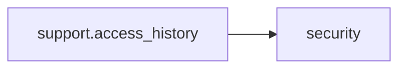

# support.access_history

## Que hace

`support.access_history` existe como submodulo de soporte para historial de
accesos o consultas operativas.

## Rol En El Sistema

En un backend financiero, este tipo de bloque sirve para:

- ver accesos relevantes
- responder tickets o dudas de soporte
- complementar auditoria funcional

## Casos De Uso

- investigar si un usuario reporta acceso no reconocido
- revisar contexto de seguridad de una incidencia
- apoyar operaciones internas sin tocar el core de autenticacion

## Relacion Con Otros Modulos

- `identity.sessions` y `identity.devices`
  fuente natural de accesos o contexto de seguridad.
- `support.audit`
  auditoria funcional complementaria.
- `security`
  señales de seguridad o abuso.

## Estado Actual

La subapp esta instalada, pero en esta pasada no detecte una superficie rica ya
materializada. Debe leerse como contexto de soporte preparado.

<!-- backend-source-audit:start -->
## Evidencia del codigo y mapa de dependencias

Inventario estatico reproducible del checkout. Describe declaraciones e imports;
no prueba despliegue, permisos efectivos ni que todos los caminos se ejecuten.
Las rutas son locales a su URLConf: el prefijo publico se consulta en
[`api/v1/routers.py`](../../api/v1/routers.py).

- Archivos Python de implementacion: **5** (excluye tests y migraciones).
- Huella SHA-256 del codigo inventariado: `6b9c200b066d4fa2ce87cba89fca4a0b8057bbb51004e2b72ad256e2bcb35027`.
- Familias detectadas: models, views.

### Declaraciones de modelos detectadas

- `SupportAccessRecord` en [support/access_history/models.py](models.py).

No se detectan declaraciones `path`/`re_path` propias en este alcance.
Esto no implica que el modulo carezca de consumidores internos.

### Diagrama de dependencia estatica

Las flechas representan imports entre paquetes, no eventos ni orden de ejecucion.

Flujos transversales: [flujo actualizado](../../docs/BACKEND_CURRENT_FLOW.md).

Regeneracion: `py -3 scripts/audit_backend_docs.py --write`.
Comprobacion de deriva: `py -3 scripts/audit_backend_docs.py --check`.
<!-- backend-source-audit:end -->
