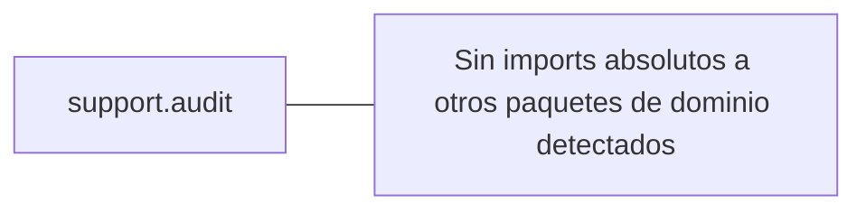

# support.audit

## Que hace

`support.audit` guarda evidencia de acciones sensibles del sistema y de usuario.

Su funcion es:

- registrar quien hizo que
- sobre que entidad
- con que impacto
- con que metadata o diff relevante

## Por Que Existe

En un backend financiero no basta con logs tecnicos.

Hace falta una superficie de auditoria entendible para:

- soporte
- operaciones
- revisiones internas
- trazabilidad de acciones sensibles

## Flujo Principal

1. un bounded context ejecuta una accion critica
2. llama `audit_log(...)`
3. se persiste `AuditLog`
4. soporte o el propio usuario consulta ese historial via API

## Politica Del Modulo

- la auditoria no debe romper el flujo de negocio
- si falla y `silent=True`, el negocio sigue y el error se registra
- debe capturar modulo, accion, entidad, impacto y metadata suficiente
- las lecturas internas sensibles usan la accion `READ`
- las busquedas no deben persistir datos de consulta sensibles en claro

## Relacion Con Otros Modulos

- `finance.accounts`
  usa auditoria en acciones de lifecycle y sharing
- `payments`
  puede auditar intents, payouts, callbacks manuales o intervenciones operativas
- `identity`
  puede auditar grants, revocaciones y cambios sensibles

## Encaje Con GCP

Esta capa complementa, no reemplaza:

- Cloud Logging
- Cloud Monitoring
- Error Reporting

Diferencia:

- logging = observabilidad tecnica
- audit = trazabilidad funcional de negocio

## Casos De Uso

- quien revoco acceso a una cuenta compartida
- quien forzo recalculo o cambio de estado
- quien aplico un deny explicito de permiso
- que operador intervino un payout o pago en disputa
- que operador busco o consulto la vista 360 de un usuario y por que

## Estado Actual

Hoy existe como registro funcional persistente y helper comun `audit_log(...)`.

La API actual se comporta asi:

- usuario normal: ve solo su propia auditoria
- staff: puede ver auditoria global y filtrar por `user_id`
- `admin_tools.user_lookup`: audita busquedas y lecturas individuales con
  actor, motivo y caso de soporte

La arquitectura ya deja listo el camino para:

- enriquecer metadata y diffs
- abrir mejores vistas de backoffice
- correlacionar auditoria con eventos y casos operativos

<!-- backend-source-audit:start -->
## Evidencia del codigo y mapa de dependencias

Inventario estatico reproducible del checkout. Describe declaraciones e imports;
no prueba despliegue, permisos efectivos ni que todos los caminos se ejecuten.
Las rutas son locales a su URLConf: el prefijo publico se consulta en
[`api/v1/routers.py`](../../api/v1/routers.py).

- Archivos Python de implementacion: **11** (excluye tests y migraciones).
- Huella SHA-256 del codigo inventariado: `2c5912a657471299a05bb19bc0e26fb4ec256ce9d4e72980c56e52b43f0c78ac`.
- Familias detectadas: models, serializers, views.

### Declaraciones de modelos detectadas

- `AuditLog` en [support/audit/models/audit.py](models/audit.py).

### Rutas declaradas

| Patron local | Fuente |
| --- | --- |
| `` | [support/audit/urls.py](urls.py) |
| `auditoria/ [DRF router]` | [support/audit/urls.py](urls.py) |

### Diagrama de dependencia estatica

Las flechas representan imports entre paquetes, no eventos ni orden de ejecucion.

Flujos transversales: [flujo actualizado](../../docs/BACKEND_CURRENT_FLOW.md).

Regeneracion: `py -3 scripts/audit_backend_docs.py --write`.
Comprobacion de deriva: `py -3 scripts/audit_backend_docs.py --check`.
<!-- backend-source-audit:end -->
