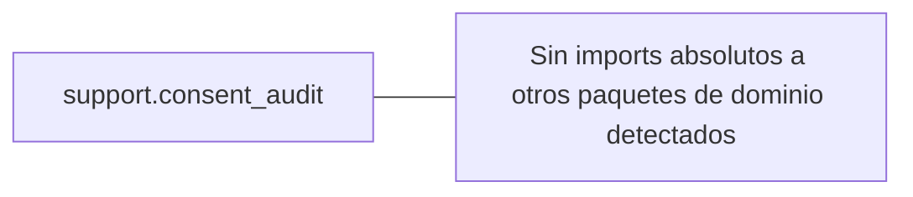

# support.consent_audit

## Que hace

`support.consent_audit` existe para apoyar trazabilidad y soporte alrededor de
consentimientos.

## Rol En El Sistema

Es un complemento natural de:

- `identity.consents`
  que resuelve consentimiento operativo/legal
- `support.audit`
  que resuelve auditoria funcional general

Aqui tendria sentido exponer vistas especializadas para investigar:

- cuando se otorgo un consentimiento
- cuando se revoco
- que teardown operativo se disparo

## Por Que Importa

En un producto financiero, consentimiento y teardown no son solo detalles
tecnicos. Tambien sostienen cumplimiento, soporte y confianza del usuario.

## Encaje Con GCP

Puede apoyarse en logs, auditoria persistida y read models internos operados
desde Cloud Run y Cloud SQL.

## Estado Actual

La subapp esta instalada, pero no detecte una superficie funcional rica en esta
pasada.

<!-- backend-source-audit:start -->
## Evidencia del codigo y mapa de dependencias

Inventario estatico reproducible del checkout. Describe declaraciones e imports;
no prueba despliegue, permisos efectivos ni que todos los caminos se ejecuten.
Las rutas son locales a su URLConf: el prefijo publico se consulta en
[`api/v1/routers.py`](../../api/v1/routers.py).

- Archivos Python de implementacion: **5** (excluye tests y migraciones).
- Huella SHA-256 del codigo inventariado: `6312456221068c55fc4e19011aca8b63f37cae8e8b0683c180d794895e63729c`.
- Familias detectadas: models, views.

No se detectan declaraciones `path`/`re_path` propias en este alcance.
Esto no implica que el modulo carezca de consumidores internos.

### Diagrama de dependencia estatica

Las flechas representan imports entre paquetes, no eventos ni orden de ejecucion.

Flujos transversales: [flujo actualizado](../../docs/BACKEND_CURRENT_FLOW.md).

Regeneracion: `py -3 scripts/audit_backend_docs.py --write`.
Comprobacion de deriva: `py -3 scripts/audit_backend_docs.py --check`.
<!-- backend-source-audit:end -->
