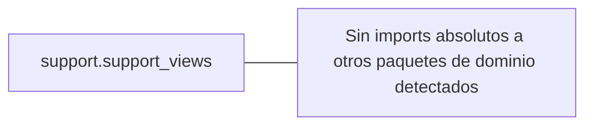

# support.support_views

## Que hace

`support.support_views` existe como lugar natural para endpoints internos o
vistas de soporte.

## Rol En El Sistema

Su responsabilidad esperada es exponer lectura o accion operativa controlada
para equipos internos sin mezclar esa superficie con la API B2C normal.

## Casos De Uso

- vistas internas de diagnostico
- endpoints de soporte protegidos
- consultas que no deben formar parte de la API publica de cliente

## Relacion Con Otros Modulos

- `support.audit`
  deja trazabilidad de acciones sensibles.
- `admin_tools`
  herramientas internas de operacion.
- bounded contexts de negocio
  pueden aportar datos o acciones de soporte.

## Estado Actual

Hoy la subapp aparece instalada pero no detecte una capa visible y documentable
mas fuerte que su propia presencia estructural.

<!-- backend-source-audit:start -->
## Evidencia del codigo y mapa de dependencias

Inventario estatico reproducible del checkout. Describe declaraciones e imports;
no prueba despliegue, permisos efectivos ni que todos los caminos se ejecuten.
Las rutas son locales a su URLConf: el prefijo publico se consulta en
[`api/v1/routers.py`](../../api/v1/routers.py).

- Archivos Python de implementacion: **5** (excluye tests y migraciones).
- Huella SHA-256 del codigo inventariado: `3a264bf2c451396600e63faf79588fa3feeb7dabeb602360e005c386eb625d6b`.
- Familias detectadas: models, views.

No se detectan declaraciones `path`/`re_path` propias en este alcance.
Esto no implica que el modulo carezca de consumidores internos.

### Diagrama de dependencia estatica

Las flechas representan imports entre paquetes, no eventos ni orden de ejecucion.

Flujos transversales: [flujo actualizado](../../docs/BACKEND_CURRENT_FLOW.md).

Regeneracion: `py -3 scripts/audit_backend_docs.py --write`.
Comprobacion de deriva: `py -3 scripts/audit_backend_docs.py --check`.
<!-- backend-source-audit:end -->
