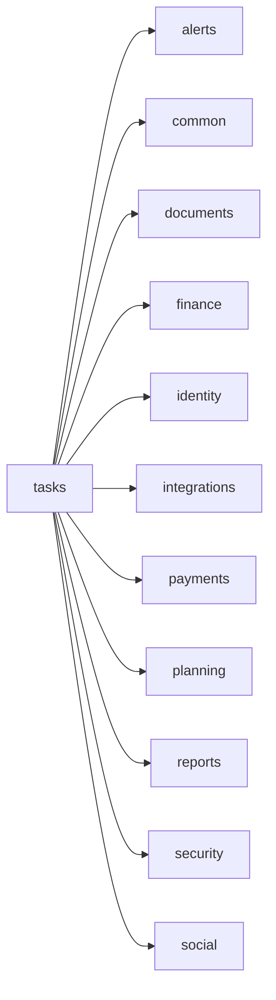

# tasks

## Que hace

`tasks` agrupa piezas relacionadas con ejecucion asincrona, scheduling,
dispatch y workers.

No todo esta igual de maduro, pero el directorio existe como punto natural para
separar trabajo de fondo del request path.

## Estructura Actual

- `celery.py`
- `queues.py`
- `retry_policies.py`
- `dispatchers/`
- `listeners/`
- `scheduled/`
- `workers/`

## Rol En El Sistema

Este bloque expresa una idea importante del backend:

- el request web debe terminar rapido
- el trabajo costoso debe ir a colas, jobs o workers

Eso ya se refleja en varios bounded contexts, aunque no toda la operacion este
centralizada dentro de `tasks`.

## Relacion Con Otros Modulos

- `common`
  contratos y eventos transversales.
- `finance.accounts`
  sync, intelligence y outbox workers.
- `payments`
  callbacks, settlement y futuros workers de integracion.
- `alerts`
  enriquecimiento async y potencial evaluacion desacoplada.
- `reports` y `documents`
  exports y retencion registrados en el scheduler; OCR tiene worker durable.

## Encaje Con GCP

Este directorio esta muy alineado con:

- Cloud Tasks
- Pub/Sub
- Cloud Scheduler
- Cloud Run workers

Incluso cuando ciertas implementaciones concretas aun no esten desarrolladas.

## Estado Actual

La operacion local esta centralizada en wrappers, registro de outboxes y
scheduler singleton. Los servicios, modelos de trabajo y procesadores siguen
perteneciendo a los bounded contexts. Algunos archivos reservados permanecen
vacios; eso no convierte a los wrappers operativos en scaffold.

## Backend comun de ejecucion

La capa comun operativa es:

- `tasks.async_backends`
  decide `cloud_tasks | local_worker | sync_inline_for_tests | disabled`
- `tasks.outbox_autopublish`
  concentra el autopublish local after-commit de outboxes
- `manage.py run_worker`
  wrapper unificado para workers locales por `job_type`
- `manage.py publish_outbox`
  wrapper unificado para publicadores de outbox
- `tasks.outbox_registry`
  registra nueve outboxes, incluido `shared_expenses`
- `tasks.scheduled.registry`
  registra once jobs ejecutados por `run_scheduler` bajo advisory lock

Eso no reemplaza la logica operativa propia de cada contexto.
La ordena bajo una sola topologia de entrega.

## Convenciones actuales

- `tasks.async_backends` ya gobierna `accounts.sync`, `accounts.intelligence`,
  `alerts.ai`, `transactions.voice` e `identity.consents`
- la politica oficial ya vive en `ASYNC_EXECUTION_MODE*` y
  `ASYNC_EXECUTION_FALLBACK_MODE*`, no en banderas legacy por contexto
- `manage.py publish_outbox` ya propaga `worker_id` de forma homogena a los
  publicadores canonicos, incluyendo `payments`
- `identity.consents` entra por la misma frontera comun, pero hoy no expone un
  `run_worker` durable propio; su modo local oficial es
  `ASYNC_EXECUTION_MODE_IDENTITY_CONSENTS=sync_inline_for_tests`

<!-- backend-source-audit:start -->
## Evidencia del codigo y mapa de dependencias

Inventario estatico reproducible del checkout. Describe declaraciones e imports;
no prueba despliegue, permisos efectivos ni que todos los caminos se ejecuten.
Las rutas son locales a su URLConf: el prefijo publico se consulta en
[`api/v1/routers.py`](../api/v1/routers.py).

- Archivos Python de implementacion: **36** (excluye tests y migraciones).
- Huella SHA-256 del codigo inventariado: `1b93206239e7c63a37006e4edc674dcd634bbee4ca040624560a065effcbd299`.
- Familias detectadas: listeners, management, models, views.

### Declaraciones de modelos detectadas

- `ScheduledJobState` en [tasks/scheduled/models.py](scheduled/models.py).

No se detectan declaraciones `path`/`re_path` propias en este alcance.
Esto no implica que el modulo carezca de consumidores internos.

### Diagrama de dependencia estatica

Las flechas representan imports entre paquetes, no eventos ni orden de ejecucion.

Flujos transversales: [flujo actualizado](../docs/BACKEND_CURRENT_FLOW.md).

Regeneracion: `py -3 scripts/audit_backend_docs.py --write`.
Comprobacion de deriva: `py -3 scripts/audit_backend_docs.py --check`.
<!-- backend-source-audit:end -->
