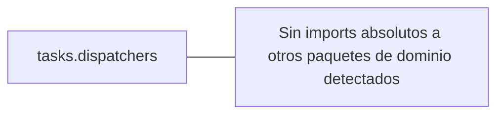

# tasks.dispatchers

## Que hace

Este directorio agrupa dispatchers pensados para enviar trabajo o eventos a
infraestructura de ejecucion externa.

## Archivos Presentes

- `cloud_tasks.py`
- `pubsub.py`
- `scheduler.py`

## Rol Esperado

La responsabilidad natural de estos archivos es traducir una intencion del
sistema a:

- una tarea HTTP en Cloud Tasks
- un mensaje en Pub/Sub
- una programacion o trigger de Scheduler

## Casos De Uso

- sacar trabajo pesado del request path
- delegar fan-out a consumidores externos
- programar ejecucion diferida o recurrente
- encapsular transporte cloud sin contaminar el dominio

## Estado Actual

En esta pasada no detecte logica visible o consolidada dentro de estos archivos,
asi que deben leerse como fronteras preparadas mas que como adapters ya
cerrados.

## Encaje Con GCP

Este subdirectorio es uno de los lugares mas directos para expresar la
topologia cloud del proyecto cuando madure mas.

<!-- backend-source-audit:start -->
## Evidencia del codigo y mapa de dependencias

Inventario estatico reproducible del checkout. Describe declaraciones e imports;
no prueba despliegue, permisos efectivos ni que todos los caminos se ejecuten.
Las rutas son locales a su URLConf: el prefijo publico se consulta en
[`api/v1/routers.py`](../../api/v1/routers.py).

- Archivos Python de implementacion: **3** (excluye tests y migraciones).
- Huella SHA-256 del codigo inventariado: `5a3fdb7c343fb09ba2c3da51f066b4e7f26e83bdce81c05bad06fc176103fdf1`.
- Familias detectadas: sin capas convencionales detectadas.

No se detectan declaraciones `path`/`re_path` propias en este alcance.
Esto no implica que el modulo carezca de consumidores internos.

### Diagrama de dependencia estatica

Las flechas representan imports entre paquetes, no eventos ni orden de ejecucion.

Flujos transversales: [flujo actualizado](../../docs/BACKEND_CURRENT_FLOW.md).

Regeneracion: `py -3 scripts/audit_backend_docs.py --write`.
Comprobacion de deriva: `py -3 scripts/audit_backend_docs.py --check`.
<!-- backend-source-audit:end -->
