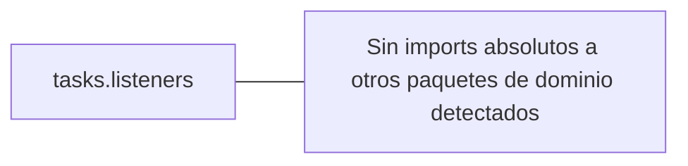

# tasks.listeners

## Que hace

`tasks.listeners` existe como contexto reservado para listeners o suscriptores
ligados a trabajo asincrono.

## Estado Del Codigo

Hoy su `models.py` esta en scaffold y no detecte una superficie funcional rica
en este app.

## Rol Esperado

Podria servir para:

- registrar listeners operativos
- auditar ejecuciones desacopladas
- coordinar fan-out tecnico no estrictamente de dominio

## Encaje Con El Sistema

La diferencia respecto a listeners de negocio es que aqui la motivacion seria
tecnica u operativa:

- colas
- workers
- tareas internas
- fan-out no visible para el usuario

## Relacion Con Otros Modulos

Buena parte de los listeners activos del sistema hoy viven en los bounded
contexts mismos:

- `accounts`
- `alerts`
- `notifications`
- `payments`

Por eso este contexto no debe leerse como la capa listener dominante actual.

## Estado Actual

App reservada o scaffold.

<!-- backend-source-audit:start -->
## Evidencia del codigo y mapa de dependencias

Inventario estatico reproducible del checkout. Describe declaraciones e imports;
no prueba despliegue, permisos efectivos ni que todos los caminos se ejecuten.
Las rutas son locales a su URLConf: el prefijo publico se consulta en
[`api/v1/routers.py`](../../api/v1/routers.py).

- Archivos Python de implementacion: **5** (excluye tests y migraciones).
- Huella SHA-256 del codigo inventariado: `31c411c3f2beb4033dda7b41061f5c02e774d4c8d7de12c0bbc98c72b5cfcfa0`.
- Familias detectadas: listeners, models, views.

No se detectan declaraciones `path`/`re_path` propias en este alcance.
Esto no implica que el modulo carezca de consumidores internos.

### Diagrama de dependencia estatica

Las flechas representan imports entre paquetes, no eventos ni orden de ejecucion.

Flujos transversales: [flujo actualizado](../../docs/BACKEND_CURRENT_FLOW.md).

Regeneracion: `py -3 scripts/audit_backend_docs.py --write`.
Comprobacion de deriva: `py -3 scripts/audit_backend_docs.py --check`.
<!-- backend-source-audit:end -->
