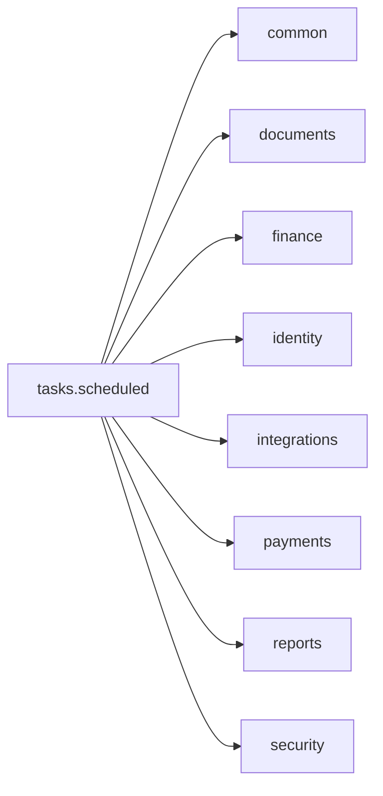

# tasks.scheduled

## Responsabilidad

`tasks.scheduled` coordina jobs periodicos del runtime local. No contiene reglas
financieras: invoca servicios canonicos de cada bounded context.

## Flujo

1. `scheduler-local` ejecuta `manage.py run_scheduler --loop`.
2. el ciclo intenta adquirir un advisory lock singleton en PostgreSQL.
3. consulta el catalogo `tasks/scheduled/registry.py`.
4. ejecuta solamente jobs cuyo `next_run_at` ya vencio.
5. persiste estado y resultado en `ScheduledJobState`.
6. libera el lock aun cuando un job falle.

Un fallo queda visible como `failed` y no impide ejecutar los otros jobs del
ciclo. Docker reinicia el proceso si termina inesperadamente.

## Catalogo Actual

- `debts.refresh_overdue`: marca cuotas vencidas y recalcula deudas.
- `payments.process_schedule_runs`: actualiza corridas y emite recordatorios.
- `identity.expire_attestations`: degrada evidencia de plataforma vencida.
- `security.purge_retention`: purga auditoria, throttling y challenges por lotes.
- `documents.migrate_encryption`: cifra documentos historicos cuando hay keyring.
- `documents.purge_expired`: purga binarios y datos derivados vencidos.
- `reports.process_exports`: procesa exports durables y expirables.
- `reports.purge_exports`: destruye material criptografico vencido.
- `open_banking.retry_syncs`: reintenta sincronizaciones vencidas con backoff.
- `open_banking.expire_consents`: vence consentimientos y credenciales caducadas.
- `open_banking.purge_payloads`: elimina cuarentenas externas vencidas.

## Operacion

```powershell
.\scripts\run_stack.ps1 local up payments
.\scripts\run_stack.ps1 local status full
.\scripts\run_stack.ps1 local logs payments -Follow
```

Ejecucion manual controlada:

```powershell
docker compose -f docker-compose.local.yml exec -T api python manage.py run_scheduler --force
```

## Crecimiento

Un job nuevo se registra una vez en `SCHEDULED_JOBS`. No requiere otro servicio
Compose, nuevas variables por entorno ni cambios en `run_stack.ps1`. Debe ser
idempotente, delegar negocio al modulo propietario y devolver un resumen JSON.

No se introduce Celery/Redis mientras PostgreSQL mantenga lag y contencion
aceptables. La migracion futura puede conservar este catalogo y reemplazar solo
el adapter de ejecucion.

`reports.process_exports` pertenece al catalogo central; no necesita un nuevo
contenedor, comando diario ni registro por entorno.

`documents.migrate_encryption` comparte el mismo scheduler y advisory lock.
Es no-op hasta que exista un keyring valido, por lo que activar cifrado no
requiere agregar procesos ni editar catalogos por entorno.

<!-- backend-source-audit:start -->
## Evidencia del codigo y mapa de dependencias

Inventario estatico reproducible del checkout. Describe declaraciones e imports;
no prueba despliegue, permisos efectivos ni que todos los caminos se ejecuten.
Las rutas son locales a su URLConf: el prefijo publico se consulta en
[`api/v1/routers.py`](../../api/v1/routers.py).

- Archivos Python de implementacion: **14** (excluye tests y migraciones).
- Huella SHA-256 del codigo inventariado: `9a20261e6a802e4de0733050aa291244348fa37467906e0f475e0c36876c9e1d`.
- Familias detectadas: management, models, views.

### Declaraciones de modelos detectadas

- `ScheduledJobState` en [tasks/scheduled/models.py](models.py).

No se detectan declaraciones `path`/`re_path` propias en este alcance.
Esto no implica que el modulo carezca de consumidores internos.

### Diagrama de dependencia estatica

Las flechas representan imports entre paquetes, no eventos ni orden de ejecucion.



Flujos transversales: [flujo actualizado](../../docs/BACKEND_CURRENT_FLOW.md).

Regeneracion: `py -3 scripts/audit_backend_docs.py --write`.
Comprobacion de deriva: `py -3 scripts/audit_backend_docs.py --check`.
<!-- backend-source-audit:end -->
