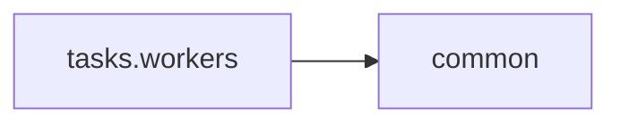

# tasks.workers

## Que hace

`tasks.workers` existe como contexto reservado para definir workers genericos o
su estado operativo.

## Estado Del Codigo

Los modelos genericos permanecen reservados, pero la ejecucion es operativa:

- `models.py` vacio
- comandos `run_worker` y `publish_outbox` conectados al runtime local

## Relacion Con Otros Modulos

El sistema ya tiene trabajo de fondo real, pero hoy mucho de eso vive dentro de
los contextos especificos:

- `finance.accounts`
- `payments`
- `alerts`
- `identity.eventing`

Este app concentra la seleccion y ejecucion de comandos; cada contexto conserva
su logica y persistencia de trabajos.

## Casos De Uso Naturales

- procesadores genericos de cola
- workers de mantenimiento
- ejecucion desacoplada por tipo de trabajo
- monitoreo basico de workers si se materializa mas adelante

## Encaje Con GCP

Cuando madure, puede servir como capa comun para workers desplegados en:

- Cloud Run
- Pub/Sub consumers
- Cloud Tasks handlers

## Estado Actual

El wrapper `run_worker` unifica estos job types:

- `accounts.sync`
- `accounts.intelligence`
- `alerts.ai`
- `transactions.voice`
- `documents.ocr`
- `security.key_rotation`

Los modelos y la logica de cada worker siguen perteneciendo a su bounded
context. `security.key_rotation` es finito/on-demand: reenvuelve DEKs por lotes
y termina cuando ya no hay credenciales pendientes; no requiere un contenedor
permanente.

<!-- backend-source-audit:start -->
## Evidencia del codigo y mapa de dependencias

Inventario estatico reproducible del checkout. Describe declaraciones e imports;
no prueba despliegue, permisos efectivos ni que todos los caminos se ejecuten.
Las rutas son locales a su URLConf: el prefijo publico se consulta en
[`api/v1/routers.py`](../../api/v1/routers.py).

- Archivos Python de implementacion: **8** (excluye tests y migraciones).
- Huella SHA-256 del codigo inventariado: `0d653bb0e9c309cad75900437a09715b203240a68438b7b35dfb00a31ba6ef63`.
- Familias detectadas: management, models, views.

No se detectan declaraciones `path`/`re_path` propias en este alcance.
Esto no implica que el modulo carezca de consumidores internos.

### Diagrama de dependencia estatica

Las flechas representan imports entre paquetes, no eventos ni orden de ejecucion.

Flujos transversales: [flujo actualizado](../../docs/BACKEND_CURRENT_FLOW.md).

Regeneracion: `py -3 scripts/audit_backend_docs.py --write`.
Comprobacion de deriva: `py -3 scripts/audit_backend_docs.py --check`.
<!-- backend-source-audit:end -->
